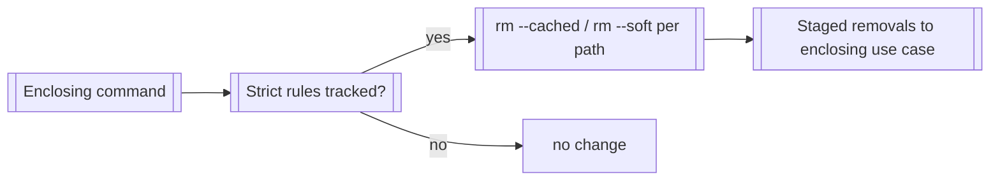

# Use case: local-only-transition (fragment)

Reusable behavior with no independent user goal; included by
`initialize-project` and `upgrade-a-project`. It makes strict rules that are
already tracked become local-only, without deleting the files.

## Level

fragment

## Actors

- Developer — invokes the enclosing command and reviews the staged removals.
- Givn maintainer — owns the truthfulness of the contract.

## Goal

Under `local-only`, remove every tracked strict rule from the current
revision while keeping its file on disk and touching nothing else. The
enclosing use case decides how the result is published.

## Trigger

The enclosing command detects that a strict rule path is tracked:
`givn init` / `givn skills sync` (setup) or `givn upgrade` (reconciliation).

## Preconditions

- The rules policy resolves to `local-only` (`rules-policy` fragment).
- The active version-control system is available and its revision membership
  is readable.

## Main flow

1. Compute the strict rule set from the effective manifest and the resolved
   targets.
2. Check which of those paths exist in the current revision.
3. Remove exactly those paths from the current revision, keeping the files:
   Git `git rm --cached`; Fossil `fossil rm --soft` (or `fossil forget`),
   pinned so the user's `mv-rm-files` setting cannot delete files.
4. Leave the result staged and hand it back to the enclosing use case:
   `givn init` reports the paths and leaves the removals for the developer to
   commit; `givn upgrade` folds them into its managed revision.

## Extensions

- `[gated]` A tracked path is also user-owned (not a strict rule): it is
  never touched, even when its name resembles a generated path (Q5).
- Nothing is tracked: the fragment does nothing and reports no removals
  `[gated]` (idempotence, Q14).

## Rules

- File-precise: one path per removal; never a directory; never `AGENTS.md`;
  never a non-Givn file.
- The working-tree file is always preserved; this fragment never deletes
  content.
- The result is always staged, never committed by this fragment; publication
  belongs to the enclosing use case.
- Idempotent `[gated]`: a second run finds nothing tracked and changes
  nothing (Q14).

## Examples

- Legacy setup: `.opencode/skills/givn-propose/SKILL.md` is tracked; `givn
  init` runs `git rm --cached` on it, the file stays on disk, the deletion is
  staged, and the report lists the path.
- Upgrade: the same detection runs inside `givn upgrade`; the removals join
  the managed revision together with the scaffold and ignore-block changes.
- Repeat: after the removals are committed, a second `givn upgrade` finds
  nothing tracked and publishes no removal.
- Fossil: `fossil rm --soft` marks the path as no longer part of the project
  and leaves the file, regardless of the checkout's `mv-rm-files` setting.

## Minimal guarantee

No strict rule is deleted, no user-owned file is touched, and nothing is
committed by the fragment itself.

## Success guarantee

After the enclosing command, no strict rule is tracked at the current
revision and every rule file still exists locally.

## Personas

- developer--primary-user
- givn-maintainer--owner

## Capabilities

- `local-only-transition` — new

## Interactions

| Capability | Consumer action | E2E scenario |
|---|---|---|
| local-only-transition | update a legacy project | Consumer upgrades a project whose rules were tracked and gets reviewable removals with the files intact |
| local-only-transition | repeat the command | Consumer runs it again and no removal is produced |

## Includes

- `rules-policy` (fragment)

## Extends

- none

## Out of scope

Publishing or committing the removals (the enclosing use case); history
rewriting (Q2); ignore entries (`initialize-project` / `upgrade-a-project`);
the commit stage-set rule (`attribute-commits`).

## Diagram

