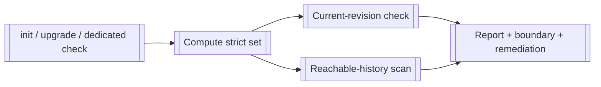

# Use case: publication-cleanliness (fragment)

Reusable behavior with no independent user goal; included by
`initialize-project` and `upgrade-a-project`, and available on demand through
a dedicated check. It reports strict rules that are still repository state.

## Level

fragment

## Actors

- Developer — reads the report before publishing.
- CI or automation caller — consumes the report as a machine contract.
- Givn maintainer — owns the truthfulness of the guarantee.

## Goal

Report whether the project's current revision or its reachable history
contains a strict rule, name the boundary, and point at remediation. Never
mutate anything.

## Trigger

- `givn init` and `givn upgrade` include the report in their output.
- A dedicated on-demand check (working name `givn check rules`; name open,
  Q21) for publication and CI.

## Preconditions

- The rules policy is resolved (`rules-policy` fragment).
- The active version-control system is selected and its state is readable.

## Main flow

1. Compute the strict rule set from the effective manifest and the resolved
   targets.
2. Check which strict rule paths are tracked at the current revision.
3. Scan reachable history for the strict rule paths and count the affected
   revisions.
4. Report: the paths, the scope (current revision and/or reachable history),
   the boundary (unreachable objects, remotes, and forks are outside the
   guarantee), and the remediation command (`rewrite-history`).
5. Optionally, when Q15 is adopted, verify that a fresh clone builds and
   tests with `givn` absent, and report that evidence.

## Extensions

- Nothing found: report the checked scope as clean; never imply more than the
  scope covers.
- The backend cannot scan history: report the limitation by name instead of a
  clean claim.
- `AGENTS.md`: exempt from every check; never listed as a violation.
- A path resembles a strict rule but is not on the computed set: never
  reported as a violation.

## Rules

- Read-only: the report never writes, stages, ignores, removes, or rewrites.
- File-precise: the reported set is the computed strict set, not a directory
  pattern.
- Every clean claim names its scope and boundary.
- The dedicated check exits non-zero when a strict rule is tracked or found
  in reachable history; init and upgrade report and still exit 0.
- A violation names the remediation command; the report never runs it.

## Examples

- Init report: `rules: local-only (default); 0 tracked; 0 in reachable
  history`.
- Upgrade report: `3 historical revisions still contain
  .opencode/skills/givn-propose/SKILL.md; run givn rewrite-history to clean
  them`.
- Dedicated check: lists each path with the affected revision count and the
  boundary note; exits non-zero when it finds a violation (confirmed
  2026-09-23).

## Minimal guarantee

The check changes nothing, and a clean claim never reaches beyond the checked
scope and boundary.

## Success guarantee

Every strict rule in the checked scope is reported with its remediation, and
no violation is silently omitted.

## Personas

- developer--primary-user
- agent--technical-role
- givn-maintainer--owner

## Capabilities

- `publication-cleanliness` — new

## Interactions

| Capability | Consumer action | E2E scenario |
|---|---|---|
| publication-cleanliness | run the dedicated check on a clean project | Consumer gets a clean report naming the scope and boundary |
| publication-cleanliness | run it on a project with historical rules | Consumer gets the paths, revision count, and the remediation command |
| publication-cleanliness | run it on a project with tracked rules | Consumer gets the tracked paths named before publishing |

## Includes

- `rules-policy` (fragment)

## Extends

- none

## Out of scope

Reconciliation of tracked rules (`local-only-transition`); history rewriting
(`rewrite-history`); remote or fork inspection; the dedicated command's name
(Q21).

## Diagram

