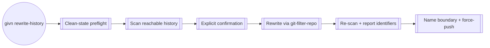

# Use case: rewrite-history

## Level

!

## Actors

- Developer

## Goal

Remove every strict rule from the project's reachable history so a published
repository carries none, while every rule file stays on disk. Explicit,
opt-in, and never automatic.

## Trigger

The developer runs the explicit rewrite command (working name
`givn rewrite-history`) after the cleanliness report named historical
occurrences.

## Preconditions

- The rules policy resolves to `local-only`; under `versioned` the command
  refuses (rules are repository content by choice).
- The active version-control system is selected and its clean-state witness
  is available.
- The backend supports history rewriting; a backend without it is refused by
  name (Fossil, Q20).
- On Git, `git-filter-repo` is installed; otherwise the command refuses by
  name with install guidance (Q20).

## Main flow

1. Witness the clean state; refuse before any write when the project is
   dirty.
2. Scan reachable history for the strict rules and report the paths found,
   the number of affected revisions, and the reachable-refs boundary.
3. Confirm: with `--yes` proceed; on a terminal without `--yes`, show the
   paths and the affected revision count and ask; with piped or closed input
   and no `--yes`, refuse before any write.
4. Rewrite reachable history so no revision contains a strict rule, keeping
   every working file on disk.
5. Re-scan reachable history, report the new revision identifiers, and
   confirm that every rule file still exists.
6. Name what remains outside the guarantee: unreachable objects, remotes,
   forks, and the force-push the developer now needs.

## Extensions

- Nothing to rewrite: report no strict rule in reachable history; change
  nothing.
- Dirty checkout: refuse before any write; names the dirty paths (minimal
  guarantee).
- Confirmation withheld: refuse before any write; nothing changes. With
  piped or closed input and no `--yes`, the refusal names the flag.
- `git-filter-repo` missing: refuse by name with install guidance; nothing
  changes.
- Fossil backend: refuse by name — history rewriting is not available on
  Fossil; the report stands and the developer cleans history with Fossil's
  own tooling if one exists (Q20).
- Policy is `versioned`: refuse by name; rules are intentionally repository
  content.

## Rules

- Never automatic: no other command invokes the rewrite, and no flag turns it
  on implicitly.
- The strict set only: file-precise paths from the effective manifest; never
  `AGENTS.md`; never a user-owned file; never a directory.
- Every working-tree file is preserved; the rewrite changes history, not the
  working tree.
- Confirmation: `--yes` proceeds; on a terminal without `--yes` the command
  shows the paths and affected revision count and asks; piped or closed
  input without `--yes` refuses, naming the flag.
- The command never pushes, never contacts a remote, and never claims a
  remote or fork is clean.
- The result is verified: reachable history is re-scanned and the new
  revision identifiers are reported.
- Idempotent: a second run finds nothing to rewrite.

## Examples

- Clean rewrite: `givn rewrite-history` reports
  `.opencode/skills/givn-propose/SKILL.md` in 214 reachable revisions, asks
  for confirmation, runs the rewrite, and reports the new identifier plus
  "rule files still on disk; force-push required".
- Missing tool: "history rewriting requires `git-filter-repo`
  (https://github.com/newren/git-filter-repo); install it and re-run";
  exit non-zero; nothing changed.
- Fossil: "history rewriting is not available on the Fossil backend; the
  cleanliness report still names the affected revisions"; exit non-zero.
- Versioned policy: "the rules are versioned by policy; nothing to purge";
  exit non-zero.
- Repeat: a second run reports no strict rule in reachable history.

## Minimal guarantee

A dirty checkout, missing tool, unsupported backend, or withheld
confirmation changes nothing; working files are never deleted.

## Success guarantee

After a successful run, no reachable revision contains a strict rule, every
rule file still exists on disk, the new revision identifiers are reported,
and the boundary and force-push need are named.

## Personas

- developer--primary-user
- givn-maintainer--owner

## Capabilities

- `history-rewrite` — new

## Interactions

| Capability | Consumer action | E2E scenario |
|---|---|---|
| history-rewrite | rewrite a project with historical rules | Consumer runs the command and receives clean reachable history with the files intact |
| history-rewrite | run it dirty | Consumer gets a refusal and the worktree stays byte-for-byte unchanged |
| history-rewrite | run it on Fossil | Consumer gets a named refusal that names the backend |

## Includes

- `rules-policy` (fragment)

## Extends

- none

## Out of scope

Reporting (the `publication-cleanliness` fragment); pushing, remote repair,
or fork cleanup; backup policy for the original refs; Fossil mechanics beyond
the named refusal (Q20).

## Diagram

