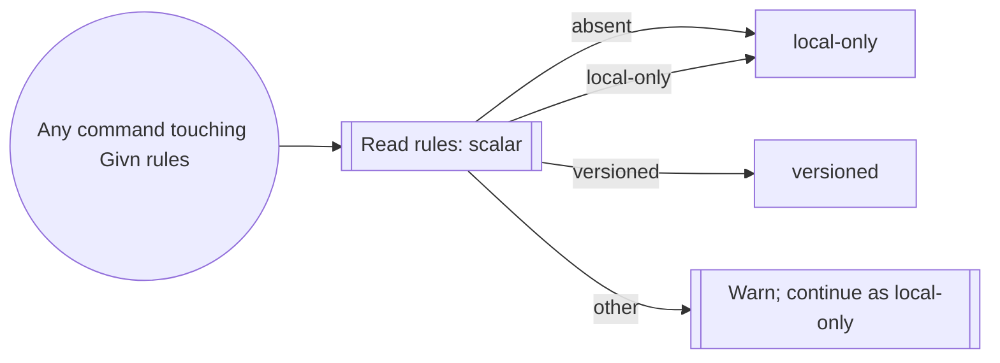

# Use case: rules-policy (fragment)

Reusable behavior with no independent user goal; included by every command
that reads or writes Givn rules. `[gated]` marks a resolution that depends on
an open question whose authoritative status lives in `questions.md`.

## Level

fragment

## Actors

- Developer — sets the value and observes the reported resolution.
- Authoring agent — consumes the resolved value through the machine
  contract.
- Givn maintainer — owns the truthfulness of the contract.

## Goal

Resolve whether Givn rules are versioned or local-only, and expose the
resolved value to every reader and writer. Never guess silently, never
mutate.

## Trigger

Any command that reads or writes Givn rules: `givn init`, `givn skills sync`,
`givn upgrade`, `givn commit`, `givn archive`, and any cleanliness check.

## Preconditions

- The project root exists and is the current working directory.
- `givn/config.yaml` is readable when it exists.

## Main flow

1. Read the top-level `rules:` scalar from `givn/config.yaml`.
2. When the key is absent, resolve to `local-only` — for both a new project
   and an existing project without the key (the user's original default).
3. When the key is `local-only` or `versioned`, resolve to that value.
4. Expose the resolved value to the caller and name it in the command's
   report (the installation report for init and upgrade).

## Extensions

- An unrecognized value: the command warns, names the value and the valid
  values (`local-only`, `versioned`), and continues as `local-only`. A typo
  fails safe and never blocks the workflow.
- `givn/config.yaml` is absent: every other config default applies as today;
  the resolved policy is `local-only`.

## Rules

- The setting is a flat scalar: `rules: local-only` (default) or
  `rules: versioned`. No nested block is introduced.
- Resolution is read-only: it never writes, stages, ignores, or deletes.
- Every writer resolves the policy before it writes a Givn rule; no writer
  carries its own default.
- The resolved value is visible: the installation report names it, so a
  project can always tell which policy is active.
- Changing the value is a configuration edit; the next applicable command
  applies it `[gated]` (Q12, Q14).

## Examples

- Fresh project, no `rules:` key: `givn init` installs the Givn rules
  locally, writes the ignore rules, and reports `rules: local-only (default)`.
- `givn/config.yaml` contains `rules: versioned`: `givn init` and
  `givn skills sync` write the rules and leave tracking to the developer and
  the managed upgrade; no ignore rules are written.
- `rules: localonly` (typo): the command warns "unrecognized rules policy
  'localonly'; continuing with local-only (valid values: local-only,
  versioned)" and proceeds locally.
- Upgrade of a project whose config predates the key: the policy resolves to
  `local-only`, and `givn upgrade` reconciles tracked Givn rules (owned by
  `upgrade-a-project`).

## Minimal guarantee

Resolution changes nothing in the project; an invalid value warns and
continues as local-only.

## Success guarantee

Every reporting command that touches Givn rules acts on the resolved policy,
and the resolved value is named in its report (the installation report for
init and upgrade).

## Personas

- developer--primary-user
- agent--technical-role
- givn-maintainer--owner

## Capabilities

- `policy-resolution` — new

## Interactions

| Capability | Consumer action | E2E scenario |
|---|---|---|
| policy-resolution | init a project with no `rules:` key | Consumer initializes a project and the rules stay local by default |
| policy-resolution | set `rules: versioned` and upgrade | Consumer opts in and the managed upgrade stages the generated rules |
| policy-resolution | write an invalid value | Consumer gets a warning and the rules stay local |

## Includes

- none

## Extends

- none

## Out of scope

Writing, ignoring, staging, or deleting any Givn rule (owned by the lifecycle
use cases); per-category switches (Q11).

## Diagram

