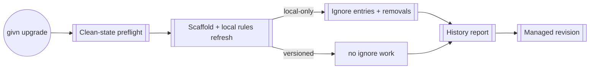

# Use case: upgrade-a-project

## Level

!

## Actors

- Project maintainer
- Supporting: Authoring agent

## Goal

Cross a release gap with reviewable upgrade and migration revisions. The
delta: the managed upgrade becomes rule-policy aware — tracked rules become
local-only, ignore entries join the revision, and history is reported.

## Trigger

The maintainer upgrades Givn, or a rules policy change takes effect on the
next applicable command `[gated]` (Q12, Q14).

## Preconditions

- The project configuration and repository state are available.
- The active version-control system is selected and its clean-state witness
  is available.
- The rules policy is resolved (`rules-policy` fragment).

## Main flow

1. Resolve the rules policy and witness the clean state; refuse before any
   write when the project is dirty or has no version-control system
   (existing behavior).
2. Synchronize the managed scaffold and refresh the generated rules locally
   through the setup path.
3. Under `local-only`, refresh both ignore destinations (tracked fenced block
   and local exclude) and run the `local-only-transition` fragment; the
   removals join the managed revision. Under `versioned`, skip both.
4. Scan reachable history for strict rules; report the paths and the
   reachable-refs boundary, and point at `rewrite-history`. Never block
   (confirmed 2026-09-23).
5. Publish the managed revision: under `local-only` it contains the config
   scaffold, commands scaffold, ignore-block changes, and the removals only —
   no strict rule content; under `versioned` it stages the generated rules
   with today's allowlist behavior. `AGENTS.md` is never staged under either
   policy (Q3).
6. When migration requirements exist, publish the plan revision recording the
   upgrade revision (existing behavior, unchanged).
7. Report the policy, the removals, and the history occurrences.

## Extensions

- Uncommitted changes exist: refuse before any write, naming the dirty paths
  (existing behavior; minimal guarantee).
- No version-control system: refuse by name before any write (existing
  behavior).
- Already current: no revision is published and the state is reported
  (existing behavior).
- A policy change was made in `givn/config.yaml`: the next applicable command
  applies steps 2-5 `[gated]` (Q12, Q14); idempotent, a second run produces
  no revision.
- A tracked strict rule is also user-modified on disk: the file is preserved
  and the removal still applies to the revision; the next sync rewrites the
  generated content (Q7).

## Rules

- Exactly the strict set is removed: file-precise, never a directory, never
  `AGENTS.md`, never a user-owned file.
- `AGENTS.md` is never staged, even when tracked, and the fence refresh is
  the developer's merge responsibility.
- Under `local-only`, the managed revision contains no strict rule content;
  under `versioned`, the force-staged allowlist behavior is unchanged.
- The history report never blocks and never rewrites; remediation is
  `rewrite-history`.
- Every write is covered by the existing snapshot/rollback behavior of the
  managed upgrade.

## Examples

- Legacy project: `.opencode/skills/givn-propose/SKILL.md` is tracked; upgrade
  removes it from the revision, keeps the file, adds its ignore entries, and
  reports 214 reachable revisions still containing it.
- Clean local-only project: nothing tracked, no history occurrence; upgrade
  refreshes the scaffold and publishes no removal.
- Versioned project: upgrade stages the generated rules with today's
  allowlist behavior; no ignore or removal work happens, and `AGENTS.md`
  stays the developer's to commit.
- Policy flip: the maintainer sets `rules: local-only`; the next upgrade
  performs the reconciliation and reports it.

## Minimal guarantee

A dirty checkout is refused before any write, user changes stay byte-for-byte
unchanged, and no rule file is deleted.

## Success guarantee

The project is current; the repository contains no strict rule; the managed
revision is reviewable and contains exactly the policy-appropriate content;
history occurrences are reported with their boundary and remediation.

## Personas

- developer--primary-user
- agent--technical-role
- givn-maintainer--owner

## Capabilities

- `apply-a-managed-upgrade` — modified

## Interactions

| Capability | Consumer action | E2E scenario |
|---|---|---|
| apply-a-managed-upgrade | upgrade a legacy project | Consumer gets reviewable removals, files intact, and a history report that never blocks |
| apply-a-managed-upgrade | upgrade a versioned project | Consumer keeps today's managed-revision content for the rules, with `AGENTS.md` left to the developer |
| apply-a-managed-upgrade | flip the policy | Consumer changes `rules:` and the next upgrade reconciles |

## Includes

- `rules-policy` (fragment)
- `local-only-transition` (fragment)
- `publication-cleanliness` (fragment)

## Extends

- none

## Out of scope

Setup (initialize-project); the rewrite itself (rewrite-history); reporting
command shape (publication-cleanliness); migration catalog behavior beyond
the recorded upgrade revision.

## Diagram

