# Event Storming: multi-scm-support

Domain events in the order they happen, with actor, command, reacting policy,
and read model. `[diverges]` marks a policy that differs by backend (table
below). `[guard]` marks an internal check or refusal rather than a value
event. IDs are stable for cross-references from `use-case-definitions.md`.

## Chain

### A. Project start

- **A1 — SCM backend was selected** — Actor: givn (on any lifecycle
  command). Command: `givn init`, `givn status`, `givn archive`, ... Policy:
  a Git worktree wins; otherwise a Fossil checkout; otherwise a named
  refusal (including a selected backend whose binary is absent — Q14). Read
  model: `.git` / `git rev-parse --is-inside-work-tree`;
  `.fslckout` / `_FOSSIL_`; `fossil status`.
- **A2 — Project was initialized** — Actor: primary user. Command:
  `givn init`. Policy: scaffold `givn/`, generate skills for the selected
  targets, install attribution plumbing only where the backend supports it.
  Read model: project root, selected backend, skill targets.
- **A3 — Guidance was generated for the backend** — Actor: givn. Command:
  `givn skills sync`. Policy: generated guidance may name only commands that
  work on the active backend. Read model: backend, skill templates, targets.
- **A4 — Attribution path was prepared** — Actor: givn. Command: `givn init`
  / `givn upgrade`. Policy `[diverges]`: Git installs the chained
  `commit-msg` hook; Fossil has no `commit-msg` hook, so the path is a
  givn-controlled commit (open question Q2). Read model: hook capability of
  the backend.

### B. Change authoring

- **B1 — Change was proposed** — Actor: primary user. Command:
  `/givn-propose`. Policy: lifecycle gates, artifact graph. Read model:
  `givn/` state, effective manifest.
- **B2 — Change was specified** — Actor: primary user. Command:
  `/givn-spec`.
- **B3 — Design was written and reviewed** — Actor: primary user. Commands:
  `/givn-design`, `/givn-design-review`.
- **B4 — Tasks were broken down** — Actor: primary user. Command:
  `/givn-tasks`.
- **B5 — Scenario was tagged as delta** — Actor: primary user. Command:
  `/givn-spec` (delta authoring). Policy: `@givn.delta` tags describe Added,
  Modified, or Removed behavior and are consumed by the archive merge. Read
  model: delta feature files.
- **B6 — Scenario was implemented** — Actor: authoring agent. Command: RED /
  GREEN / REFACTOR loop.
- **B7 — Revision was created for the scenario** — Actor: authoring agent.
  Command `[diverges]`: `git commit` (with the attribution hook) or
  `fossil commit` (new files need `fossil add` first). Policy: exactly one
  atomic revision per scenario; attribution appended where supported. Read
  model: `git status` / `fossil status`.
- **B8 — Revision identifier was recorded** — Actor: authoring agent.
  Command: edit `tasks.md`. Policy: the integrity check accepts the active
  backend's identifier shape and rejects placeholders and duplicates. Read
  model: `git rev-parse HEAD` / `fossil status` checkout hash.
- **B9 — Review was signed off** — Actor: primary user. Command:
  `/givn-review`. Policy: mandatory checks and gate dispositions.

### C. Archive publication

- **C1 — Archive was requested** — Actor: primary user. Command:
  `givn archive --change <id>`. Policy: `apply.requires` gates run first.
- **C2 — Project state was witnessed** — Actor: givn. Policy `[diverges]`:
  no changes beyond declared evidence paths; Git counts untracked files,
  Fossil reports them only with `changes --differ` (open question Q3). Read
  model: `status --porcelain -z -uall` / `fossil changes --differ`.
- **C3 — Accepted behavior was merged** — Actor: givn. Policy: delta merge
  with base-revision match; retirement and grouping rules.
- **C4 — Evidence scope was resolved** — Actor: givn. Policy: the
  finalization may change only the resolved evidence paths — the archive
  directory, the README when the readme addon is on, and the configured
  coverage outputs. Read model: effective manifest addons, coverage paths,
  archive id.
- **C5 — Archive candidate was published** — Actor: givn (publisher per open
  question Q5). Command `[diverges]`: a Git commit of the merged paths, or a
  Fossil check-in of the merged paths (`fossil add` for new files). Policy:
  the candidate revision contains exactly the merged corpus paths. Read
  model: revision identifier and its file list.
- **C6 — Pending receipt was recorded** — Actor: givn. Policy: the pending
  receipt carries the candidate revision and marks the archive unproven, so
  a rerun resumes without repeating the merge. Read model:
  `givn/archive/<id>/verification.json`.
- **C7 — Verification scopes were executed against the candidate** — Actor:
  givn and the test runner. Command: `verify.command`,
  `verify.e2e_command`. Policy: one run per scope, fail-closed runner
  result.
- **C8 — Coverage was measured and published** — Actor: givn. Command:
  coverage addon commands. Policy: coverage gate.
- **C9 — Archive was finalized** — Actor: givn. Policy: the revision
  binding is checked `[guard]` (tested revision equals candidate revision),
  the proven receipt is recorded, README managed blocks are refreshed, and
  an evidence-only revision is published. Read model: receipt, revision
  identifier, evidence scope.
- **C10 — Archive was proven** — Actor: givn. Policy: only a proven archive
  is complete; an unproven candidate is never reported as proven.

### D. Managed upgrade

- **D1 — Upgrade was requested** — Actor: primary user. Command:
  `givn upgrade`. Policy: version gap resolution through the migration
  catalog.
- **D2 — Clean state was witnessed** — Actor: givn. Policy `[diverges]`:
  same witness semantics as archive.
- **D3 — Managed scaffold was synchronized** — Actor: givn. Policy:
  Givn-owned allowlist only; ignored managed paths may be force-staged only
  through the calculated allowlist.
- **D4 — Run declaration was backfilled** — Actor: givn. Policy: append the
  `run:` scaffold to `givn/commands.yaml` when the key is absent;
  idempotent. Read model: effective manifest, `givn/commands.yaml`.
- **D5 — Upgrade revision was published** — Actor: givn (publisher per open
  question Q5). Command `[diverges]`: the allowlist-only revision (the
  current glossary's "Upgrade Commit A").
- **D6 — Migration plan was recorded and published** — Actor: givn. Policy:
  the plan revision records the upgrade revision (the current glossary's
  "Migration Commit B"); the maintenance change is created.
- **D7 — Maintenance change was created** — Actor: givn. Policy: visible
  change that may skip a product specification.

### E. Failure, refusal, and repair

- **E1 — Candidate verification failed** — Actor: givn. Policy: the
  candidate stays published and unproven; no rollback.
- **E2 — Unproven candidate was surfaced** — Actor: givn. Command:
  `givn status` / `givn instructions`. Policy: the unproven candidate is
  reported and routed to its resume command. Read model: receipt status,
  change state.
- **E3 — Candidate was repaired forward** — Actor: primary user / authoring
  agent. Command: fix, new revision, `givn archive` resume. Policy: the
  failed candidate is never silently discarded.
- **E4 — Candidate revision was refused by a hook** — Actor: backend hook.
  Policy `[diverges]`: a Git `commit-msg` rejection leaves the merge staged
  and unproven; a Fossil `before-commit` rejection aborts the check-in with
  the working tree unchanged (open question Q13). Read model: hook output.
- **E5 — README check refused the archive** — Actor: givn `[guard]`.
  Policy: open placeholders or damaged managed blocks block the archive when
  the readme addon is enabled.
- **E6 — Archive run was refused** — Actor: givn `[guard]`. Cases: dirty
  state, nested repository root, already proven, legacy archive without a
  receipt, active and archived copy both present. The no-SCM case belongs to
  A1's selection policy.
- **E7 — Revision binding was checked** — Actor: givn `[guard]`. Policy:
  finalization refuses a tree change outside the resolved evidence; the
  tested revision must be the published candidate revision.

## Reverse narrative

Walking backwards from the terminal value "archive was proven" to the
domain's beginning:

```mermaid
flowchart RL
    P[Archive was proven] --> R[Proven receipt was recorded]
    R --> F[Archive was finalized]
    F --> V[Scopes passed against the candidate]
    V --> C[Archive candidate was published]
    C --> M[Accepted behavior was merged]
    M --> W[Project state was witnessed clean]
    W --> A[Archive was requested]
    A --> RS[Review was signed off]
    RS --> RC[Scenario revisions were created]
    RC --> I[Scenarios were implemented]
    I --> T[Tasks were broken down]
    T --> D[Design was written and reviewed]
    D --> S[Change was specified]
    S --> PR[Change was proposed]
    PR --> IN[Project was initialized]
    IN --> B[SCM backend was selected]
```

The chain starts at the domain's beginning: no revision can exist before a
backend was selected, and no archive can be proven before the project state
was witnessed clean in that backend. The diagram is the happy path; the
refusal and repair events in section E hang off these nodes.

## Backend-divergent policies

| Policy | Git | Fossil |
|---|---|---|
| Backend detection | `.git` / `rev-parse --is-inside-work-tree` | `.fslckout` / `_FOSSIL_` |
| Clean-state witness | `status --porcelain -z -uall` (untracked counts) | `fossil status -b` for the clean/dirty verdict, `changes --differ` for entries (EXTRA included) — Q3 |
| Publishing a subset | `add -- <paths>` then `commit` (index) | `add --force <paths>` then `commit -m <msg> <paths>` (no index) |
| New file in a published subset | `add` | `add` required first; unknown path fails |
| Ignored paths | `check-ignore`, skipped | `ignore-glob`, invisible; `add --force` would include |
| Revision identifier | `rev-parse HEAD` (40 hex) | `status` checkout hash (40 hex shown, 64 hex internal) |
| Attribution | `commit-msg` hook, chained launcher | no `commit-msg` hook; givn-controlled commit path only — Q2 |
| Hook rejection repair | merge stays staged | working tree unchanged; no index |
| Root rule | project root must equal worktree top level (TC-32) | repository file lives outside the checkout; one repository may have several checkouts — Q4 |

## Term collisions

- "commit" (Git) vs. "check-in" (Fossil) vs. the domain's neutral term
  "revision" — Q10.
- "worktree" (Git) vs. "checkout" (Fossil).
- "repository root": Git worktree top level vs. the Fossil checkout root,
  while the Fossil repository file lives elsewhere — Q4.
- "hook": a Git `commit-msg` hook, a Fossil `before-commit` hook, and givn's
  own artifact `post` hooks are three different things.
- "clean": Git counts untracked files; Fossil's default does not — Q3.
- "check-in" (Fossil) vs. givn's `check` commands and mandatory checks — the
  words are unrelated.
- "Upgrade Commit A" / "Migration Commit B" (glossary) vs. the neutral
  "upgrade revision" / "plan revision" used here; the receipt fields
  `candidate_commit` / `tested_commit` have the same collision — Q10.

## Open questions raised here

- Q13: Hook-rejection repair parity — does the archive promise the same
  repair behavior when a backend hook rejects the candidate, given Git keeps
  the merge staged and Fossil has no index?
