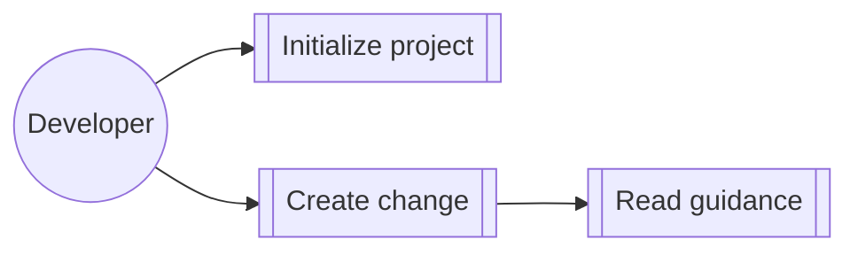

# Use case: author-change

Existing permanent use case, elaborated for the SCM-neutral delta. `[delta]`
marks a changed contract element; `[proposed]` marks a resolution of an open
question whose authoritative status lives in `questions.md`.

## Level

!

## Actors

- Developer
- Authoring agent

## Goal

Create a valid change and the guidance needed to carry it from intent to
executable specification.

## Trigger

The developer starts a new change or initializes a project.

## Preconditions

- The project is in a location where Givn can manage its workflow.
- `[delta]` The active SCM backend is selected when one exists (fragment
  `scm-backend`); a project without a backend is still initializable
  `[proposed]` (Q7).

## Main flow

1. Initialize the project and select agent targets.
   `[delta]` Report the selected backend, install attribution plumbing only
   where the backend supports it, and name what was skipped and why.
2. Create a change with a valid identity.
3. Read the canonical artifact guidance.
   `[delta]` Generated guidance names only commands that work on the active
   backend and states backend limitations explicitly.

## Extensions

- Optional addons are enabled or disabled by explicit user decision.
- `[proposed]` No SCM backend exists: initialization scaffolds the corpus,
  generates guidance, and exits 0 with a named warning that archive and
  managed upgrade are unavailable (Q7).
- `[delta]` The active backend lacks a capability (for example transparent
  attribution hooks): the installation report and the generated guidance
  state the limitation instead of naming a command that would fail.

## Rules

- Change identities are stable kebab-case values.
- Generated guidance is synchronized from canonical source assets.
- `[delta]` Generated guidance may name only commands that work on the active
  backend.
- `[delta]` The installation report names what was installed, what was
  skipped, and why.
- `[proposed]` Commit path (Q2): the SCM-neutral path is `givn commit`; Git
  keeps the chained `commit-msg` hook as a fallback for raw commits; Fossil
  attribution exists only through `givn commit`, and the guidance says so.
- `[proposed]` Initialization without an SCM does not refuse; it warns (Q7).

## Examples

- Git: `givn init` writes `.githooks/commit-msg`, chains an existing hook,
  generates skills, and reports `commit attribution: .githooks/commit-msg`.
  The agent then commits with `givn commit -m "feat: parser"` or raw
  `git commit`; both carry attribution.
- Fossil: `givn init` scaffolds `givn/`, writes no hook, and reports
  "attribution: givn commit path only". `givn commit -m "feat: parser"` stamps
  the check-in comment; raw `fossil commit` does not, and the generated skill
  states that.
- No SCM: `givn init` exits 0 with "no Git worktree or Fossil checkout found;
  archive and managed upgrade are unavailable"; skills are generated; a later
  `givn archive` refuses by name.

## Minimal guarantee

The project remains unchanged when an invalid request is rejected, and no
generated guidance names a command that cannot work in the active project.

## Success guarantee

The project has the requested change scaffold and generated guidance that
matches the active backend.

## Personas

- Primary user (developer / maintainer)
- Technical role (authoring agent / automation caller)
- Givn maintainer (owner)

## Capabilities

- `init-agent-target-selection` — modified (backend report, conditional
  plumbing installation)
- `prose-consolidation` — modified (guidance names active-backend commands)
- `install-extras` — unchanged
- `new-command` — unchanged
- `visual-design-contract` — unchanged

## Interactions

| Capability | Consumer action | E2E scenario |
|---|---|---|
| prose-consolidation | request canonical E2E guidance | Canonical E2E policy is emitted by specs instructions |
| prose-consolidation | inspect generated E2E guidance | Generated guidance points to the canonical E2E policy |
| visual-design-contract | request the design guidance for a visual interface | Author requests the visual design contract guidance |
| visual-design-contract | read the synchronized design and step guidance | Synchronized guidance defines the contract approval and capture mechanics |
| init-agent-target-selection | select agent targets | Consumer selects agent targets during interactive init |
| init-agent-target-selection | initialize non-interactively | Consumer runs init non-interactively and gets opencode skills |
| init-agent-target-selection | resynchronize selected targets | Consumer re-syncs skills after init and the selection is honoured |
| init-agent-target-selection | initialize a Fossil project | Consumer initializes a Fossil checkout and receives backend-aware guidance |
| init-agent-target-selection | initialize without SCM | Consumer initializes a plain directory and receives a named warning |

## Includes

- fragment: support
- `[delta]` fragment: scm-backend

## Extends

- none

## Out of scope

Implementing the product behavior described by a change; archive publication
(`archive-change`); managed upgrade (`maintain-project`).

## Diagram

