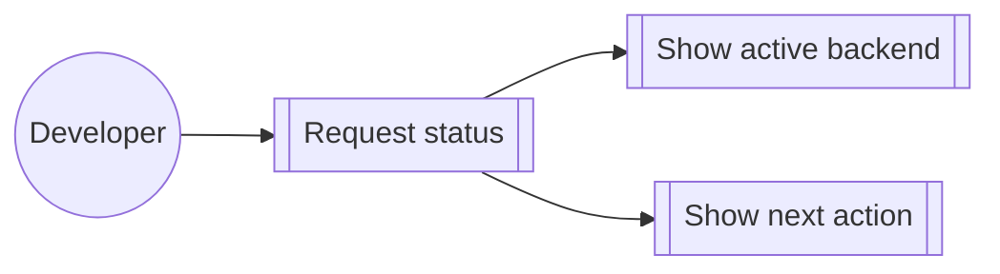

# Use case: inspect-change-state

Existing permanent use case, elaborated for the SCM-neutral delta. `[delta]`
marks a changed contract element.

## Level

!

## Actors

- Developer

## Goal

Understand the current change and artifact state without reading workflow
files by hand.

## Trigger

The developer requests change status.

## Preconditions

- A Givn project exists.

## Main flow

1. Discover active and archived changes.
2. Read artifact completion and task progress.
3. `[proposed]` Report the active SCM backend alongside the next required
   workflow action.

## Extensions

- Invalid change identities are rejected.
- `[proposed]` No SCM backend is selected: status reports the absence and the
  commands that are unavailable, without failing.

## Rules

- Skipped artifacts remain visible in status output.
- Uppercase and lowercase completed task markers are equivalent.
- `[proposed]` Status names the active backend; it does not describe backend
  internals.
- `[proposed]` Revision identity in status output is backend-neutral wording;
  the unproven-candidate report itself remains owned by `archive-change`.

## Examples

- Git project: status reports "SCM: git" and the current stage.
- Fossil project: status reports "SCM: fossil" and the current stage.
- Plain directory: status reports "SCM: none" and names archive and managed
  upgrade as unavailable; exit remains 0.

## Minimal guarantee

Status inspection does not mutate change artifacts.

## Success guarantee

The developer can identify the current stage, the active backend, and the next
action.

## Personas

- Primary user (developer / maintainer)
- Technical role (authoring agent / automation caller)
- Givn maintainer (owner)

## Capabilities

- `givn-status-command` — possibly modified (backend line and backend-neutral
  revision wording; one new scenario proposed)
- `validate-change-id-input` — unchanged
- `remove-dead-skip-list-code` — unchanged
- `fix-uppercase-checkbox-parsing` — unchanged

## Interactions

| Capability | Consumer action | E2E scenario |
|---|---|---|
| validate-change-id-input | reject unsafe status identity | Consumer invokes givn status with a path traversal change id and gets a clear error |
| remove-dead-skip-list-code | inspect skipped status | Consumer runs givn status on a change with skipped artifacts and sees them correctly |
| fix-uppercase-checkbox-parsing | inspect uppercase task status | Consumer runs givn status on a change with uppercase checkboxes |
| givn-status-command | inspect the active backend | Consumer runs givn status in a Fossil checkout and sees the active backend |

## Includes

- fragment: support
- `[delta]` fragment: scm-backend

## Extends

- none

## Out of scope

Mutating change artifacts or completing workflow tasks on the developer's
behalf; reporting backend internals.

## Diagram

