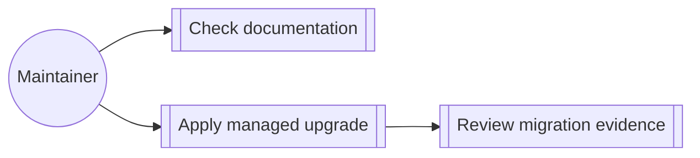

# Use case: maintain-project

Existing permanent use case, elaborated for the SCM-neutral delta. `[delta]`
marks a changed contract element; `[proposed]` marks a resolution of an open
question that needs user confirmation.

## Level

!

## Actors

- Project maintainer

## Goal

Keep a project current, documented, and able to cross a release migration
without fabricated completion evidence.

## Trigger

The maintainer checks project documentation or upgrades Givn.

## Preconditions

- The project configuration and repository state are available.
- `[delta]` The active SCM backend is selected and its clean-state witness is
  available (fragment `scm-backend`).

## Main flow

1. Inspect documentation completeness.
2. Apply a managed upgrade when required.
   `[delta]` Witness the clean state, synchronize the managed scaffold, and
   publish the allowlist-only upgrade revision on the active backend.
3. Preserve a reviewable migration plan when the upgrade carries migration
   requirements.
   `[delta]` Publish the plan revision on the active backend, recording the
   upgrade revision.

## Extensions

- An unclean repository blocks automatic migration commits.
- `[delta]` No SCM backend is selected: the upgrade is refused by name before
  writing anything.
- `[proposed]` Migration bundles run on the active backend with the same
  guarantees as the managed upgrade: clean preflight, calculated allowlist,
  and reviewable revisions (Q8).

## Rules

- Historical migration evidence remains reviewable.
- Open documentation placeholders block completion.
- `[delta]` Ignored managed paths are force-staged only through the
  calculated allowlist, on both backends.
- `[delta]` The plan revision records the upgrade revision identifier.
- `[proposed]` The managed upgrade and migration bundles run on both backends
  with the same guarantees (Q8). A migration-free managed upgrade publishes
  exactly one revision and no plan revision.

## Examples

- Git: a clean project without migration requirements receives one
  allowlist-only upgrade revision `a1b2c3d4e5f6...`.
- Git migration: a project crossing a version gap receives the upgrade
  revision and then a plan revision recording it.
- Fossil: the same project receives the allowlist-only check-in
  `c8d9e0f1a2b3...`; a migration-bearing upgrade adds the plan check-in.
  Ignored managed paths are added with `fossil add --force` only when the
  allowlist names them.
- Dirty project: `givn upgrade` refuses before writing, naming the dirty
  paths.
- No SCM: `givn upgrade` refuses by name before writing.

## Minimal guarantee

The project is protected from partial automatic migration.

## Success guarantee

The project is documented and the upgrade work is explicit in the active
backend's history.

## Personas

- Primary user (developer / maintainer)
- Givn maintainer (owner)

## Capabilities

- `release-0-3-0` — modified (backend-neutral preflight, allowlist, revisions)
- `readme-enforcement` — unchanged

## Interactions

| Capability | Consumer action | E2E scenario |
|---|---|---|
| readme-enforcement | scaffold README placeholders | Scaffolding marks the unfilled sections |
| readme-enforcement | check a complete README | The check passes on a complete README |
| readme-enforcement | archive and refresh documentation | Archiving refreshes the development block |
| readme-enforcement | record documentation impact | A recorded impact decision passes the review |
| readme-enforcement | request unfinished README guidance | Instructions surface an unfinished README |
| release-0-3-0 | plan a release migration | A clean 0.2.0 project receives a reviewable aggregate migration plan |
| release-0-3-0 | run a managed upgrade | A clean project without migration requirements receives one managed upgrade revision |
| release-0-3-0 | invoke a retired engine command | A consumer invoking a retired engine command is told it does not exist |
| release-0-3-0 | archive a maintenance migration | A completed maintenance migration can be archived without a product specification |
| release-0-3-0 | upgrade a Fossil project | A clean Fossil project receives the same managed upgrade revision shape |

## Includes

- fragment: support
- `[delta]` fragment: scm-backend

## Extends

- none

## Out of scope

Changing product specifications as part of routine project maintenance.

## Diagram

