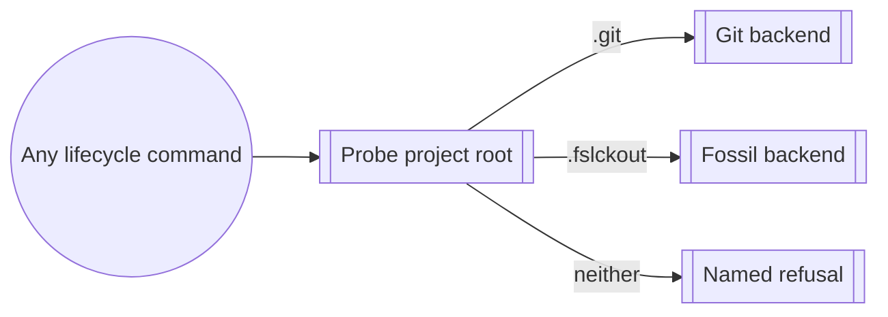

# Use case: scm-backend (fragment)

Reusable behavior with no independent user goal; included by the lifecycle
use cases. `[proposed]` marks a resolution of an open question whose
authoritative status lives in `questions.md`.

## Level

fragment

## Actors

- Primary user (developer / maintainer) — observes the selection and the
  refusal.
- Technical role (authoring agent / automation caller) — consumes the
  capability facts.
- Givn maintainer (owner) — owns the truthfulness of the contract.

## Goal

Determine the project's SCM backend and expose its capability facts, or refuse
by name. Never guess, never mutate.

## Trigger

Any givn command that needs repository state: `givn init`, `givn status`,
`givn check`, `givn archive`, `givn upgrade`, `givn skills sync`.

## Preconditions

- The project root exists and is the current working directory.

## Main flow

1. Probe the project root for a Git worktree (`.git` /
   `git rev-parse --is-inside-work-tree`).
2. If Git: confirm the Git executable is available, select the Git backend,
   and expose its capability facts.
3. Otherwise probe the project root for a Fossil checkout (`.fslckout` /
   `_FOSSIL_`).
4. If Fossil: confirm the Fossil executable is available, select the Fossil
   backend, and expose its capability facts.
5. Otherwise report no backend: commands that require one (archive, managed
   upgrade) refuse by name before any mutation; `givn init` and `givn status`
   continue and report the absence.

## Extensions

- `[proposed]` Both markers are present at the project root: refuse as
  ambiguous rather than silently preferring Git (Q6).
- `[proposed]` A marker is present but its executable is missing: refuse by
  name, naming the executable (Q14).
- `[proposed]` A Git worktree whose top level is above the project root:
  selection succeeds, and the Git backend's project-boundary rule refuses
  archive and managed upgrade exactly as today (TC-32). Detection and root
  equality stay separate concerns.
- `[proposed]` No backend declaration in `givn/config.yaml` in the first
  version: detection only (Q1). A forced backend remains possible later if
  mixed setups demand it.

## Rules

- Selection order is fixed: Git worktree, then Fossil checkout, then a named
  refusal.
- Detection probes the project root for markers. For Git,
  `git rev-parse --is-inside-work-tree` may resolve to an enclosing worktree
  (the nested-project case, TC-32); a Fossil marker on an ancestor is ignored.
- Selection never mutates the project.
- Capability facts exposed per backend: clean-state witness, revision
  identifier, subset publication, hook support, attribution support, and the
  project-boundary rule.
- `[proposed]` Project-boundary rule (Q4): the Git backend requires the
  project root to equal the worktree top level; the Fossil backend requires
  the project root to be the checkout root (where `.fslckout` / `_FOSSIL_`
  lives). Where the Fossil repository file sits is irrelevant to the rule.
- A refusal names the reason, the project root, and the command that would
  have run; it exits non-zero and mutates nothing. Commands that do not
  require a backend do not refuse (Main flow step 5).

## Examples

- Plain directory, no markers: `givn archive --change x` exits non-zero with
  "no Git worktree or Fossil checkout found at /tmp/plain; archive requires a
  version-controlled project"; nothing is written.
- Git worktree at the root: `givn archive --change x` witnesses with
  `git status --porcelain -z -uall` and identifies the revision with
  `git rev-parse HEAD`.
- Fossil checkout: `.fslckout` present and `fossil` on PATH; `givn archive
  --change x` witnesses with `fossil changes --differ` (EXTRA included; the
  `fossil status -b` verdict confirms `clean`) and identifies the revision
  from the `checkout:` header.
- Fossil marker, binary absent: exits non-zero with "Fossil checkout detected
  at /tmp/project but the `fossil` executable was not found on PATH".
- Git worktree nested in a larger repository: selected as Git; `givn archive
  --change x` refuses "project root /tmp/inner is not the Git worktree top
  level /tmp/outer".
- Both `.git` and `.fslckout` at the project root: refused as ambiguous, with
  both markers named.

## Minimal guarantee

No command mutates the project during selection, and a project without a
usable backend is refused by name.

## Success guarantee

Every lifecycle command acts on the backend that owns the project, and every
refusal names the missing prerequisite.

## Personas

- Primary user (developer / maintainer)
- Technical role (authoring agent / automation caller)
- Givn maintainer (owner)

## Capabilities

- `scm-backend-selection` — new

## Interactions

| Capability | Consumer action | E2E scenario |
|---|---|---|
| scm-backend-selection | archive in a Fossil project | Consumer archives a change in a Fossil checkout and receives a proven archive |
| scm-backend-selection | run in a project without SCM | Consumer runs archive in a plain directory and receives a named refusal |
| scm-backend-selection | run with an ambiguous project root | Consumer runs archive where both markers exist and receives an ambiguity refusal |

## Includes

- none

## Extends

- none

## Out of scope

Publishing, merging, and verifying (owned by the lifecycle use cases); SCM
installation or configuration; remote and network operations.

## Diagram

