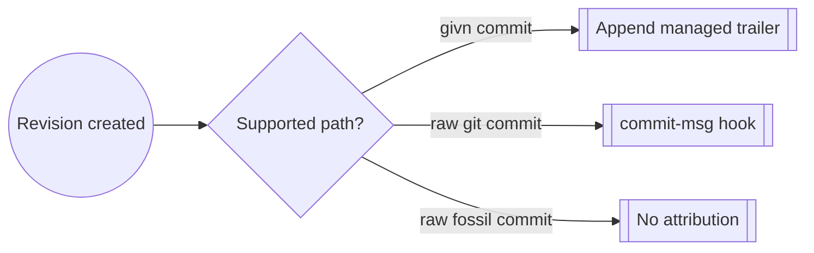

# Use case: support (fragment) — capability llm-attribution

Existing fragment capability, elaborated for the SCM-neutral delta.
`[proposed]` marks a resolution of an open question whose authoritative status
lives in `questions.md`.

## Level

fragment (capability inside the `support` fragment)

## Actors

- Authoring agent (commits per scenario)
- Primary user (commits manually)
- Technical role (reads the attribution result in history)

## Goal

Identify the LLM, reasoning mode, harness, and Givn version behind a revision,
best effort, without ever blocking the revision.

## Trigger

A revision is created through a supported path.

## Preconditions

- The harness integration supplies attribution context when it has it; the
  context is optional by contract.

## Main flow

1. The committer creates a revision: `givn commit` on either backend, or raw
   `git commit` where the hook is active.
2. The path reads the attribution context (LLM, reasoning mode, harness, Givn
   version).
3. The managed trailer is appended to the message; the committer identity is
   set where the backend and integration support it.
4. The revision succeeds whether or not context exists.

## Extensions

- Missing or partial context: the trailer records what is known and marks the
  rest unavailable; the revision still succeeds.
- `[proposed]` Raw `fossil commit`: no attribution is added; generated
  guidance states this limitation.
- An existing Git commit hook: preserved and chained before Givn attribution.
- The model changes between revisions: each revision records its own context.

## Rules

- Attribution never blocks a revision on either backend.
- The trailer format is unchanged: `Co-Authored-By:
  <model>/<reasoning>@<harness> with Givn <version>`.
- `[proposed]` On Fossil, attribution is message-trailer only; no committer
  identity override (Fossil records its own user).
- Ordinary human co-author trailers remain untouched.
- `[proposed]` givn stamps its own archive and upgrade revisions directly, so
  they do not depend on a backend hook.

## Examples

- Git, raw: `git commit -m "fix parser"` with context -> the message gains the
  managed trailer; the integration-provided committer name is used.
- Git, wrapper: `givn commit -m "fix parser"` -> the same result.
- Fossil, wrapper: `givn commit -m "fix parser"` -> the check-in comment gains
  the managed trailer.
- Fossil, raw: `fossil commit -m "fix parser"` -> no trailer; the skill says
  to use `givn commit` when attribution matters.
- No context: the revision succeeds and the message is unchanged.

## Minimal guarantee

No revision is blocked, and no message is altered beyond the managed trailer.

## Success guarantee

Revisions created through a supported path carry the available attribution
context; the limitation is documented per backend.

## Personas

- Technical role (authoring agent / automation caller)
- Primary user (developer / maintainer)

## Capabilities

- `llm-attribution` — modified (SCM-neutral commit path, Fossil limitation,
  backend-aware installation report). Note: `llm-attribution-installation`
  exists as a separate feature file but is not registered in
  `givn/specs/fragments/fragment.md`; spec authoring must either register it or
  fold it into `llm-attribution`.

## Interactions

| Capability | Consumer action | E2E scenario |
|---|---|---|
| llm-attribution | create an attributed revision | Consumer creates an attributed revision and history identifies the LLM and harness |
| llm-attribution | commit without context | Consumer commits without context and the revision succeeds unchanged |
| llm-attribution-installation | initialize a Git project | Consumer initializes a Git project and receives the chained hook |
| llm-attribution-installation | initialize a Fossil project | Consumer initializes a Fossil project and receives the givn commit path without a hook |

## Includes

- none

## Extends

- none

## Out of scope

Enforcing attribution; rewriting existing history; attributing raw Fossil
commits that bypass `givn commit`.

## Diagram

