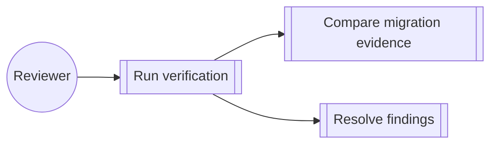

# Use case: verify-change

Existing permanent use case, elaborated for the SCM-neutral delta. `[proposed]`
marks a resolution of an open question that needs user confirmation.

## Level

!

## Actors

- Developer
- Reviewer

## Goal

Check that a change is structurally valid, complete, and free of unresolved
overlap before implementation or archive.

## Trigger

The developer or reviewer runs a Givn check.

## Preconditions

- The change artifacts and active specifications are available.

## Main flow

1. Parse the active features and workflow artifacts.
2. Detect duplicates, overlap, and invalid references.
3. Compare migration evidence when a migration check is requested.
4. Report blocking and advisory findings.

## Extensions

- A missing review disposition blocks completion.
- A migration with missing behavior, lost E2E evidence, lower interaction
  coverage, or lower source coverage blocks completion.

## Rules

- Parse failures outrank other lint findings.
- Every blocking overlap has an explicit disposition.
- Migration coverage cannot regress without an explicit retirement record.
- `[proposed]` The recorded revision identifier is opaque: any non-empty,
  non-placeholder identifier is accepted, with no length or alphabet
  assumption (Q11). Placeholder and duplicate rejection is unchanged; the
  check does not need to know the active backend.

## Examples

- A duplicate title is reported as a hard error in JSON and text output.
- A migration with lower branch coverage is rejected before archive.
- Git: a `COMMIT: a1b2c3d4e5f6...` line passes; `COMMIT: ___` fails as a
  placeholder.
- Fossil: a `COMMIT: c8d9e0f1a2b3...` line (40-hex shown) passes; a 64-hex
  full artifact hash passes too; placeholders and duplicates still fail.

## Minimal guarantee

An invalid change cannot pass the verification gate.

## Success guarantee

The reviewer receives complete, machine-readable verification evidence.

## Personas

- Technical role (authoring agent / automation caller)
- Givn maintainer (owner)

## Capabilities

- `givn-workflow-enforcement` — modified (identifier acceptance is
  backend-neutral)
- `validate-artifact-id-input` — unchanged
- `spec-overlap-gates` — unchanged
- `review-disposition-gates` — unchanged
- `deduplicate-change-dir-detection` — unchanged (placeholder rejection keeps
  its existing scenarios)
- `lint-command` — unchanged
- `visual-review-gate` — unchanged

## Interactions

| Capability | Consumer action | E2E scenario |
|---|---|---|
| validate-artifact-id-input | check an unknown artifact | Consumer invokes givn check with an unknown artifact and gets a helpful error |
| visual-review-gate | run the review check on a visual change | A visual change with complete evidence passes review |
| visual-review-gate | read the visual review guidance | Review guidance requires the visual verdict and persona lenses |
| spec-overlap-gates | detect a duplicate title | A duplicate title across two permanent spec files is a hard error |
| spec-overlap-gates | inspect duplicate JSON | The json output reports duplicate-title findings machine-readably |
| review-disposition-gates | pass a disposed review | Review passes when every shape match is disposed and reports the net-delta receipt |
| deduplicate-change-dir-detection | run integrity in a change | Consumer runs the integrity check on a change inside givn/changes and the correct directory is detected |
| deduplicate-change-dir-detection | reject placeholder commit evidence | Integrity check detects a placeholder COMMIT hash in tasks.md and fails |
| givn-workflow-enforcement | run migration coverage check | Consumer runs migration coverage check and sees passed evidence |
| givn-workflow-enforcement | record a Fossil revision | Consumer records a Fossil check-in hash in tasks.md and the integrity check accepts it |

## Includes

- fragment: support
- `[delta]` fragment: scm-backend

## Extends

- none

## Out of scope

Running the product test suite or changing implementation code.

## Diagram

