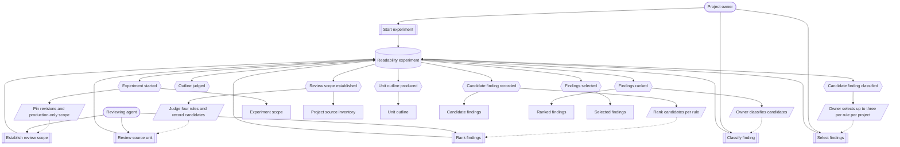

# Event Storming: readability-experiment

Status: revised 2026-10-19 after a fresh-context quality review; six core terms confirmed by the user on 2026-10-19.

## Narrative

The project owner starts a bounded readability experiment over three pinned
Givn-created projects, production sources only. The reviewing agent produces an
outline for each source unit, judges it against the four rules, and records
candidate findings with recommended actions. The agent ranks the candidates per
rule; the owner classifies them as genuine or false positive and selects the
three most severe genuine findings per rule per project. The agent applies each
recommended action in the project's worktree, one commit per distinct fix, and
verifies the build. The agent compiles a project report; the owner inspects the
diff, accepts or rejects each fix as a reader who did not write the code, and
judges whether the code improved. After all three projects, the agent compiles a
cross-project summary and the owner decides whether the check is promoted, kept
opt-in, or retired. The experiment is concluded. No pinned main checkout and no
Givn product behavior changes; the fixes stay on the spike worktrees.

## Canvas

### Legend

| Kind | Shape | Example |
|---|---|---|
| Actor | Stadium | `Owner([Project owner])` |
| Command | Subroutine | `C1[["Start experiment"]]` |
| Aggregate | Cylinder | `Experiment[(Readability experiment)]` |
| Event | Hexagon | `E1{{"Experiment started"}}` |
| Policy | Parallelogram | `P1[/"Pin scope"/]` |
| Read model | Rectangle | `R1[Experiment scope]` |
| External system | Rectangle with a dashed link | `Build[Build tooling]` |

### Setup and review

### Fixes and judgment

```mermaid
flowchart TD
  Owner([Project owner])
  Agent([Reviewing agent])
  Build[Build tooling]
  Experiment[(Readability experiment)]

  E8{{"Findings selected"}}

  C7[["Apply fix"]]
  C8[["Compile project report"]]
  C9[["Inspect project diff"]]
  C10[["Decide fix"]]
  C11[["Judge improvement"]]
  C12[["Compile cross-project summary"]]
  C13[["Decide adoption"]]
  C14[["Conclude experiment"]]

  P4[/"One commit per distinct fix; verify build"/]
  P5a[/"Compile project report"/]
  P5b[/"Request diff inspection"/]
  P6a[/"Record fix decisions"/]
  P6b[/"Judge improvement"/]
  P7a[/"Compile summary after all three projects"/]
  P7b[/"Request adoption decision"/]
  P8[/"Conclude; no Givn change"/]

  E9{{"Recommended action applied"}}
  E10{{"Fix commit verified"}}
  E11{{"Project review reported"}}
  E12{{"Project diff inspected"}}
  E13{{"Fix decision recorded"}}
  E14{{"Improvement judged"}}
  E15{{"Cross-project summary compiled"}}
  E16{{"Adoption decided"}}
  E17{{"Experiment concluded"}}

  R6[Selected findings]
  R7[Project report]
  R8[Worktree diff]
  R9[Cross-project summary]
  R10[Adoption decision]

  E8 --> P4 -.-> C7
  Agent --> C7 --> Experiment
  Experiment --> E9
  Experiment --> E10
  Build -.-> E10
  E10 --> P5a -.-> C8
  Agent --> C8 --> Experiment
  Experiment --> E11
  E11 --> P5b -.-> C9
  Owner --> C9 --> Experiment
  Experiment --> E12
  E12 --> P6a -.-> C10
  Owner --> C10 --> Experiment
  Experiment --> E13
  E13 --> P6b -.-> C11
  Owner --> C11 --> Experiment
  Experiment --> E14
  E14 --> P7a -.-> C12
  Agent --> C12 --> Experiment
  Experiment --> E15
  E15 --> P7b -.-> C13
  Owner --> C13 --> Experiment
  Experiment --> E16
  E16 --> P8 -.-> C14
  Owner --> C14 --> Experiment
  Experiment --> E17

  R6 -.-> C7
  E9 --> R8
  E11 --> R7
  R7 -.-> C10
  E12 --> R8
  E15 --> R9
  R9 -.-> C13
  E16 --> R10
```

## Event chain

| ID | Event | Actor | Command | Aggregate | Policy (reaction) | Read model |
|---|---|---|---|---|---|---|
| E1 | Experiment started | Project owner | Start experiment | Readability experiment | none (start) | Experiment scope |
| E2 | Review scope established | Reviewing agent | Establish review scope | Readability experiment | P1 reacts to E1 | Experiment scope, Project source inventory |
| E3 | Unit outline produced | Reviewing agent | Review source unit | Readability experiment | P2 reacts to E2 | Unit outline |
| E4 | Outline judged | Reviewing agent | Review source unit | Readability experiment | P2 reacts to E2 | Unit outline |
| E5 | Candidate finding recorded | Reviewing agent | Review source unit | Readability experiment | P2 reacts to E2 | Candidate findings |
| E6 | Findings ranked | Reviewing agent | Rank findings | Readability experiment | P3a reacts to E5 | Ranked findings |
| E7 | Candidate finding classified | Project owner | Classify finding | Readability experiment | P3b reacts to E6 | Candidate findings |
| E8 | Findings selected | Project owner | Select findings | Readability experiment | P3c reacts to E7 | Selected findings |
| E9 | Recommended action applied | Reviewing agent | Apply fix | Readability experiment | P4 reacts to E8 | Worktree diff |
| E10 | Fix commit verified | Reviewing agent | Apply fix | Readability experiment | P4 reacts to E8 | Worktree build result |
| E11 | Project review reported | Reviewing agent | Compile project report | Readability experiment | P5a reacts to E10 | Project report |
| E12 | Project diff inspected | Project owner | Inspect project diff | Readability experiment | P5b reacts to E11 | Worktree diff |
| E13 | Fix decision recorded | Project owner | Decide fix | Readability experiment | P6a reacts to E12 | Project report |
| E14 | Improvement judged | Project owner | Judge improvement | Readability experiment | P6b reacts to E13 | Project report |
| E15 | Cross-project summary compiled | Reviewing agent | Compile cross-project summary | Readability experiment | P7a reacts to E14 for all three projects | Cross-project summary |
| E16 | Adoption decided | Project owner | Decide adoption | Readability experiment | P7b reacts to E15 | Adoption decision |
| E17 | Experiment concluded | Project owner | Conclude experiment | Readability experiment | P8 reacts to E16 | Adoption decision |

## Policies

- **P1 — Pin the scope.** Reacts to E1; issues C2. Pins the three project
  revisions, restricts the review to production sources, and fixes the four
  rules.
- **P2 — Judge and record.** Reacts to E2; issues C3 for each source unit.
  Produces E3, E4, and E5. When a rule is violated, E5 carries the outline
  evidence and the recommended action.
- **P3a — Rank.** Reacts to E5; issues C4; produces E6.
- **P3b — Classify.** Reacts to E6; issues C5; produces E7. The owner marks
  each candidate genuine or false positive.
- **P3c — Select.** Reacts to E7; issues C6; produces E8. Only genuine
  candidates are selected, at most three per rule per project.
- **P4 — Apply and verify.** Reacts to E8; issues C7; produces E9 and E10.
  Applies the recommended action for each selected finding, one commit per
  distinct fix; a fix that resolves overlapping findings cites every rule;
  records dependencies between fixes; verifies the build and, when available
  and reasonably fast, the project's test command.
- **P5a — Report.** Reacts to E10; issues C8; produces E11.
- **P5b — Request inspection.** Reacts to E11; issues C9; produces E12.
- **P6a — Record fix decisions.** Reacts to E12; issues C10; produces E13.
- **P6b — Judge improvement.** Reacts to E13; issues C11; produces E14.
- **P7a — Summarize.** Reacts to E14 after all three project reviews; issues
  C12; produces E15.
- **P7b — Request adoption.** Reacts to E15; issues C13; produces E16.
- **P8 — Conclude.** Reacts to E16; issues C14; produces E17. No pinned main
  checkout and no Givn product behavior changes.

## Aggregates and boundaries

- **Readability experiment** — the only aggregate root. Its consistency
  boundary holds the fixed scope, the four rules, the owner's decisions, and
  the no-product-change invariant. Its invariants: the scope is pinned; at most
  three selected findings per rule per project; every selected finding has one
  recommended action and one applying commit; every fix is verified before the
  owner judges; no pinned main checkout or Givn product behavior changes.
- **Project review** — a record inside the aggregate, one per project. It holds
  the outlines, candidate findings, classifications, selected findings, fix
  commits, and owner decisions. Not an aggregate.
- **Candidate finding**, **Selected finding**, **Fix commit**, **Owner
  decision** — records inside the project review. Not aggregates.
- **Source unit** — the external code artifact under review. Not an aggregate.
- **Git worktree** and **build tooling** — external systems. Not aggregates.

Existing project aggregates (`Project`, `Change`) do not fit: the experiment's
invariants span three projects' code artifacts and the owner's judgment, not a
project record or a change lifecycle. The new aggregate is therefore declared
here and submitted to the term check.

## Reverse narrative

Start at the terminal event E17 (Experiment concluded).

- E17 requires E16 (Adoption decided) because the conclusion records the
  decision.
- E16 requires E15 (Cross-project summary compiled) and E14 (Improvement
  judged) because the summary is the basis for adoption and the judgment is the
  evidence.
- E15 requires E14 for all three projects because the summary compares them.
- E14 requires E13 (Fix decision recorded) because the judgment follows the
  per-fix decisions.
- E13 requires E12 (Project diff inspected) because a fix cannot be accepted
  or rejected before its diff is read.
- E12 requires E11 (Project review reported) because the report points at the
  diff.
- E11 requires E10 (Fix commit verified) because the report cannot claim a
  verified fix before verification.
- E10 requires E9 (Recommended action applied).
- E9 requires E8 (Findings selected).
- E8 requires E7 (Candidate finding classified) because only genuine findings
  can be selected.
- E7 requires E6 (Findings ranked).
- E6 requires E5 (Candidate finding recorded).
- E5 requires E4 (Outline judged).
- E4 requires E3 (Unit outline produced).
- E3 requires E2 (Review scope established).
- E2 requires E1 (Experiment started).

## Term check

Status: confirmed 2026-10-19 (user).

| Term | Status | Definition | Contrast | Collision check |
|---|---|---|---|---|
| Readability experiment | confirmed 2026-10-19 (user) | A bounded trial that reviews production source units in the three pinned projects, selects findings, applies fixes, and records the owner's judgment. | Not the future opt-in Givn capability | `grep -rin "readability experiment" docs/arc42/12-glossary.md givn/ideation/*/domain-terms.md` -> 0 outside this topic; `grep -ril "readability experiment" --include='*.md' --include='*.rs' .` -> 2 files, both this topic |
| Project review | confirmed 2026-10-19 (user) | The per-project record of outlines, candidate findings, selected findings, fix commits, and owner decisions inside the experiment. | Not the Givn review step, not a worktree | `grep -rin "project review" docs/arc42/12-glossary.md givn/ideation/*/domain-terms.md` -> 0; `grep -ril "project review" --include='*.md' --include='*.rs' .` -> 7 files, mostly review prose |
| Candidate finding | confirmed 2026-10-19 (user) | A rule violation proposed by the agent with outline evidence and a recommended action, before the owner classifies it. | Not a confirmed or selected finding | `grep -rin "candidate finding" docs/arc42/12-glossary.md givn/ideation/*/domain-terms.md` -> 0; `grep -ril "candidate finding" --include='*.md' --include='*.rs' .` -> 3 files including this topic |
| Selected finding | confirmed 2026-10-19 (user) | A genuine candidate finding chosen for the fix batch, at most three per rule per project. | Not every candidate finding | `grep -rin "selected finding" docs/arc42/12-glossary.md givn/ideation/*/domain-terms.md` -> 0; `grep -ril "selected finding" --include='*.md' --include='*.rs' .` -> 3 files including this topic |
| Experiment scope | confirmed 2026-10-19 (user) | The pinned projects and revisions, the production-only file set, and the four rules the trial is fixed to. | Not the whole repository | `grep -rin "experiment scope" docs/arc42/12-glossary.md givn/ideation/*/domain-terms.md` -> 0; `grep -ril "experiment scope" --include='*.md' --include='*.rs' .` -> 0 files |
| Fix commit | confirmed 2026-10-19 (user) | The one commit in a project worktree that applies a recommended action and passes the build check. | Not the recommended action, not a generic commit | `grep -rin "fix commit" docs/arc42/12-glossary.md givn/ideation/*/domain-terms.md` -> 0; `grep -ril "fix commit" --include='*.md' --include='*.rs' .` -> 5 files, generic commit prose |

The generic word **Finding** is rejected as a core term because it hides the
state that matters; the experiment uses **Candidate finding** and **Selected
finding**. The durable glossary already uses "Finding severity" and "Run
finding" for other concepts, so the generic term cannot be confirmed here.
