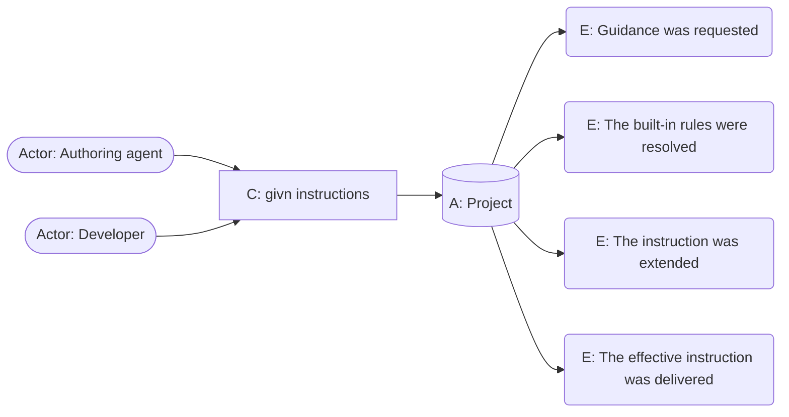
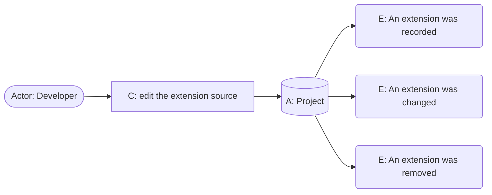
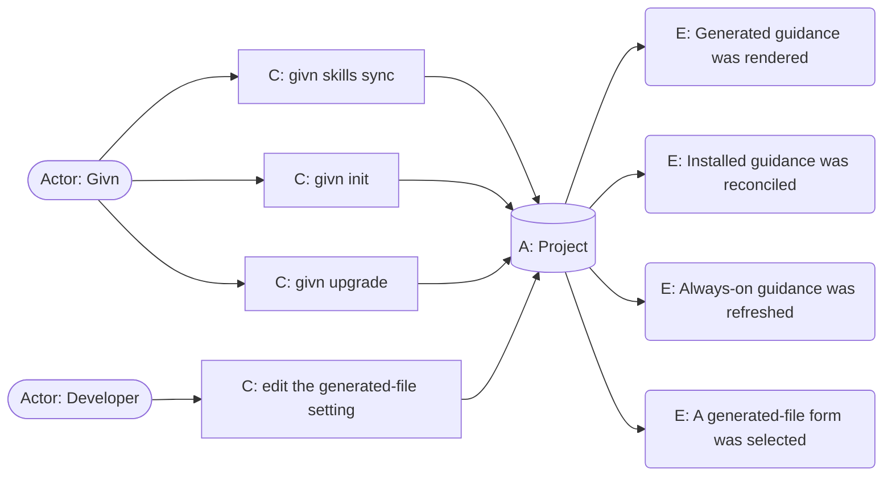
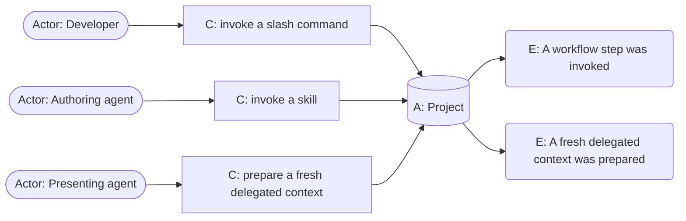
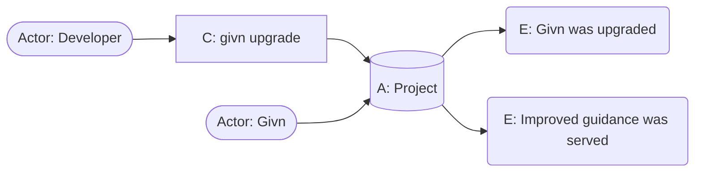
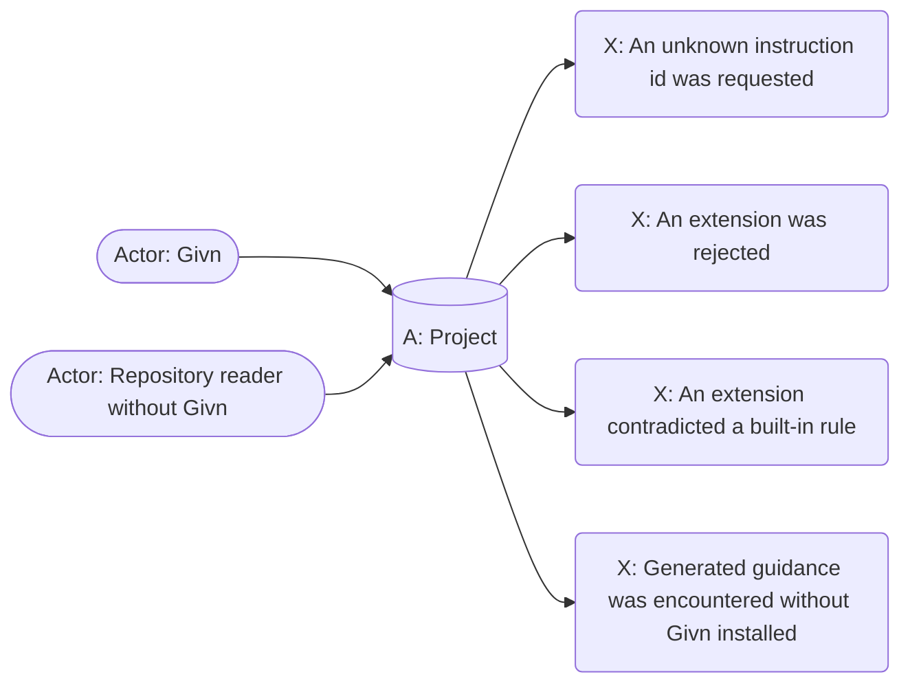

# Event Storming: rules-through-instructions

Domain events in the order they happen, with actor, command, reacting policy,
and read model. `[guard]` marks an internal check or refusal rather than a
value event. `[consequence]` marks an observable outcome with no system
action behind it. `[Qn]` marks a policy that depends on an open question; see
the question-dependent behavior table. IDs are stable for cross-references
from `use-case-definitions.md`.

Domain: the delivery of Givn's built-in rules to a project's authoring
agents, and the project's ability to extend them with project-specific
rules. Givn's built-in rules stay technology-agnostic — they guide the
workflow and the guardrails — and a project extends them; the result an
agent follows is the extended rule. Givn is the harness: it tracks the
workflow deterministically and guides the LLM. The built-in flow (steps,
order, gates) is not configurable and is not replaced.

The only aggregate is `Project` (the version-controlled Givn project).
Boundary and invariant, stated for the target state (subject to Q1 and Q2):
the installed guidance in the project contains no copy of a built-in rule —
every generated file carries trigger metadata and directs the agent to
`givn instructions` — and the project's extensions exist only in project
configuration, outside installable files. The effective instruction is a
report resolved per request; the extension set is project configuration; the
canonical assets are shipped configuration. None of the three is an
aggregate.

## Chain

### A. Instruction request and delivery

- **A1 — Guidance was requested** — Aggregate: Project. Actor: authoring
  agent (the developer, when reading manually). Command:
  `givn instructions <id> [--change <id>] [--json]`. Policy: the id resolves
  as an artifact, a policy, or a step [Q5]; the change context is the
  explicit `--change` or the single active change, otherwise a refusal naming
  the boundary; an unknown id refuses with the known list (F1). Read model:
  effective instruction.
- **A2 — The built-in rules were resolved** — Aggregate: Project. Actor:
  givn. Policy: cascade — a project override
  (`givn/artifacts/<id>/instructions.md`) wins entirely, then the embedded
  `instructions/<id>.md`, then the addon `addons/<id>/instructions.md`; a
  policy id resolves the same way. Read model: canonical asset, project
  override.
- **A3 — The instruction was extended** — Aggregate: Project. Actor: givn.
  Policy [Q4]: the project's extension for the id is added to the built-in
  rules in the confirmed position under a marked section; the result is the
  extended rule the request serves. The built-in rules stay unmodified, and
  the extension never overrides, suppresses, or reorders them (Q6 closed).
  A malformed extension or unknown id follows the confirmed rejection mode
  (F2). Read model: extension set.
- **A4 — The effective instruction was delivered** — Aggregate: Project.
  Actor: givn. Policy: the text path and the JSON path carry the same
  effective content (`id`, `generates`, `requires`, `instruction`,
  `skill_to_load`); the agent persona requires this parity. Read model:
  effective instruction.

### B. Extensions

- **B1 — An extension was recorded** — Aggregate: Project. Actor: developer.
  Command: edit the extension source [Q4]. Policy: additive; extends one
  instruction with project-specific rules; never written into generated
  files or the managed revision; effective at the next request. Read model:
  extension set.
- **B2 — An extension was changed** — Aggregate: Project. Actor: developer.
  Policy: no installed file is touched; the next resolution serves the
  changed text.
- **B3 — An extension was removed** — Aggregate: Project. Actor: developer.
  Policy: the built-in rules stand alone again; nothing else is cleaned up
  because extensions never entered installed files or the revision.

### C. Generated guidance

- **C1 — Generated guidance was rendered** — Aggregate: Project. Actor:
  givn. Command: `givn skills sync` (also `givn init`, `givn upgrade`).
  Policy [Q1][Q5]: each selected target receives a file with trigger
  metadata that directs the agent to `givn instructions <id>` where a served
  instruction exists (the coverage set is Q5's answer); no built-in rule
  content is copied; addon conditions and command-owning targets apply as
  today. Read model: selected targets, addon flags.
- **C2 — Installed guidance was reconciled** — Aggregate: Project. Actor:
  givn. Policy: a generated file from an earlier version that carries a full
  copy of the rules is rewritten to the directing form; a disabled addon's
  files are removed; a project-owned replacement stays byte-for-byte and
  receives no injected text (R-74).
- **C3 — Always-on guidance was refreshed** — Aggregate: Project. Actor:
  givn. Policy [Q2]: the `givn-project` block — today a direction to
  `givn instructions` that also carries the resident task-checkoff and
  commit-message obligations, and the dialog-policy obligation that stays
  under every option — plus the confirmed always-available set, and
  `absolute-mode` when enabled; `AGENTS.md` is never staged.
- **C4 — A generated-file form was selected** — Aggregate: Project. Actor:
  developer. Policy [Q1, only when the experiment adds the setting]: the
  config key selects the directing form or the full-copy form; the next sync
  re-renders; the installed file set stays unchanged; an absent key resolves
  to the default form (today's full copy) and an unrecognized value warns
  and continues with the default.

### D. Step invocation and delegation

- **D1 — A workflow step was invoked** — Aggregate: Project. Actor:
  developer (slash command) or authoring agent (skill). Command:
  `/givn-<step>` or a skill invocation. Policy [Q5]: the invoked file carries
  trigger metadata and invocation-specific orchestration only — subagent
  boundaries, stop conditions, reporting; the rule content comes from the
  pulled effective instruction (the coverage set is Q5's answer). Read
  model: the step's instruction ids.
- **D2 — A fresh delegated context was prepared** — Aggregate: Project.
  Actor: presenting agent. Command: prepare a fresh delegated context.
  Policy: the delegation passes the instruction ids (and the dialog
  obligation) explicitly; the fresh context loads the effective instruction
  from the same source, never from a private variant; the presenting agent
  stays responsible for user-facing questions.

### E. Upgrade and evolution

- **E1 — Givn was upgraded** — Aggregate: Project. Actor: developer.
  Command: `givn upgrade`. Policy: the managed revision refreshes the
  scaffold and the installed generated guidance; extensions live outside the
  managed allowlist and are never staged, merged, or rewritten; a
  project-owned replacement stays authoritative (R-74).
- **E2 — Improved guidance was served** — Aggregate: Project. Actor: givn.
  Policy: the next request after an upgrade serves improved built-in rules
  with no project action; generated files change only when trigger
  metadata, ids, targets, or addons change, and then through sync or
  upgrade.

### F. Guards, refusals, and consequences

- **F1 — An unknown instruction id was requested** — Aggregate: Project.
  Actor: givn `[guard]`. Policy: the existing named refusal listing the known
  artifacts; a non-artifact id resolves through the instruction cascade
  before the error.
- **F2 — An extension was rejected** — Aggregate: Project. Actor: givn
  `[guard]` [Q4]. Policy: an unknown artifact id or a malformed entry
  follows the confirmed mode — warn and drop (the OpenSpec precedent), or a
  named refusal for the request.
- **F3 — An extension contradicted a built-in rule** — Aggregate: Project.
  Actor: givn `[guard]` [Q4]. Policy: the merge is textual, not semantic —
  both appear in the extended rule. Rules are extended, never overridden
  (Q6 closed): a project that needs the opposite semantics cannot get it
  through the extension mechanism, and the system detects no contradiction.
- **F4 — Generated guidance was encountered without Givn installed** —
  Aggregate: Project. Actor: repository reader on a versioned project
  `[consequence]`. Policy: no Givn behavior exists in that environment — the
  generated file carries trigger text and directs the agent to
  `givn instructions`, which cannot run. Under `local-only` (default)
  committed guidance does not exist and the case cannot arise; under
  `versioned` the project accepts that the rules resolve only with Givn
  installed.

## Reverse narrative

Which events must have happened for `E2 — Improved guidance was served` to be
possible? The project was upgraded (E1); the canonical asset carried the
improvement; the request path (A1) resolved and extended it (A2, A3) and
delivered it (A4). And for that request to happen, a step was invoked (D1) —
which required installed generated guidance (C1) — which required the project
to be initialized (existing `initialize-project` events). The chain starts at
project setup, as the sibling topics' chains do; nothing in this topic
changes the setup order.

## Canvas

Every event of the chain with its actor, command, and aggregate. Kinds are
marked on every node (`Actor`, `C`, `A`, `E`, `X`): a command sits between
the actor that issues it and the aggregate it changes, and the aggregate
emits its events. The only aggregate is `Project`; the effective instruction
is a report, the extension set is configuration, and the canonical assets
are shipped configuration — never drawn in the aggregate shape.

### A. Instruction request and delivery

### B. Extensions

### C. Generated guidance

### D. Step invocation and delegation

### E. Upgrade and evolution

### F. Guards, refusals, and consequences

## What loads when — the duplicate-loading analysis

Guidance reaches the agent through four touch points today:

1. **Always-on** — `AGENTS.md` at session start: the `givn-project` block —
   today a direction to `givn instructions` that also carries the resident
   task-checkoff and commit-message obligations that
   `assets/instructions/tasks.md` owns — user prose, and `absolute-mode`
   content when the addon is enabled.
2. **Skill trigger** — the skill frontmatter (name, description) is indexed
   by the harness; the skill body loads when the agent invokes it.
3. **Command invocation** — the slash-command body loads when the user
   invokes it.
4. **Pulled instruction** — `givn instructions <id>` output loads when the
   agent runs it.

Measured overlap between 1/2/3 and 4:

- Touch point 1 overlaps too: the `givn-project` block in `AGENTS.md`
  restates the task-checkoff and commit-message contract that
  `assets/instructions/tasks.md` owns, so the commit rule has an always-on
  home beside its instruction home.
- `assets/commands/givn-propose.md` (345 lines) carries an "Artifact-specific
  rules" section restating the release note, capability routing, use-case
  context, seed stamping, question disposition, and question IDs of
  `assets/instructions/proposal.md`; `assets/skills/givn-propose/SKILL.md.tmpl`
  (53 lines) carries a third partial copy, including the
  persona-confirmation rule that `proposal.md` also owns.
- `assets/commands/givn-implement.md` (285 lines) and
  `assets/skills/givn-implement/SKILL.md.tmpl` (180 lines) restate the
  RED→GREEN→REFACTOR→COMMIT loop, row by row, that
  `assets/instructions/tasks.md` owns end to end (including the
  never-empty-body rule and the commit-message contract).
- A change authored through `/givn-propose` reads the rules in the command
  body and then reads the same rules again when it follows the command's
  directive to pull `givn instructions <artifact-id> --change <id>` for each
  planning artifact. The copies can also disagree — the
  `prose-consolidation` capability had to fix exactly that for the E2E
  policy and the dialog policy, which proves the drift is real, not
  theoretical.

After the delivery change:

- Always-on: the `givn-project` block plus the always-available set [Q2];
  today's block also carries the commit obligations, so that rule keeps a
  second home exactly as long as [Q2] keeps it resident.
- Invoked file: trigger metadata plus invocation-specific orchestration
  (subagent boundaries, stop conditions). No built-in rule content.
- Pulled instruction: the single content copy per rule.

Result, with the directing form chosen [Q1] and the always-on set confirmed
[Q2]: each rule content is loaded once per step; drift between copies
becomes structurally impossible, because there is only one copy. Trigger
metadata can still lag until the next sync, but it carries no rules. The
experiment must confirm that harnesses follow the direction reliably — that
is the trial's core evidence (G7/G8).

## Invariants

In the target state [Q1][Q2]:

- One canonical asset per rule: each built-in rule lives in exactly one
  canonical instruction asset (or the project's whole-facet override);
  generated files direct, never copy (enforcement site: the acceptance
  suite's canonical-policy assertions, extended to the covered topics).
- Rules are extended, never overridden: the extension adds to the built-in
  rules; no extension replaces, suppresses, or reorders them (Q6 closed).
- Givn's built-in rules stay technology-agnostic — workflow and guardrails;
  project-, technology-, and domain-specific guidance enters only through
  extensions.
- The extension adds guidance, never workflow: steps, order, gates, and the
  artifact list are unaffected. Givn is the harness that tracks them.
- Extensions are request-time additions: they never enter installed files or
  the managed revision (enforcement site: sync/upgrade write lists and their
  tests).
- Every generated file resolves: the instruction ids it names exist in the
  same Givn version or a later one (enforcement site: generated-guidance
  reference checks, Q-97/D-20).
- The text and JSON paths serve the same effective content (enforcement
  site: instruction tests).
- A project-owned replacement stays authoritative and is never modified or
  injected (enforcement site: replacement-preservation scenarios, R-74).
- The always-available set stays bounded by the confirmed decision [Q2]
  (enforcement site: generated `AGENTS.md` block content tests).

## Question-dependent behavior

| Behavior | Depends on | Status |
|---|---|---|
| Generated-file form: directing only, or a setting selecting directing vs full copy | Q1 | open |
| Always-on set: direction only, or plus resident obligations | Q2 | open |
| Deliverable cut: one change for delivery + extensions, or two | Q3 | closed 2026-10-13 (user): one change on the experiment branch |
| Extension source, shape, position, rejection mode, contradiction handling | Q4 | open |
| Which steps receive an instruction id (artifact, policy, and the rest of the skills and commands) | Q5 | open |
| Override semantics for rules | Q6 | closed 2026-10-13 (user): rules are extended, never overridden |
| Extension on top of a whole-facet replacement | Q7 | open |

## Term collisions and notes

- `rule` is overloaded: a Givn rule (a generated file, durable glossary) and
  the Rules policy (`rules:` scalar); the OpenSpec `rules:` map means extra
  per-artifact guidance. The user's model adds the built-in rule content and
  the extended rule — the durable glossary will need the distinction at
  handoff; see `domain-terms.md`.
- `extension` collides with the use-case contract vocabulary: the glossary's
  `«extend»` relationship and every `usecase.md`'s `## Extensions` section
  (main-flow deviation branches). The extended-rule sense is a different
  bounded context; the collision is recorded in `domain-terms.md`.
- The shape coins "snapshot rule", "pointer rule", "project rule", and
  "rule topic" are rejected (user, 2026-10-13); use the built-in rules, the
  extension, and the extended rule.
