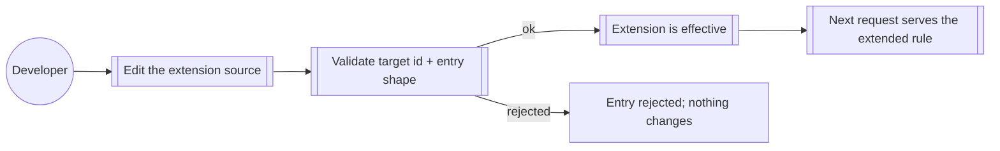

# Use case: extend-an-instruction

## Level

!

## Actors

- Developer

## Goal

Extend an instruction's built-in rules with project-specific rules. The
delta: the extension is recorded in the project's extension source, never
inside installed files; it extends, never overrides; the next request serves
the extended rule.

## Trigger

The developer records, changes, or removes project-specific rules for an
instruction — because the project needs guidance the technology-agnostic
built-in rules do not carry (a house convention, a domain rule, a local
constraint).

## Preconditions

- The project is initialized as a Givn project.

## Main flow

1. The developer edits the extension source for an instruction id (open:
   Q4 — the source, shape, and position are open; candidates are a config
   map, an extension file per artifact, or both).
2. The system validates the target: the id names an artifact, a policy, or
   a step `[Q5]`, and the entry is well-formed for the source's shape.
3. The system records the extension; no generated file and no managed
   revision is touched.
4. The next guidance request for that id serves the extended rule (the
   merge itself is `obtain-effective-guidance`'s flow).

## Extensions

- 2: the id is unknown → rejected per Q4's decision (open: warn and drop
  like the OpenSpec precedent, or a named refusal); the extension set and
  the built-in rules stay unchanged (F2).
- 2: the entry is malformed for the source's shape → same rejection mode;
  nothing else changes (F2).
- 3: the extension is changed → the next request serves the changed text;
  no installed file, revision, or built-in rule is touched (B2).
- 3: the extension is removed → the built-in rules stand alone again;
  nothing else needs cleanup because the extension never entered installed
  files or the revision (B3).
- 3: the extension textually contradicts a built-in rule → both appear in
  the served content; the system detects no semantic conflict; rules are
  extended, never overridden (F3; Q6 closed).
- 3: a whole-facet replacement exists for the same id → the replacement
  interplay is Q7 (open).

## Rules

- The extension adds project-specific rules; it never changes steps,
  order, gates, or the artifact list — Givn is the harness, and the
  built-in flow is not configurable.
- It never overrides, replaces, suppresses, or reorders the built-in
  rules (Q6 closed).
- It lives in the project's extension source; it never enters generated
  files, the managed revision, or the published clean-history surface
  (B1-B3).
- It is effective at the next request: no synchronization, upgrade, or
  restart is needed.
- It belongs to the project: every upgrade leaves it untouched (E1).
- Project-, technology-, and domain-specific guidance enters only through
  extensions; the built-in rules stay technology-agnostic.
- The extension source, shape, and position are Q4's open decision; this
  use case asserts only the semantics above, not the mechanism.

## Examples

- Record: the developer records `Keep proposals under 500 words` for the
  proposal instruction; the next `givn instructions proposal` serves the
  built-in rules plus that line.
- Change: the developer edits the line to `Keep proposals under 300
  words`; the next request serves the new text; nothing else changes.
- Remove: the developer deletes the extension; the served content is the
  built-in rules alone.
- Unknown target: the developer records rules for `propozal`; the system
  warns and drops the entry (OpenSpec precedent; Q4 decides) or refuses by
  name — the extension set stays unchanged.
- Contradiction: the developer records `Never write a release note` while
  the built-in proposal rules require one; the served content carries
  both; the project resolves its own contradiction.

## Minimal guarantee

A rejected extension changes nothing: the previous extension set and the
built-in rules remain effective, and no generated file, revision, or
installed artifact is touched.

## Success guarantee

The instruction serves the extended rule: Givn's built-in rules plus the
project's extension (open: Q7 for an id whose instruction is replaced
whole-facet). The extension belongs to the project and survives upgrades
untouched; removing it restores the built-in rules alone.

## Personas

- developer--primary-user
- givn-maintainer--owner

## Capabilities

- `instruction-extension` — new

## Interactions

| Capability | Consumer action | E2E scenario |
|---|---|---|
| instruction-extension | record an extension | The next guidance request serves the project's extension beside the built-in rules |
| instruction-extension | remove an extension | The served content is the built-in rules alone |
| instruction-extension | record an unknown target or malformed entry | The entry is rejected per Q4's mode and nothing changes |
| instruction-extension | upgrade the project after an extension | The extension survives and the improved built-in rules are served |

## Includes

- none

## Extends

- none

## Out of scope

The request-time merge and delivery (`obtain-effective-guidance`); the
whole-facet replacement mechanism (separate ownership, R-74; interplay Q7);
generating and refreshing installed guidance (`initialize-project`,
`upgrade-a-project`); custom workflow configuration (never).

## Diagram

