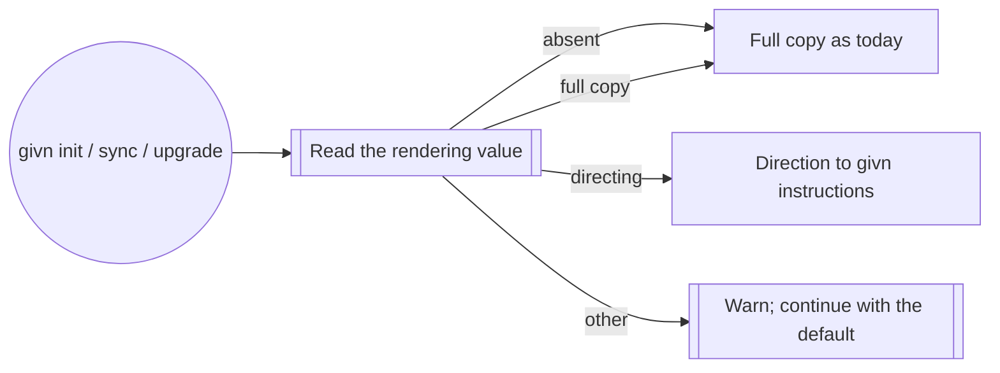

# Use case: generated-file-form (fragment, gated on Q1)

Reusable behavior with no independent user goal; included by
`initialize-project` and `upgrade-a-project` only when the experiment adds
the setting (Q1 option 2). The name is descriptive and provisional — not a
domain term; the user's term record rejects shape coins, and the setting's
user-facing name is Q1's and the proposal's to decide.

## Level

fragment

## Actors

- Developer — sets the value and observes the resolved rendering.
- Givn — reads the value when it renders generated guidance.
- Givn maintainer — owns the truthfulness of the contract.

## Goal

Resolve which rendering the generated files use: a direction to
`givn instructions`, or a full copy of the rules. Never guess silently,
never mutate.

## Trigger

Any command that renders generated guidance: `givn init`,
`givn skills sync`, `givn upgrade`.

## Preconditions

- The project root exists and is the current working directory.
- `givn/config.yaml` is readable when it exists.

## Main flow

1. Read the top-level value that selects the rendering from
   `givn/config.yaml` (the exact key name is Q1's and the proposal's
   decision).
2. When the key is absent, resolve to today's rendering — the full copy.
3. When the key names the directing rendering or the full-copy rendering,
   resolve to that value.
4. Expose the resolved value to the caller and name it in the command's
   report when the setting exists.

## Extensions

- 3: an unrecognized value → the command warns, names the value and the
  valid values, and continues with the default — today's full copy;
  protects the minimal guarantee (C4).
- 2: `givn/config.yaml` is absent → the default rendering resolves; the
  rest of the config defaults apply as today.

## Rules

- Resolution is read-only: it never writes, stages, or renders anything.
- The value never changes the workflow, the selected agent targets, or the
  installed file set — only which rendering the files use (C4).
- Every writer resolves the value before it renders; no writer carries its
  own default.
- This fragment exists only under Q1 option 2; under Q1 option 1 (a
  branch-only change) there is no value and the directing rendering is
  simply what sync writes.

## Examples

- Absent key: `givn skills sync` renders today's full copy and the report
  is unchanged.
- Directing rendering selected: `givn skills sync` renders the direction
  to `givn instructions` for every covered step `[Q5]`.
- Typo: `givn skills sync` warns "unrecognized value; continuing with the
  default rendering" and writes the full copy.

## Minimal guarantee

Resolution changes nothing in the project; an invalid value warns and
continues with the default rendering.

## Success guarantee

Every rendering command acts on the resolved rendering, and the resolved
value is visible in its report when the setting exists.

## Personas

- developer--primary-user
- givn-maintainer--owner

## Capabilities

- `generated-file-form` — new, provisional name

## Interactions

| Capability | Consumer action | E2E scenario |
|---|---|---|
| generated-file-form | sync with the setting absent | The default full copy is rendered |
| generated-file-form | select the directing rendering | Sync renders files that direct agents to the rules |
| generated-file-form | write an invalid value | A warning names the valid values and the default is used |

## Includes

- none

## Extends

- none

## Out of scope

The rendering itself (`initialize-project`, `upgrade-a-project`); the
decision to have the setting at all (Q1 option 1 vs option 2); changing
the workflow, targets, or installed file set.

## Diagram

