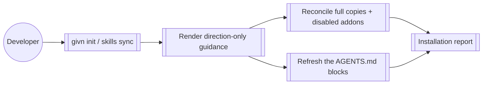

# Use case: initialize-project

## Level

!

## Actors

- Developer
- Supporting: Authoring agent

## Goal

Set up a Givn project and its agent integrations. The delta: generated
guidance directs agents to `givn instructions` instead of carrying the
rules; full copies are reconciled to the directing form when that form is
resolved `[Q1]`; the always-on set follows Q2's decision (open).

## Trigger

The developer initializes a project (`givn init`) or re-synchronizes the
agent integrations (`givn skills sync`).

## Preconditions

- The project directory is writable.
- The active version-control system is detected when one exists.

## Main flow

1. The developer selects at least one agent target (existing interactive or
   `--agents` behavior, unchanged).
2. The system renders each selected target's skill and command as trigger
   metadata plus a direction to `givn instructions <id>`, where a served
   instruction exists `[Q1][Q5]`; no built-in rule content is copied.
3. When the directing form is resolved `[Q1]`, the system reconciles
   installed guidance: a full copy from an earlier version is rewritten to
   the directing form, a disabled addon's files are removed, and a
   project-owned replacement stays byte-for-byte (R-74).
4. The system refreshes the always-on `AGENTS.md` block: the direction to
   `givn instructions` and the dialog obligation stay under every option;
   whether the resident task-checkoff and commit-message obligations stay,
   are dropped, or are generated from the canonical source follows Q2
   (open).
5. The system reports what was installed, what was skipped, and why
   (existing behavior), naming the resolved generated-file form when the
   setting exists `[Q1]` (open).

## Extensions

- 1: no version-control system exists → the system scaffolds the corpus,
   generates the guidance, exits 0, and warns that archive and managed
   upgrade are unavailable (existing behavior, unchanged).
- 2: a step has no served instruction `[Q5]` (open) → the file keeps
   resident content or receives a new instruction id, per Q5's answer;
   this use case asserts only that no rule content is duplicated in the
   directing form.
- 3: a project-owned skill or command replacement exists → it is
   preserved byte-for-byte and receives no injected text (R-74; existing
   behavior).
- 3: an addon is disabled → its generated files are removed (existing
   reconciliation).
- 5: the generated-file setting is absent → the resolved form is today's
   full copy; an unrecognized value warns and continues with the default
   (C4; `generated-file-form` fragment, gated on Q1 option 2).

## Rules

- In the directing form, a generated file carries trigger metadata and
  invocation-specific orchestration only — subagent boundaries, stop
  conditions, reporting; rule content comes from the request path
  `[Q1]`.
- Every direction names an instruction id that resolves in the same Givn
  version or a later one; the reference checks grade this (unchanged).
- Reconciliation never overwrites a project-owned replacement and never
  injects text into it.
- The dialog obligation in the project-start block is independent of
  optional addons and stays under every Q2 option.
- `AGENTS.md` keeps its fenced-block behavior and is never staged
  (existing).
- The installation report, the detected version-control system reporting,
  and the attribution plumbing are unchanged.
- Setup changes no workflow behavior: same targets, same files, same
  commands.
- The generated content stays technology-agnostic; project-specific
  guidance arrives only through extensions.

## Examples

- Fresh init, directing form resolved `[Q1]`: `givn init` writes
  `.opencode/skills/givn-propose/SKILL.md` as a file that names
  `givn instructions proposal`; the rules arrive only when the agent pulls
  them. When the default full-copy form is resolved, the file carries the
  rules as today.
- Existing project, directing form resolved `[Q1]`: a full copy from an
  earlier version is rewritten to the directing form on the next
  `givn skills sync`; the diff shows the rules replaced by the direction.
- Agent run: the agent invokes the skill, follows the direction, and
  pulls the extended rule; in the directing form it never reads a rule
  copy from the file.
- No version-control system: init scaffolds, generates the guidance,
  exits 0, and warns that archive and managed upgrade are unavailable
  (existing).
- Disabled addon: its generated files are removed on the next sync
  (existing).
- Project replacement: a project-owned `givn/skills/givn-propose/
  SKILL.md.tmpl` stays byte-for-byte; nothing is injected.

## Minimal guarantee

Setup writes only Givn-owned paths; user content outside the `AGENTS.md`
fenced block stays byte-for-byte unchanged, and a project-owned
replacement is never modified or injected.

## Success guarantee

Every selected target's generated guidance leads an agent to the effective
instructions for its step, and in the directing form the installed files
carry no duplicated built-in rules.

## Personas

- developer--primary-user
- agent--technical-role
- givn-maintainer--owner

## Capabilities

- `initialize-a-project` — modified (directing rendering, reconciliation
  when the directing form is resolved)
- `enable-optional-addons` — possibly modified only through the always-on
  set (open: Q2)
- `refresh-generated-guidance` — modified (content assertions move to the
  served instruction)
- `match-guidance-to-enabled-addons` — modified (addon conditions select
  the served instruction's content rather than the file's)

## Interactions

| Capability | Consumer action | E2E scenario |
|---|---|---|
| initialize-a-project | init a fresh project `[Q1]` | Consumer initializes and the installed guidance directs agents to the rules when the directing form is resolved |
| initialize-a-project | sync an existing project with full copies `[Q1]` | When the directing form is resolved, the copies are reconciled to it |
| initialize-a-project | keep a project-owned replacement | Consumer synchronizes and the replacement stays byte-for-byte with no injected text |
| refresh-generated-guidance | read content assertions after the change | Rule content is asserted on the served instruction, not on the generated file |
| match-guidance-to-enabled-addons | toggle an addon | The served instruction carries or omits the addon's content; the file keeps trigger metadata |

## Includes

- `instruction-integrity` (capability of the `support` fragment)
- `refresh-generated-guidance` and `match-guidance-to-enabled-addons`
  (capabilities of the `support` fragment)
- `generated-file-form` (fragment, gated on Q1 option 2)

## Extends

- none

## Out of scope

Serving the guidance (`obtain-effective-guidance`); recording extensions
(`extend-an-instruction`); the upgrade's managed revision
(`upgrade-a-project`); session-start next-step guidance
(`inspect-change-state`); changing the built-in flow.

## Diagram

