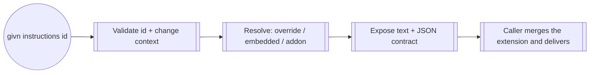

# Use case: instruction-integrity (fragment)

Reusable behavior with no independent user goal; included by the guidance,
setup, upgrade, and authoring flows. `[gated]` marks a resolution that
depends on an open question whose authoritative status lives in
`questions.md`.

## Level

fragment

## Actors

- Authoring agent — requests instructions and consumes the machine
  contract.
- Developer — reads instructions manually and owns overrides.
- Givn maintainer — owns the truthfulness of the contract.

## Goal

Resolve an instruction from the canonical sources and expose it with a
stable machine contract. Never guess silently, never mutate, never modify
a project override. The resolved content feeds the extended rule when an
extension exists `[Q4]` (open); the merge and delivery themselves belong to
`obtain-effective-guidance`, not to this fragment.

## Trigger

Any instruction request: `givn instructions <id> [--change <id>]
[--json]`, for an artifact id or a policy id (a step id under Q5, open).

## Preconditions

- The project is initialized as a Givn project.
- For an artifact instruction, the change context resolves.

## Main flow

1. Validate the id: a manifest artifact, else a cascade-resolvable policy
   id (a step id under Q5, open), else the named refusal (F1).
2. Resolve the instruction through the project-overrides-first cascade:
   project override wins entirely, then the embedded asset, then the addon
   asset.
3. Expose the resolved content: the instruction text, and for artifacts
   `id`, `generates`, and `requires`; `skill_to_load` when the
   domain-modeling and arc42 addons are both active (arc42 §8.3b).
4. Hand the resolved content to the caller; the caller merges the project's
   extension and delivers `[Q4]` (open; merge and delivery belong to
   `obtain-effective-guidance` A3-A4).

## Extensions

- 1: an unknown id → the named refusal listing the known artifacts; the
  non-artifact fallback resolves policies before erroring (existing).
- 1: an unsafe change context → the kebab-case error (existing).
- 2: a project override exists → it wins entirely and is never modified
  (R-74; existing).
- 3: a policy id → the same JSON shape with empty `generates` and
  `requires` (existing).

## Rules

- Resolution order and override precedence are today's contract and stay
  unchanged.
- The JSON shape stays `id`, `generates`, `requires`, `instruction`
  (plus `skill_to_load` when the addons are active).
- Resolution is read-only: it never writes, stages, or modifies anything.
- A project-owned override stays byte-for-byte; no bundled text is
  injected into it (R-74).
- Every reference the resolved guidance carries resolves in the consumer
  project or is owned by a named creation step (Q-97; D-20 — the
  generated-guidance reference checks, unchanged).
- The resolved content is not the responsibility of this fragment to
  merge: the extension merge is `obtain-effective-guidance`'s flow.

## Examples

- Artifact: `givn instructions specs --change add-user-auth` resolves the
  specs instruction; the caller then adds the project's extension for
  specs and delivers the extended rule.
- Override: a project-owned `givn/artifacts/proposal/instructions.md`
  wins and the file is not modified; whether the extension for proposal
  applies on top of it is Q7 (open).
- Policy without a change: `givn instructions dialog` resolves and exits 0
  (existing).
- Unknown id: `givn instructions propozal` exits non-zero with the
  unknown-artifact error (existing).
- Machine contract: `givn instructions specs --change add-user-auth
  --json` emits `id`, `generates`, `requires`, and `instruction`.

## Minimal guarantee

An unresolvable request changes nothing and refuses by name; no resolution
modifies any file, override, or configuration.

## Success guarantee

The caller receives the resolved content (project replacement, embedded,
or addon) with the stable machine contract, identical on the text and JSON
paths, ready for the extension merge.

## Personas

- agent--technical-role
- givn-maintainer--owner

## Capabilities

- `instruction-integrity` — modified (the resolved content feeds the
  extended rule)

## Interactions

| Capability | Consumer action | E2E scenario |
|---|---|---|
| instruction-integrity | request a policy id without a change | The general policy is served without a selected change |
| instruction-integrity | keep a project-owned override | The override stays byte-for-byte and wins over the embedded asset |

Mapping note: the permanent `fragment.md` interaction "request effective
instructions by id" moves under `obtain-effective-guidance`; its
session-start row ("request normal session-start instructions") stays with
the session-start guidance owner (`inspect-change-state`). This fragment
keeps the resolution, policy-id, and override interactions.

## Includes

- none

## Extends

- none

## Out of scope

The extension merge and delivery (`obtain-effective-guidance`); the
extension content and its recording (`extend-an-instruction`); rendering
generated files (`initialize-project`, `upgrade-a-project`).

## Diagram

