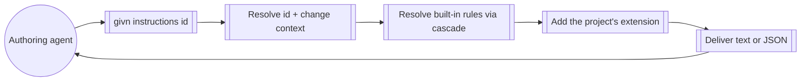

# Use case: obtain-effective-guidance

## Level

!

## Actors

- Authoring agent
- Supporting: Developer (manual reading)

## Goal

Obtain the rules governing the work at hand, extended with the project's
extension. The delta: the request serves the built-in rules plus the
project's extension when one exists, on the text and machine-readable paths
alike.

## Trigger

The authoring agent requests the guidance for an instruction id
(`givn instructions <id> [--change <id>] [--json]`), typically because an
invoked skill or slash command directs it there; the developer may request
the same id manually.

## Preconditions

- The project is initialized as a Givn project.
- For an artifact instruction, exactly one change context resolves: the
  explicit `--change`, or the single active change.

## Main flow

1. The authoring agent requests the guidance for an instruction id; the
   system resolves the id as an artifact, a policy, or a step `[Q5]`.
2. For an artifact instruction, the system resolves the change context
   (explicit `--change`, or the single active change).
3. The system resolves the built-in rules through the project-overrides-
   first cascade (project replacement, then embedded, then addon).
4. The system adds the project's extension for that id, in the position Q4
   decides, under a marked section (open: Q4, Q7); the built-in rules stay
   unmodified.
5. The system delivers the effective content on the requested path — text
   or machine-readable — with identical content.
6. The agent follows the extended rule for its step.

## Extensions

- 1: the id is unknown → the system refuses by name and lists the known
  ids; protects the minimal guarantee (F1).
- 2: multiple active changes and no `--change` → the system refuses and
  names the boundary; protects the minimal guarantee (existing behavior).
- 2: no active change and no `--change` for an artifact instruction → the
  system refuses and names the missing context; protects the minimal
  guarantee (existing behavior).
- 4: no extension exists for the id → the built-in rules are served alone;
  the call is valid and unchanged (A3, the no-extension case).
- 4: the extension was rejected when it was recorded → it never reaches
  the request path; rejection is `extend-an-instruction`'s guard (F2).
- 5: the machine-readable path is requested → the same extended content is
  carried as `instruction` alongside `id`, `generates`, `requires`, and
  `skill_to_load` (existing shape, A4).

## Rules

- The served content is the extended rule: the built-in rules resolved
  from the canonical asset (or the project's whole-facet replacement,
  unchanged mechanism) plus the project's extension when one exists
  `[Q4]` (open: Q4 for position and shape, Q7 for the replacement
  interplay).
- An extension never overrides, suppresses, or reorders the built-in
  rules; rules are extended, never overridden (Q6 closed).
- The text path and the machine-readable path carry the same effective
  content, extensions included (A4).
- Improved built-in rules are served at the next request after an upgrade;
  no project action and no synchronization is needed (E2).
- A request never mutates project state: it resolves configuration and
  content and prints.
- The unknown-id refusal, the change-context rules, and the JSON shape are
  today's contract and stay unchanged.
- The built-in rules stay technology-agnostic; project-specific guidance
  arrives only through the extension.

## Examples

- An extension exists: the project records `Keep proposals under 500
  words` for the proposal instruction. The agent runs
  `givn instructions proposal --change add-user-auth` and receives the
  built-in proposal rules followed by the marked section carrying the
  project's line; it writes the proposal accordingly.
- No extension exists: `givn instructions specs --change add-user-auth`
  serves the built-in rules alone — identical to today's content.
- Unknown id: `givn instructions propozal` exits non-zero with the
  unknown-artifact error naming the known ids; nothing changes.
- Machine-readable: an agent requests the same proposal id with `--json`
  and finds the project's line inside `instruction`, alongside `id`,
  `generates`, and `requires`.
- Fresh delegated context: the delegation passes the instruction id; the
  fresh context pulls the same extended rule and the parent's loaded copy
  plays no role.

## Minimal guarantee

A request that cannot be satisfied changes nothing and names what is
missing — the unknown id, the ambiguous change context, or the absent
change; no request modifies project state.

## Success guarantee

The caller holds the extended rule for the requested id: Givn's built-in
rules as the canonical asset (or the project's replacement) defines them,
plus the project's extension when one exists — identical on the text and
machine-readable paths. Whether the extension applies on top of a
whole-facet replacement is open (Q7).

## Personas

- agent--technical-role
- developer--primary-user

## Capabilities

- `serve-extended-rules` — new

## Interactions

| Capability | Consumer action | E2E scenario |
|---|---|---|
| serve-extended-rules | request guidance by id | An agent requests machine-readable artifact guidance |
| serve-extended-rules | request guidance for an id with an extension | An agent receives the built-in rules plus the project's extension and follows them |
| serve-extended-rules | request guidance for an id without an extension | An agent receives the built-in rules alone |
| serve-extended-rules | request an unknown id | The command refuses by name and nothing changes |
| serve-extended-rules | request the machine-readable path | The JSON carries the same extended content as the text path |

## Includes

- `instruction-integrity` (capability of the `support` fragment)

## Extends

- none

## Out of scope

The cascade resolution mechanics, override precedence, JSON shape, and
reference integrity (the `instruction-integrity` capability); recording,
changing, or removing the project's extensions (`extend-an-instruction`);
generating and refreshing installed guidance (`initialize-project`,
`upgrade-a-project`); session-start next-step guidance
(`inspect-change-state`); changing the built-in flow.

## Diagram

