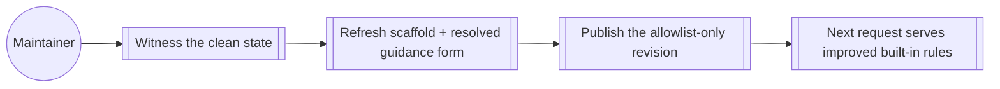

# Use case: upgrade-a-project

## Level

!

## Actors

- Project maintainer
- Supporting: Authoring agent

## Goal

Cross a release gap with reviewable upgrade and migration revisions. The
delta: the managed revision refreshes direction-only guidance `[Q1]`; the
project's extensions live outside the allowlist and are never staged,
merged, or rewritten.

## Trigger

The maintainer upgrades Givn.

## Preconditions

- The project configuration and repository state are available.
- The active version-control system is selected and its clean-state witness
  is available.

## Main flow

1. The maintainer requests an upgrade; the system witnesses the clean state
   and refuses before any write when the project is dirty or has no
   version-control system (existing).
2. The system synchronizes the managed scaffold and the installed guidance:
   it refreshes the resolved generated-file form `[Q1]`; when the directing
   form is resolved, a full copy from an earlier version is rewritten to it
   (C1-C2).
3. The system publishes the allowlist-only upgrade revision; the project's
   extensions live outside the allowlist, so the revision never stages,
   merges, or rewrites them (E1).
4. Improved built-in rules need no revision: the next request serves them
   (`obtain-effective-guidance`, E2).
5. Migration behavior is unchanged: when the upgrade carries migration
   requirements, the system publishes the plan revision recording the
   upgrade revision.

## Extensions

- 2: a project-owned replacement exists → it stays authoritative and is
   never modified or injected (R-74; existing behavior).
- 2: a generated file carries a full copy and the resolved form is the
   directing form → it is rewritten; when the resolved form is the full
   copy (the default), it stays a full copy `[Q1]`.
- 3: the project records extensions → they survive the upgrade byte-for-byte
   and are never part of the revision (E1).
- Existing refusals (dirty tree, no version-control system, already
   current, existing migration plan, removed commands) are unchanged.

## Rules

- The managed revision refreshes generated guidance only to the resolved
  form; it never carries the project's extensions.
- Improved built-in rules are served without any revision, at the next
  request (E2).
- A project-owned replacement stays authoritative (R-74).
- Content assertions that previously read rules from generated guidance
  move to the served instruction (assertion rework; owned by the delivery
  change, not this use case).
- The allowlist, the clean preflight, and the one-revision guarantee
  (one revision for a migration-free upgrade) are unchanged.

## Examples

- Full copies upgraded, directing form resolved `[Q1]`: a project whose
  installed guidance carries the rules receives a revision whose diff
  shows the directing form; the rules now arrive only through
  `givn instructions`. When the default full-copy form is resolved, the
  files stay full copies.
- Extensions present: the same project records `Keep proposals under 500
  words`; after the upgrade the extension is untouched and the next request
  serves it beside the improved built-in rules.
- No revision needed for content: after the upgrade, the changed built-in
  text appears on the next call with no committed change.
- Replacement kept: a project-owned command replacement stays
  byte-for-byte across the upgrade.

## Minimal guarantee

The project is protected from partial automatic migration (existing), and
an upgrade never stages, merges, rewrites, or injects into the project's
extensions or a project-owned replacement.

## Success guarantee

The upgrade work is explicit in the project's history, any migration it
carries is reviewable (existing), and the installed guidance matches the
resolved form with the improved built-in rules reachable at the next
request — with the project's extensions unchanged.

## Personas

- developer--primary-user
- givn-maintainer--owner

## Capabilities

- `apply-a-managed-upgrade` — modified (allowlist and revision content)

## Interactions

| Capability | Consumer action | E2E scenario |
|---|---|---|
| apply-a-managed-upgrade | upgrade a project with full-copy guidance `[Q1]` | When the directing form is resolved, the revision reconciles the copies to it |
| apply-a-managed-upgrade | upgrade a project with extensions | The revision excludes the extensions and the next request serves them untouched |
| apply-a-managed-upgrade | upgrade with a project-owned replacement | The replacement stays byte-for-byte and the revision carries no injected text |
| apply-a-managed-upgrade | run a managed upgrade without migration | One allowlist-only revision, as today |

## Includes

- `instruction-integrity` (capability of the `support` fragment)
- `refresh-generated-guidance` and `match-guidance-to-enabled-addons`
  (capabilities of the `support` fragment)
- `generated-file-form` (fragment, gated on Q1 option 2)

## Extends

- none

## Out of scope

Serving the guidance (`obtain-effective-guidance`); recording extensions
(`extend-an-instruction`); initial setup (`initialize-project`); changing
the built-in flow.

## Diagram

