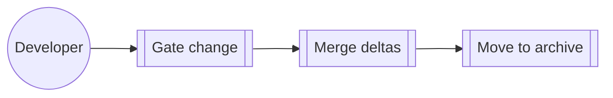

# Group: archival

## Actor

A developer archiving a completed, reviewed change.

## Goal

Merge deltas into the permanent corpus, run the post-merge gates, and
move the change into the archive — atomically, with rollback on failure.

## Main flow

1. Run the archive gate hooks (verify, verify-e2e).
2. Merge (or retire) delta features into `givn/specs/`.
3. Run post-merge verify and coverage gates; roll back on failure.
4. Move the change directory to `givn/archive/`.

## Interactions

- archive a change with delta merging and rollback
- enforce the post-merge e2e gate before the merge completes
- extract and merge coverage data as part of the pipeline
- preserve docstrings when merging delta features

## Includes

- verification (the gates run before any mutation)

## Extends

- support (coverage-script-workflow for coverage merge commands)

## Out of scope

- Reviewing the change (check review, not archive).
- Capability routing decisions (proposal-time).

## Diagram

