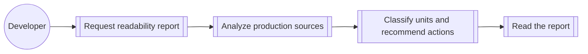

# Use case: assess-code-structure

## Level

!

## Actors

- Developer
- Supporting: Authoring agent

## Goal

See the structure of an existing codebase and the units that need a plan or
exception.

## Trigger

The developer asks for a readability report.

## Preconditions

- The project is a Givn project.
- The readability experiment is enabled.
- Production sources are available.

## Main flow

1. The developer requests a readability report; the system reads the production
   sources in the requested scope (the project-root `src/` by default, or the
   named `--path` roots).
2. The system analyzes each source unit and reports its size, public surface,
   cohesion and coupling indicators, and method complexity.
3. The system classifies each unit and recommends watch, plan, exception,
   advisory, or no action.
4. The developer receives the report and can plan the next action.

## Extensions

- 1: the readability experiment is disabled → the command reports that the
  experiment is disabled and exits non-zero; protects the preconditions.
- 1: no production sources exist in the requested scope → the report says
  there are no production sources; protects the success guarantee.
- 1: the requested scope does not exist → the command names the path and exits
  non-zero; protects the success guarantee.
- 2: a source file cannot be analyzed → the report names the file and continues
  with the remaining units; protects the minimal guarantee.
- 2: the analysis engine does not support a construct → the report marks the
  unit as unsupported and does not invent data; protects the minimal guarantee.

## Rules

- The report is advisory; it does not block review or archive.
- The report stores no baseline or historical classification.
- The report is deterministic and offline.
- The report uses production sources only, from the project-root `src/` or
  explicit `--path` roots, in the first release.
- Conditional code is counted as written: non-test `#[cfg(...)]` branches are
  not evaluated, and a parent-module `#[cfg(test)]` is not propagated.
- The report format is independent of the analysis engine.
- Every analyzed unit has exactly one classification and one action.

## Examples

- A 1,560-line wizard is a god type; the action is a plan.
- A 521-line enum with one method is data-only; the action is advisory.
- A 507-line module with a cohesive test double is a watch.
- A 2,882-line module with no god type is a module finding; the action is a
  plan or a recorded exception.

## Minimal guarantee

The developer receives a report that names every unit it could not analyze and
every analyzed unit's classification and action; existing review, archive, and
verification behaviour is unchanged.

## Success guarantee

The developer receives a complete readability report for the production
sources, with a classification and action for every analyzed unit.

## Personas

- developer--primary-user
- agent--technical-role
- givn-maintainer--owner

## Capabilities

- readability-report

## Interactions

| Capability | Consumer action | E2E scenario |
|---|---|---|
| readability-report | run a readability report | A developer runs a readability report and sees the classified units |

## Includes

- none

## Extends

- none

## Out of scope

- Review enforcement; that is the second change, `add-readability-review-gate`.
- A stored baseline or watchlist.
- Languages other than Rust.
- Automatic refactoring.
- Automatic Cargo workspace discovery; the developer names members with
  `--path`.
- Target-specific `cfg` evaluation and parent-module `#[cfg(test)]`
  propagation; conditional code is counted as written.
- Test and tooling sources outside the accepted limitations above.

## Diagram

