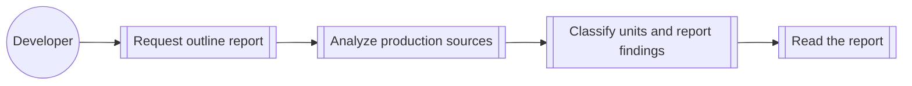

# Use case: assess-code-structure

## Level

!

## Actors

- Developer
- Supporting: Authoring agent

## Goal

See the structure of an existing codebase and the units that are findings.

## Trigger

The developer asks for a outline report.

## Preconditions

- The project is a Givn project.
- The outline experiment is enabled.
- Production sources are available.

## Main flow

1. The developer requests a outline report; the system reads the production
   sources in the requested scope (the project-root `src/` by default, or the
   named `--path` roots).
2. The system analyzes each source unit and reports its outline first — method
   declarations, signatures, and calls — then its size, public surface,
   cohesion and coupling indicators, and method complexity. Same-unit calls
   nest under their caller; calls to another component are leaves tagged with
   the target component. Data is not part of the outline.
3. The system classifies each unit and reports a finding for every unit above
   its threshold or carrying a long method; a within-limits unit is listed
   without a finding.
4. The developer receives the report. It states findings only: no action, no
   recommendation, and no advice. The outline is the primary evidence; the
   metrics support it.

## Extensions

- 1: the outline experiment is disabled → the command reports that the experiment is disabled and exits non-zero; protects the preconditions.
- 1: no production sources exist in the requested scope → the report says there are no production sources; protects the success guarantee.
- 1: the requested scope does not exist → the command names the path and exits non-zero; protects the success guarantee.
- 2: a source file cannot be analyzed → the report names the file and continues with the remaining units; protects the minimal guarantee.
- 2: the analysis engine does not support a construct → the report marks the unit as unsupported and does not invent data; protects the minimal guarantee.

## Rules

- The report is advisory; it does not block review or archive.
- The report stores no baseline or historical classification.
- The report is deterministic and offline.
- The report uses production sources only, from the project-root `src/` or explicit `--path` roots, in the first release.
- Conditional code is counted as written: non-test `#[cfg(...)]` branches are not evaluated, and a parent-module `#[cfg(test)]` is not propagated.
- The report format is independent of the analysis engine.
- Every analyzed unit has exactly one classification.
- The report leads with each unit's per-component call tree: declarations,
  signatures, and calls, without data. A module outline also lists its
  declared member types as type items. Same-unit calls nest under the caller;
  calls to another component are leaves tagged with the target and their
  resolution. An unknown-receiver call stays a visible `name_only` leaf. The
  metrics hint at potential problems; they do not decide.
- The report attaches no action or recommendation to a unit; a finding states the classification, the measured metrics, and the evidence.

## Examples

- A 1,560-line wizard is a `god-type` finding.
- A 521-line enum with one method is a `data-only` finding.
- A 507-line module is a `module` finding.
- A 2,882-line module with no god type is a `module` finding.

## Minimal guarantee

The developer receives a report that names every unit it could not analyze and
every analyzed unit's classification; existing review, archive, and
verification behaviour is unchanged.

## Success guarantee

The developer receives a complete outline report for the production
sources, with one classification and no recommendation for every analyzed
unit.

## Personas

- developer--primary-user
- agent--technical-role
- givn-maintainer--owner

## Capabilities

- outline-report

## Interactions

| Capability | Consumer action | E2E scenario |
|---|---|---|
| outline-report | run a outline report | A developer runs a outline report and sees the classified units |

## Includes

- none

## Extends

- none

## Out of scope

- Review enforcement; that is the `outline-review-gate` capability under `verify-change`.
- A stored baseline or watchlist.
- Languages other than Rust and Python.
- Automatic refactoring.
- Automatic Cargo workspace discovery; the developer names members with
  `--path`.
- Target-specific `cfg` evaluation and parent-module `#[cfg(test)]`
  propagation; conditional code is counted as written.
- Test and tooling sources outside the accepted limitations above.

## Diagram

