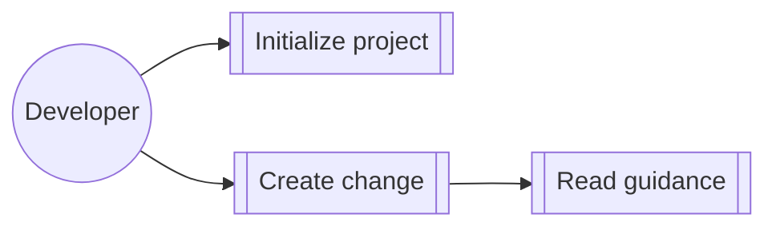

# Use case: author-change

## Level

+

## Actors

- Developer
- Authoring agent

## Goal

Set up a Givn project and create changes with the guidance to carry them from
intent to executable specification.

## Trigger

The developer starts a new project or a new change.

## Preconditions

- The project is in a location where Givn can manage its workflow.

## Main flow

1. Initialize the project and its agent integrations.
2. Create a change with a valid identity and read the guidance for its
   artifacts.

## Extensions

- none

## Rules

- Coverage is the union of `initialize-project` and `create-change`.

## Examples

- A developer sets up a project and creates a change with its guidance.

## Minimal guarantee

The project remains unchanged when a request is rejected.

## Success guarantee

The project is set up and the requested change exists with the guidance its
artifacts need.

## Personas

- developer--primary-user
- agent--technical-role
- givn-maintainer--owner

## Capabilities

- none

## Interactions

- none

## Includes

- usecase: initialize-project
- usecase: create-change

## Extends

- none

## Out of scope

Implementing the product behavior described by a change; archive publication
(`archive-change`); managed upgrade (`maintain-project`).

## Diagram

