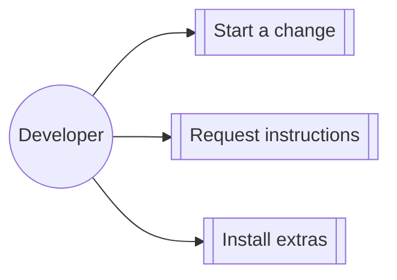

# Group: authoring

## Actor

A developer starting and driving a givn change from proposal to
implementation.

## Goal

Create, name, and prepare changes correctly — from `givn init` of the
project through `givn new`, artifact instructions, and the extras that
come with installation.

## Main flow

1. Initialise the project and pick agent targets (`givn init`).
2. Start a change and write its artifacts (`givn new`, `givn instructions`).
3. Install optional extras where the workflow needs them.

## Interactions

- initialise a givn project with agent target selection
- start a new change with a valid kebab-case id
- request artifact writing instructions for a change
- consolidate prose and install extras for an initialised project

## Includes

- support (instruction-integrity, config-overlay)

## Extends

- none

## Out of scope

- Archiving and merging (archival).
- Status reporting (status).

## Diagram

