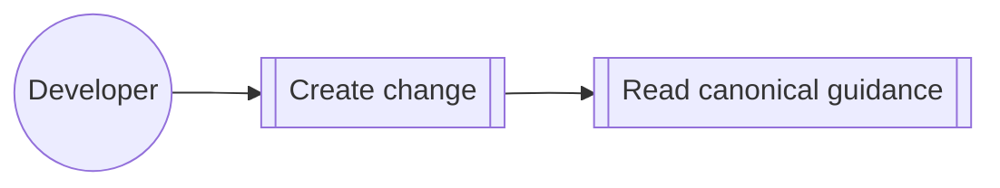

# Use case: create-change

## Level

!

## Actors

- Developer
- Supporting: Authoring agent

## Goal

Create a change ready to carry from intent to executable specification.

## Trigger

The developer starts a new change.

## Preconditions

- The project is initialized as a Givn project.

## Main flow

1. The developer creates a change; the system writes the scaffold with a
   stable identity.
2. The developer reads the artifact guidance; the system keeps one canonical
   policy per topic and points derived guidance at it.

## Extensions

- 1: the requested identity is invalid → the system rejects it and leaves the project unchanged; protects the minimal guarantee.

## Rules

- Change identities are stable kebab-case values.
- Generated guidance is synchronized from canonical source assets.
- One canonical policy exists per topic; derived guidance points at it.

## Examples

- A developer creates a multi-word change without manual scaffolding.

## Minimal guarantee

The project remains unchanged when an invalid identity is rejected.

## Success guarantee

The project has the requested change, ready to carry from intent to
executable specification.

## Personas

- developer--primary-user
- agent--technical-role
- givn-maintainer--owner

## Capabilities

- create-a-change
- prose-consolidation
- visual-design-contract

## Interactions

| Capability | Consumer action | E2E scenario |
|---|---|---|
| prose-consolidation | request canonical E2E guidance | Canonical E2E policy is emitted by specs instructions |
| prose-consolidation | inspect generated E2E guidance | Generated guidance points to the canonical E2E policy |
| visual-design-contract | request the design guidance for a visual interface | Author requests the visual design contract guidance |
| visual-design-contract | read the synchronized design and step guidance | Synchronized guidance defines the contract approval and capture mechanics |

## Includes

- fragment: support

## Extends

- none

## Out of scope

Implementing the change's product behavior; archiving the change
(`archive-change`); managed upgrade (`maintain-project`).

## Diagram

