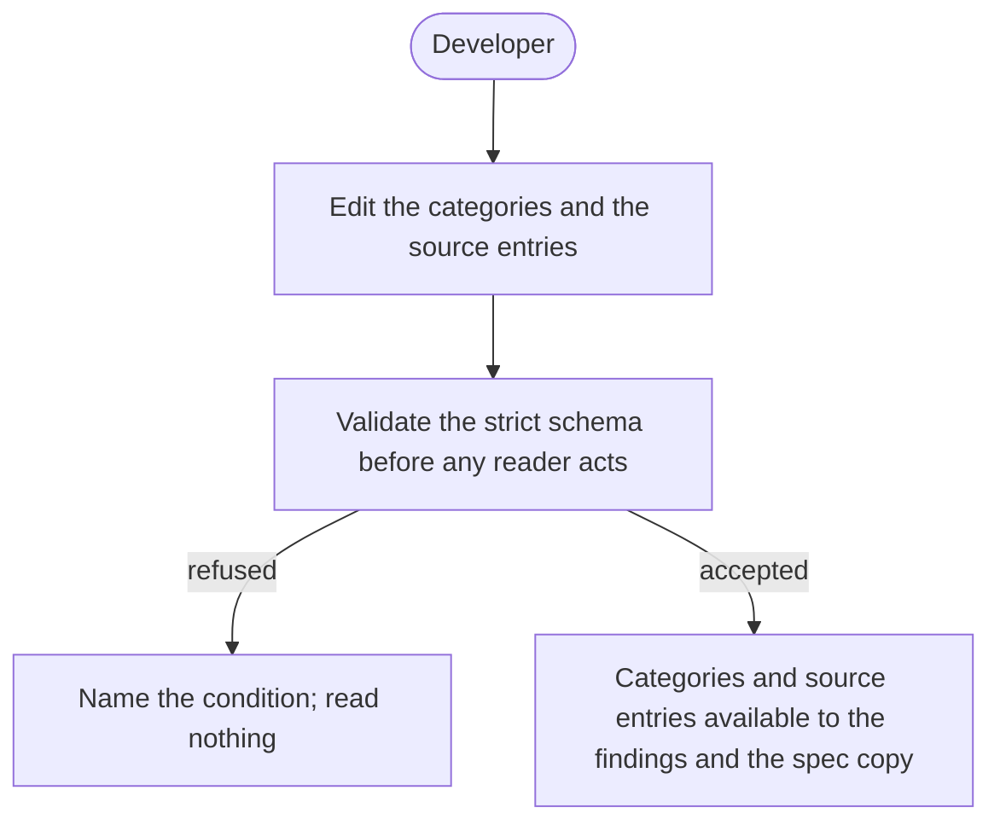

# Use case: declare-the-specification

## Level

!

## Actors

- Developer
- Supporting: Authoring agent (reads the Specification Manifest before authoring a change)

## Goal

Declare the boundary between the Specification and the Source code.

## Trigger

The developer changes a declared category or a replaceable `source:` entry, or a
durable contract moves to another path.

## Preconditions

- The project is initialized.
- `ise` is effective, which requires `architecture_principles`.
- The Specification Manifest is present from project setup or upgrade.
- The project is the developer's to configure.

## Main flow

1. The developer maps each Specification category to its manifest entries and lists the replaceable `source:` entries in the Specification Manifest; the system reads the current Specification Manifest and the project working tree.
2. The developer saves the changed Specification Manifest; the system validates it against the manifest rules before any reader acts on it and refuses an unknown key, an unknown or repeated category, an omitted category, an absent list of replaceable `source:` entries, and an entry outside the project.
3. The system exposes the resolved categories and `source:` entries to the flows that read them: the project-health findings in `verify-change` today, and the boundary check and spec-copy preparation the later capabilities add.

## Extensions

- 2: an unknown key or category name → the refusal names it and nothing is read; protects the minimal guarantee.
- 2: a category is named twice → the refusal names the category and nothing is read; protects the minimal guarantee.
- 2: a Specification category is omitted or the list of replaceable `source:` entries is absent → the refusal names the missing category or list and nothing is read; protects the minimal guarantee.
- 2: a category entry or a `source:` entry falls outside the project → the refusal names the entry and nothing is read; protects the minimal guarantee.
- 2: the Specification Manifest cannot be read → the refusal names the file and the read error, exits 1, and nothing is read; protects the minimal guarantee.
- 2: the Specification Manifest cannot be parsed → the refusal names the file and the loader's reason, exits 1, and nothing is read; protects the minimal guarantee.
- 1: `ise` is not effective → the Specification Manifest is never read, and a file left in the tree is preserved; protects the success guarantee.

## Rules

- The Specification Manifest is `givn/specification.yaml`, holding exactly five Specification categories: `behavior`, `structure`, `contracts`, `limits`, `e2e`.
- Exactly one `source:` list of replaceable roots; every declared manifest entry and every `source:` entry is bounded to the project.
- The schema is strict: an unknown key, an unknown or repeated category, an omitted category, an absent `source:` list, or an entry outside the project is refused, named, and never read. The Specification Manifest is project-owned text: a refusal never rewrites the file and never exposes a partial category set.
- An empty category list matches nothing and produces no finding; a declared non-empty entry that matches nothing does.
- No `components:` key and no per-component file list: the rebuilt Component's paths are a command input for `prepare-an-ise-test`, not a permanent project declaration.
- A declared entry missing from the tree, one entry declared in two categories, and a `.feature` file outside the `behavior` globs are advisory findings reported by `verify-change`; none refuses the Specification Manifest.
- The `e2e` category holds manifest entries like the other four categories; the union of their matched files identifies the packages holding the End-to-end (E2E) test runner and every `@e2e` step definition, resolved by the nearest project-relative `Cargo.toml` walking up from each matched file. Whether those packages exist and link no production source is a `verify-change` finding, not a manifest refusal. The frozen digest of a later change covers the resolved files, not one directory.
- The Specification Manifest reader parses text and does not own file access. `givn lint` reads the project working tree's Specification Manifest and refuses a present but unreadable file by name with exit 1; `givn ise rebuild-all` and `givn ise rebuild-component` read the Specification Manifest recorded at the selected revision and refuse four cases with exit 1 before any write: the revision does not record it (names the path, the revision, and `does not record`), the revision records it but the backend returns no blob (names the path, the revision, and `returned no blob`), the bytes are not UTF-8 (names the path and the decoding error), and the bytes are not a valid Specification Manifest (names the path and the loader's reason). Both surfaces parse the same bytes with the same strict loader, and neither rewrites the file.
- One Specification Manifest feeds every reader: no second category list or component list exists elsewhere.
- A written Specification Manifest is project-owned: setup and upgrade scaffold it only when absent and never rewrite its content.

## Examples

- A Givn self-rebuild Specification Manifest reads `behavior: ["givn/specs/**"]`, `structure: ["docs/glossary.md", "docs/domain-model.md"]`, `contracts: ["docs/reference.md"]`, `limits: ["docs/arc42/02-architecture-constraints.md"]`, `e2e: ["tests/e2e"]`, and `source: ["src/**"]`; the Specification Manifest is accepted, and a later Component rebuild naming `src/cli/archive.rs` accepts that path because it falls inside `src/**`.
- The developer writes a sixth category named `acceptance`; the refusal names `acceptance`, and the Specification Manifest keeps its five categories.
- The developer writes `e2e` twice; the refusal names `e2e` and the file is never read as a category set.
- The developer writes `source: ["../gh-notify/crates/**"]`; the refusal names `../gh-notify/crates/**` because the entry leaves the project.
- The developer moves `contracts` from `docs/reference.md` to `docs/cli-contract.md`; the next read retains `docs/cli-contract.md`, and `docs/reference.md` is now outside the Specification Manifest.
- The developer declares `limits: ["docs/performance.md"]` while that file does not exist; the Specification Manifest is accepted, and `givn lint` reports an advisory finding naming `docs/performance.md` and still exits 0.
- A project edits its `limits` entries and later crosses a release gap; `givn upgrade` leaves the Specification Manifest byte-identical.

## Minimal guarantee

A refused Specification Manifest leaves the previous file byte-for-byte unchanged
and exposes no partial category set.

## Success guarantee

The Specification Manifest names exactly the five Specification categories and
one list of replaceable `source:` entries, every entry bounded to the project,
and the resolved categories and `source:` entries are available to the flows
that read them.

## Personas

- developer--primary-user
- agent--technical-role
- givn-maintainer--owner

## Capabilities

- specification-manifest

## Interactions

| Capability | Consumer action | E2E scenario |
|---|---|---|
| specification-manifest | declare the five categories and the replaceable `source:` entries (an unknown key, an unknown or repeated category, an omitted category, an absent source list, and an entry outside the project are refusal variants) | The declared categories are read by the project-health pass |

## Includes

- none

## Extends

- none

## Out of scope

Boundary: the project's declaration of its Specification and replaceable Source
code. Everything below stays outside this case.

- Authoring the durable contracts the categories retain: the change's authoring
  flow.
- Materializing a spec copy: `prepare-an-ise-test`.
- Reporting manifest findings: `verify-change`.
- Scaffolding the Specification Manifest file: `initialize-project` and
  `upgrade-a-project`.

## Diagram

