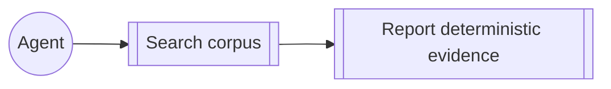

# Use case: discover-specifications

## Level

!

## Actors

- Authoring agent

## Goal

Find existing behavior deterministically before authoring or reviewing a
specification.

## Trigger

The agent investigates a proposed behavior or permanent corpus.

## Preconditions

- The active specification corpus is readable.

## Main flow

1. Search or inspect the corpus.
2. Report exact and structural overlap.
3. Preserve deterministic evidence for review.

## Extensions

- Model evidence may be unavailable while deterministic checks remain useful.

## Rules

- Discovery commands do not modify permanent specifications.
- JSON output remains machine-readable.

## Examples

- An agent audits duplicate scenarios without downloading a model.

## Minimal guarantee

The corpus remains unchanged by discovery.

## Success guarantee

The agent receives stable, actionable candidates and findings.

## Personas

- none

## Capabilities

- spec-progress-output
- spec-duplicates

## Interactions

| Capability | Consumer action | E2E scenario |
|---|---|---|
| spec-progress-output | request JSON duplicate audit | The JSON duplicate audit is valid JSON without progress wording |
| spec-duplicates | audit duplicates in one feature | Exact duplicates in one feature are reported together |
| spec-duplicates | audit duplicates across features | Exact duplicates across features are reported together |

## Includes

- fragment: support

## Extends

- none

## Out of scope

Changing the behavior of a capability discovered in the corpus.

## Diagram

