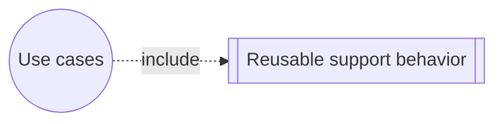

<!-- givn:base-sha256:743c12e62070c587d0e3695b6c0f7da8bdee9001636a67efbaf8df008ed66f6d -->
# Fragment: support

## Capabilities

- generate-ideation-guidance
- match-guidance-to-enabled-addons
- guide-domain-modeling
- find-existing-scenarios
- measure-coverage-per-project
- verify-repository-ownership
- coverage-readme-example
- route-a-change
- show-coverage-in-the-readme
- refresh-generated-guidance
- review-architecture-documentation
- instruction-integrity
- choose-project-license
- adr-qualification-gate
- attribute-commits
- enable-commit-attribution
- detect-the-project-repository
- customize-the-lifecycle-graph
- rules-policy
- local-only-transition
- publication-cleanliness

## Interactions

| Capability | Consumer action | E2E scenario |
|---|---|---|
| instruction-integrity | resolve an instruction and expose the machine contract | An agent requests machine-readable artifact guidance |
| instruction-integrity | request normal session-start instructions | Author starts a session with the universal dialog obligation |
| refresh-generated-guidance | synchronize selected skills | Synchronized guidance explains how to resolve the deterministic gates |
| adr-qualification-gate | request architecture-decision guidance (design-review selection is a regular variant) | An author requests the strict ADR guidance through the Givn CLI |
| review-architecture-documentation | request architecture-aware review guidance | Arc42-enabled review instructions require conformance evidence |
| review-architecture-documentation | eject the review template | The review template includes the Arc42 conformance block |
| review-architecture-documentation | synchronize the generated review skill | Generated review guidance stays aligned after skill sync |
| attribute-commits | initialize shared attribution plumbing | Consumer initializes a project and receives shared attribution plumbing |
| attribute-commits | commit explicit selected paths with attribution | An attributed commit exposes the current LLM and harness |
| attribute-commits | prepare attribution with OpenCode's selected model | OpenCode prepares attribution using its selected model |
| attribute-commits | attribute a commit with Claude's current model | Claude attributes a commit using its current model |
| attribute-commits | attribute a commit with omp's current model | omp attributes a commit using its current model |
| attribute-commits | attribute a commit with Maki's current model | Maki attributes a commit using its current model |
| enable-commit-attribution | inspect attribution installation | Consumer sees the commit attribution installation report |
| enable-commit-attribution | upgrade missing attribution plumbing | Consumer upgrades an existing project with attribution plumbing missing |
| enable-commit-attribution | initialize Fossil attribution | Consumer initializes a Fossil project and receives the givn commit path without a hook |
| measure-coverage-per-project | inspect initialized test and coverage scripts | An initialized project documents reusable test and coverage scripts |
| measure-coverage-per-project | publish line and branch badges when archiving | Archiving publishes line and branch badges from the merged report |
| coverage-readme-example | receive a complete README coverage example | Coverage-enabled project receives a complete README coverage example |
| detect-the-project-repository | detect the repository from a Git worktree at the project root | A Git worktree at the project root selects the Git backend |
| find-existing-scenarios | find a permanent scenario by a step text token | Lexical search locates a permanent scenario by a step text token |
| find-existing-scenarios | inspect per-use-case counts in the spec tree | The spec tree reports per-use-case counts and the use-case narrative |
| guide-domain-modeling | receive domain guidance for the next step | An agent requests next-step guidance and is routed to the domain skill |
| guide-domain-modeling | receive domain guidance for design | An agent requests the design guidance and is routed to the domain skill |
| guide-domain-modeling | receive domain guidance for specs | An agent requests the specs guidance and is routed to the domain skill |
| guide-domain-modeling | receive the domain skill after synchronizing skills | An agent synchronizes skills and the domain skill is routed |
| match-guidance-to-enabled-addons | enable the addons a generated section needs | A consumer enables the addons a generated section needs and the guidance gains it |
| match-guidance-to-enabled-addons | synchronize skills with disabled-addon sections omitted | A consumer synchronizes skills and the generated guidance omits disabled-addon sections |
| route-a-change | route a proposal and inspect ranked candidates | Routing a proposal prints ranked candidates with evidence |
| show-coverage-in-the-readme | place the coverage badge after the README title | Coverage-enabled project is guided to place the coverage badge directly after the README title |
| verify-repository-ownership | archive and publish consolidated permanent specifications | Archive publishes consolidated permanent specifications |
| verify-repository-ownership | accept explicit overlap dispositions in repository-wide review | Repository-wide review accepts explicit overlap dispositions |

## Diagram

The reusable support contract applies through inclusion; capabilities remain declared above rather than introducing new lifecycle actions or gates.

Generated guidance is skills only: trigger metadata and one resolvable served-instruction direction, without copied rules, separate command generation, orchestration, or repeated dialog/handoff/delegation blocks. Preserve authoritative project overrides and machine-readable metadata, safe context refusal, reference integrity, unaffected scope and decision-ledger examples, black-box behavior coverage, and distinct requirement coverage. Reconcile only recognizable generated legacy commands; custom command bytes require manual transition, not automatic replacement.

Managed bootstrap owns loading the effective dialog policy once before the first question in each context, outside named skills and independently of optional addons; reload it if lost. Its concise policy indexes preserved companion examples for scope approval, target selection, behavior choice, persistent-format commitment, and discoverable diagnosis. Read the relevant type before its first question per context, retain concrete consequences, resolved alternatives and reasons, and ask one question at a time. Neither bootstrap nor thin skills copy the companion examples, and no portable autoload or subagent choreography is assumed.

Review retains explicit split-or-keep for long scenarios: a keep has a brief reason and a chosen split is completed before sign-off. Shape-match discovery and outline analysis are advisory, with no mandatory shape table, outline verdict, metric waiver, or forced reviewer context. Available outlines support source-confirmed substantive review; uncertain or omitted edges and non-runtime structural call order limit conclusions.

Architecture applies from the first implementation: cohesive responsibilities, narrow consumer contracts and Interface Segregation, external adapters, separate composition, and explicit dependency direction, checked against actual imports and calls rather than filenames. A narrow module API suffices unless isolation or substitution needs an explicit interface; hypothetical providers or registries are not required. Domain modeling remains coupled to the durable Arc42 glossary. Confirmed Personas remain stakeholder review lenses, without invented identities, needless reconfirmation, or an internal-change exemption.

The first completed change using Arc42 establishes all twelve real, proportionate chapters without unfinished scaffold or fabricated completeness. Specific explicit unknowns and explained inapplicability are valid; later changes maintain affected chapters without repeating whole-baseline approval. Disabled-addon conformance is not applicable rather than silently required.

Review consumes available implementation verification, writes findings and an actual verdict, then completed-review checks inspect it; neither an unwritten review nor future archive receipt is an implementation prerequisite. Preserve canonical independent-review requirements and honest self-review labeling. One substantive review receives one targeted closure of recorded findings and material regressions from their fixes. Critical defects remain repairable blockers; minor naming, style, polish, and unrelated findings go to the existing backlog or a separate follow-up batch, not another open-ended audit or redundant full-suite run.

ADR qualification is recorded once in the change assessment: an architectural commitment, real alternatives, lasting boundary or consequence, and search for an existing decision. Route to a new, amended, or superseding ADR or the appropriate existing lower-level artifact. Chapter impact or shared guidance alone does not qualify an ADR. The ADR owns decision, rationale, alternatives, and consequences, not another qualification worksheet or fixed gate/route form. Only actionable downside risks or debt need risk tracking; ordinary tradeoffs remain consequences. Preserve honest evidence, independent architecture history and supersession links; this is authoring policy, not a new runtime gate.

`givn commit` requires explicit supplied paths on both Git and Fossil and refuses missing paths before staging or adding files. A revision contains only selected working content; unrelated staged, unstaged, and pending additions remain unchanged, and unsafe isolation is refused without consuming other work. Broad selections remain explicit, but examples name narrow batch files. Coherent completed batches record actual implementation or regression-test revisions, not separate phase revisions or a production diff per scenario; actual RED/GREEN/REFACTOR evidence is not reconstructed from history. Init and skill synchronization never implicitly commit.

Attribution installation preserves user hooks, is repeatable with core.hooksPath=.githooks, and never dispatches its own launcher, directly or through a saved hook. Optional attribution helpers cannot break or indefinitely delay an ordinary human commit or invent missing attribution. Reports name the shared hook and selected harness integrations truthfully. Fossil has no Git hook: only explicit-path `givn commit` stamps check-in attribution, while raw Fossil commits do not.

The `ise` instruction carries the obligations the addon promises: Specification completeness, the two-layer test boundary, persisted-state continuity, the `Ise rebuild decision`, implementation freedom, and the four-way `Spec gap` classification. It may use `Component`, `Component Interface`, contract, `Specification`, `Source code`, and `System` because `ise` requires `architecture_principles`. The design instruction requires exactly one Ise rebuild decision in the existing `## Decisions` ledger as a `Decides D<n>` entry, and a rebuilding change records its plain `Rebuilt code` line beside it; the entry names the affected consumers, the persisted state, and the rebuild boundary, and adds no mandatory design field. The design-review instruction keeps an unresolved decision, and a rebuild with no recorded `Rebuilt code` line, a finding. The review instruction requires exactly one `Spec gap` outcome before any fix, states that only `specification defect` is a gap in the Specification, and asks the rebuild-impact question as one review question, never a gate. One canonical owner per rule: the instruction that owns a rule states it and the instructions that depend on it point at the owner.

Stack instructions carry the mechanics a core step instruction leaves out. `steps` and `design` name each stack instruction id with the condition for loading it and carry no stack body: no per-runner step-definition path, empty-body stub, binding form, strict-mode mechanism, or single-scenario command. `specs` and `review` carry no stack body and name no stack instruction. A stack instruction's body reaches the caller only on a request for its own id, and an unknown id keeps the unknown-id refusal with the known list. The `ise` instruction names `steps` as the mapping for the change's stack mechanics, names one stack instruction id as a worked example, and keeps `design` and `proposal` as the record owners; every id it names is served while `ise` is effective. The guidance reference check resolves every instruction id a served instruction names, fails naming an unresolved id, and is read-only. Instruction length carries no numeric cap: a core step instruction carries the universal rules and the id mapping, per-stack mechanics are served only on a request for that stack's id, and prose that adds no rule is the only length defect. One canonical owner per rule still governs the split: a moved row keeps one home and the core instruction points at it rather than restating it.

