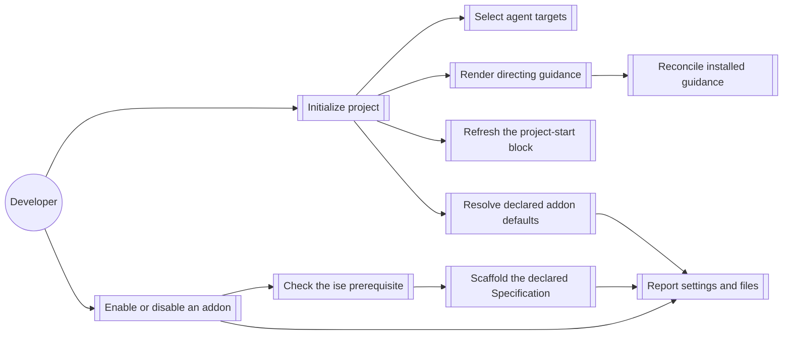

<!-- givn:base-sha256:458e56aca216339c71e6e5b92a3366a0551e27dad70a644d510b951fcab8dae1 -->
# Use case: initialize-project

## Level

!

## Actors

- Developer
- Supporting: Authoring agent

## Goal

Set up a Givn project and its agent integrations.

The delta: `ise` is an `Opt-in addon`; a fresh initialization never makes it
effective, enabling it requires `architecture_principles`, that prerequisite
cannot be disabled while `ise` is on, and the first effective enable leaves the
project holding the declared Specification.

## Trigger

The developer initializes a project, re-synchronizes the agent integrations, or
enables or disables an optional addon.

## Preconditions

- The project directory is writable.
- The active version-control system is detected when one exists.
- For an addon change, the project is initialized: its configuration file exists and its settings are readable.

## Main flow

1. The developer selects at least one agent target. The interactive list opens with `.opencode` marked and re-asks when nothing is marked; generation affects selected targets only.
2. The system scaffolds project configuration and thin skills with trigger metadata and a direction to the canonical served instruction, without separately authored command files, orchestration, or copied rulebooks.
3. The system reconciles recognizable generated guidance, removes recognizable generated legacy commands and disabled-addon skills, preserves project-owned replacements and custom commands byte-for-byte, and reports custom commands requiring manual transition.
4. The system refreshes one managed project-start block beside untouched human-authored instructions. Bootstrap owns loading the effective dialog policy before the first question once per context, reloading if lost, independently of addons and named skills.
5. The developer initializes a fresh project or accepts the resolved defaults; the system resolves each addon's declared default, writes explicit choices, and preserves existing explicit opt-outs on repeated initialization. A fresh initialization writes an explicit `true` for every addon whose declared default is on and writes no key for `ise`.
6. The developer enables or disables an optional addon; the system checks the `ise` prerequisite relation before any write, applies the setting when the relation holds, runs that addon's one-time materialization, and reports the files it scaffolded. The first effective enable of `ise` leaves the project with the documented Specification Manifest when the project has none.
7. The system reports the detected version-control system, installs supported attribution plumbing safely, and names installed or skipped integrations and limitations.
8. Only after required skill generation succeeds does the system report initialization complete. No initialization or synchronization action implicitly commits project work.

## Extensions

- 1: no version-control system exists → the system scaffolds the corpus, generates skills, exits 0, and warns that archive and managed upgrade are unavailable; protects the success guarantee.
- 1: interactive confirmation marks no target → the selection is shown again with the at-least-one-target requirement; protects the success guarantee.
- 1: a non-interactive answer or an agents value resolves to no known target → the system names valid targets, exits nonzero, and writes nothing; protects the minimal guarantee.
- 3: a project-owned replacement or custom legacy command exists → its bytes remain authoritative and unchanged, and any manual command transition is reported; protects the minimal guarantee.
- 3: an addon is disabled → only its recognizable generated guidance is removed; protects the success guarantee.
- 5: configuration presentation cannot be safely edited → the request refuses before writes rather than duplicating sections or changing unrelated values; protects the minimal guarantee.
- 6: enabling `ise` while `architecture_principles` is off → the refusal names both addons, exits nonzero, writes neither stored flag, and scaffolds nothing; protects the minimal guarantee.
- 6: disabling `architecture_principles` while `ise` is on → the refusal names `ise` first, exits nonzero, and writes neither stored flag; protects the minimal guarantee.
- 6: the declared Specification already exists → its bytes are preserved, it is reported as project-owned, and no scaffold is written; protects the minimal guarantee.
- 6: an addon change is requested during an active change → the existing operator-owned refusal stands, and `--operator --reason` on an interactive terminal records the override; protects the minimal guarantee.
- 6: the Specification Manifest scaffold cannot be written after the addon setting was applied → the command exits nonzero, names the path and the setting already written, and claims no completion; protects the success guarantee.
- 6: attribution is unsupported by the active version-control system → the report and guidance name the limitation; protects the success guarantee.
- 8: required skill synchronization fails → the command exits nonzero, names the failed destination and partial initialization, preserves successful scaffold writes and choices, and specifies `givn skills sync` after repair; it prints no unconditional Ready and promises no rollback; protects the minimal guarantee.

## Rules

- Initialization without version control warns rather than refuses; at least one selected agent target is required.
- Thin skills are the only generated invocation surface. Supported Claude and OpenCode versions use native skill invocation, agents use skill discovery, OMP uses `/skill:givn-propose`, and Maki uses explicit requests or agent-selected skills, not generated `/givn-*` commands.
- Every generated skill directs to exactly one served instruction id that resolves; it copies neither built-in rules nor repeated dialog-loading, handoff, delegation, or orchestration blocks. Canonical rules remain served by `givn instructions`.
- Reconciliation rewrites recognizable old generated full copies but never overwrites or injects into project-owned replacements. A matching command filename alone does not prove generated ownership; custom legacy commands require manual transition.
- Managed bootstrap loads the effective dialog policy once before the context's first user-facing question, independently of optional addons; reload it if lost. Skills do not duplicate that obligation, and no portable skill autoload is assumed.
- The managed project-start block preserves human-authored surrounding instructions and derives task-checkoff and revision-message obligations from the same canonical source as served startup instructions.
- Resynchronization refreshes the block once without changing persisted targets or unrelated configuration.
- Each registered addon declares its own default posture. `ise` is the one `Opt-in addon` (`default_enabled: false`); the nine existing addons keep `true`. An omitted key in a partial `addons:` block resolves to that addon's declared default, and only an explicit `false` disables a default-on addon.
- A fresh initialization writes an explicit `true` for every addon whose declared default is on and omits the `ise` key. `--no-addons` writes an explicit `false` for every addon, `ise` included.
- No fresh-initialization flag makes `ise` effective: `--no-addons` only disables. `ise` becomes effective through `givn addons enable ise` or a forced re-initialization that restores an explicit `ise: true` from the project's own settings.
- Enabling `ise` refuses by name until `architecture_principles` is on; disabling `architecture_principles` refuses while `ise` is on and names `ise` first. Both refusals leave both stored flags unchanged.
- The prerequisite relation is one rule read by enable, disable, and the addon lock proposal. A forced re-initialization proposes each addon's declared default, so a locked project is never proposed an `ise` change it did not record.
- The first effective enable of `ise` materializes `givn/specification.yaml` from its documented shape when the file is absent, preserves an existing Specification Manifest byte-for-byte, and reports the scaffold it wrote. The scaffold content is the documented shape, not a project decision. A path occupied by a directory is not an existing Specification Manifest: the write is attempted, its failure is reported by name with the reason and the setting already written, and no completion is claimed.
- `givn addons disable ise` leaves an existing Specification Manifest in place and reports it as project-owned; it removes no file.
- A change lock written before `ise` existed omits its key, and the lock comparison reads only recorded keys, so enabling `ise` afterwards is not reported as drift.
- The declaration scaffold follows the same one-time materialization as the other addon documents, so the initialization path and the explicit enable path produce the same file and a repeated enable changes nothing.
- Addon edits during an active change keep their existing meaning: the operator-owned lock refuses, and `--operator` without an interactive terminal or with an empty reason is refused too. An override records the addon's resolved value before the change, so `ise` records `false` as its before value.
- `givn addons list` reports each addon's effective value, and its prose, the scaffolded configuration prose, and the `Addon` and `Addon default` glossary rows state the per-addon declared default. The word `opt-in` names the `Opt-in addon` posture only.
- The all-default scenarios and the partial-block scenario are read per addon: the enabled set is the nine default-on addons with `ise` disabled, and an unnamed key resolves that addon's declared default rather than "enabled" unconditionally.
- `initialize-a-project` is unchanged as a contract: no fresh-initialization path writes the Specification Manifest, and setup guidance stays technology-agnostic.
- All current addons other than `ise` default enabled. An absent or partial addons block uses the same effective defaults for artifacts, skills, listing, and execution; explicit choices, including opt-outs, survive init reentry and force initialization.
- `--no-addons` explicitly disables every optional addon but never disables mandatory dialog correctness.
- communication_policy replaces absolute_mode; challenge replaces grill_me and grill_with_docs. Retired names have no automatic aliases; refusal explains manual transition. Communication rules govern concrete presentation and documentation formats, never cognitive-rebuilding rhetoric or repository layout.
- Optional challenge installs one thin givn-challenge skill and adds no lifecycle gate. Its subject variants include proposals, tests, specs, design, code, and whole changes; its rules are obtained through the existing instruction-request action.
- Workflow and addon policy belong in config.yaml; command and runtime settings belong in commands.yaml. Misplaced fields fail clearly naming their owner instead of being ignored or silently applied.
- Addon and target edits change only intended values or refuse before writing, preserving unrelated YAML and guidance and introducing no duplicate sections.
- New projects declare explicit unconfigured runners for regular and E2E verification; initialization never assumes test scripts exist. Setup guidance must satisfy scope, selected features, result-file, counts, and failure contracts.
- Required skill failures are nonzero partial initialization, not success or rollback. Retrying synchronization retains persisted targets and addon choices; optional reporting remains non-blocking.
- Git attribution hooks preserve user hooks, are safe under repeated installation and core.hooksPath=.githooks, and never dispatch themselves. Optional attribution failure must not break an ordinary human commit.
- Init and synchronization create no implicit revisions. Later `givn commit` requires explicit file selections on Git and Fossil; raw Git hooks stamp attribution when available, while raw Fossil commits are not stamped.
- Generated guidance remains technology-agnostic; project-specific guidance comes through extensions. Reports name what was installed, skipped, or failed and why.

## Examples

- Fresh project: `givn init --agents opencode` writes the nine explicit `true` keys, omits `ise:`, writes no `givn/specification.yaml`, and `givn addons list` prints `[disabled]  ise`.
- First enable: `givn addons enable ise` on that project succeeds because `architecture_principles` is default-on; it writes `addons.ise: true` and creates `givn/specification.yaml` with the documented roles (`behavior`, `structure`, `contracts`, `limits`, `e2e`) and a `source:` list.
- Repeated enable: a second `givn addons enable ise` reports the existing file and leaves an edited `source:` list byte-for-byte unchanged.
- Disable: on a project holding `ise: true` and an edited declaration, `givn addons disable ise` exits 0, reports `givn/specification.yaml` as project-owned, and leaves its bytes unchanged.
- Forced re-initialization: `givn init --force --agents opencode` on an `ise`-enabled project restores the preserved `ise: true`, re-enables its prerequisite, and preserves the Specification Manifest byte-for-byte.
- Old lock: an active change whose `config-lock.yaml` lists only the nine default-on addons does not report drift when `ise` is enabled, because the comparison reads the recorded keys.
- Prerequisite missing: on a project holding `architecture_principles: false`, `givn addons enable ise` prints `addon 'ise' requires 'architecture_principles'; enable it first`, exits nonzero, and leaves both flags as they were.
- Reverse direction: on a project holding `ise: true`, `givn addons disable architecture_principles` prints `addon 'architecture_principles' is required by 'ise'; disable 'ise' first` and writes nothing.
- Addon-free project: `givn init --no-addons --agents opencode` writes an explicit `false` for all ten addons, including `ise`, and the mandatory dialog bootstrap remains installed.
- Untouched project: a project that never enables `ise` initializes, re-synchronizes, and upgrades without an `ise` Specification Manifest file and without an `ise` gate firing.
- `givn init --no-addons --agents opencode` installs thin skills and mandatory dialog bootstrap without generated command files or an implicit commit.
- Git initialization preserves an existing commit-msg hook under `.githooks`; a later explicit `givn commit src/parser.rs tests/parser.rs -m "feat: parser"` selects only the named files.
- Fossil initialization installs no Git hook and reports explicit-path `givn commit` as the attribution path; raw Fossil commits are not stamped.
- Without SCM, initialization exits 0 with an archive/upgrade warning and still generates skills.
- A blank interactive target confirmation reopens the list; invalid scripted selection refuses before writes and names valid targets.
- Repeated init preserves an explicit outline or challenge opt-out. A partial addons block disabling outline leaves omitted default-on addons enabled and omits `ise`.
- A failed required skill destination leaves scaffold files available, reports partial initialization, and directs a retry with `givn skills sync` after the destination is repaired.

## Minimal guarantee

Invalid selections or unsafe configuration edits refuse before writes. An addon
refusal leaves both stored flags unchanged and writes no Specification Manifest.
Project-owned guidance and surrounding human-authored instructions are
preserved, and an existing Specification Manifest is never rewritten; a later required
generation failure is reported honestly as partial initialization, without an
implicit commit or rollback claim.

## Success guarantee

The project has the selected discoverable thin skills, one managed dialog
bootstrap, consistent effective addon choices in which `ise` is effective only
where the developer enabled it, the declared Specification created at the
first effective enable of `ise` and left project-owned afterwards, truthful
attribution reporting, and explicit unconfigured runner declarations where
newly scaffolded; required generation has succeeded without duplicated
built-in rules or implicit commits.

## Personas

- developer--primary-user
- agent--technical-role
- givn-maintainer--owner

## Capabilities

- initialize-a-project
- enable-optional-addons

## Interactions

| Capability | Consumer action | E2E scenario |
|---|---|---|
| initialize-a-project | select agent targets in the interactive terminal (the fresh default addon posture is asserted here) | Consumer selects agent targets during interactive init |
| initialize-a-project | initialize with an explicit noninteractive target selection (SCM backend, no-SCM, and `--no-addons` are precondition variants) | Consumer runs init non-interactively and gets opencode skills |
| initialize-a-project | resynchronize selected targets | Consumer re-syncs skills after init and the selection is honoured |
| enable-optional-addons | enable an optional addon (the `ise` prerequisite check and the Specification Manifest scaffold are variants) | Consumer enables the outline addon and it is listed as enabled |
| enable-optional-addons | disable an optional addon (the reverse prerequisite refusal is a variant) | A consumer disables a required addon and the refusal names ise |
| enable-optional-addons | list the registered addons | A consumer lists addons and each declared default is reported |
| enable-optional-addons | list addons with their materialized files | Consumer lists addons and sees each addon's materialized files reported |

## Includes

- fragment: support

## Extends

- none

## Out of scope

Changing an existing project's configuration without a request; implementing
the product behavior described by a change (`create-change`); the Specification Manifest's
content and validation (`declare-the-specification`); adding the Specification Manifest on
upgrade (`upgrade-a-project`); the change-start addon lock (`create-change`).

## Diagram

