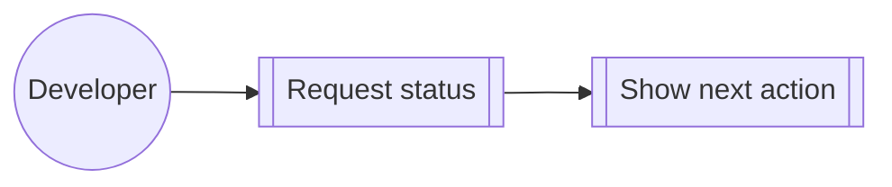

# Use case: inspect-change-state

## Level

!

## Actors

- Developer

## Goal

Understand the current change and artifact state without reading workflow files
by hand.

## Trigger

The developer requests status for a project or change.

## Preconditions

- The project has a valid Givn directory.

## Main flow

1. Resolve the requested change identity.
2. Derive artifact state from the filesystem.
3. Report the next required action.

## Extensions

- Unsafe identities are rejected without reading outside the project.

## Rules

- Skipped artifacts are visible as intentionally skipped.
- Uppercase and lowercase completed checkboxes count equally.

## Examples

- A developer sees task progress and the next workflow step.

## Minimal guarantee

An invalid request does not mutate the project.

## Success guarantee

The developer receives an accurate text or JSON status report.

## Personas

- none

## Capabilities

- validate-change-id-input
- remove-dead-skip-list-code
- fix-uppercase-checkbox-parsing

## Interactions

| Capability | Consumer action | E2E scenario |
|---|---|---|
| validate-change-id-input | reject unsafe status identity | Consumer invokes givn status with a path traversal change id and gets a clear error |
| remove-dead-skip-list-code | inspect skipped status | Consumer runs givn status on a change with skipped artifacts and sees them correctly |
| fix-uppercase-checkbox-parsing | inspect uppercase task status | Consumer runs givn status on a change with uppercase checkboxes |

## Includes

- fragment: support

## Extends

- none

## Out of scope

Mutating change artifacts or completing workflow tasks on the developer's
behalf.

## Diagram

