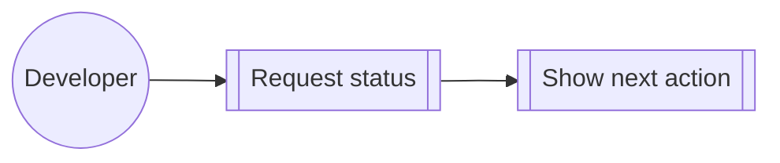

# Use case: inspect-change-state

## Level

!

## Actors

- Developer

## Goal

Understand the current change and artifact state without reading workflow files by hand.

## Trigger

The developer requests the current change state.

## Preconditions

- A Givn project exists.

## Main flow

1. The developer requests the state; the system discovers active and archived changes.
2. The system reads artifact completion and task progress.
3. The system reports the next required workflow action.

## Extensions

- 1: the requested identity is invalid → the request is rejected before any file is read; protects the minimal guarantee.

## Rules

- Skipped artifacts remain visible in status output.
- Uppercase and lowercase completed task markers are equivalent.

## Examples

- A path traversal change identity is rejected before filesystem access.

## Minimal guarantee

Status inspection does not mutate change artifacts.

## Success guarantee

The developer can identify the current stage and next action.

## Personas

- developer--primary-user

## Capabilities

- validate-change-ids
- show-skipped-artifacts
- read-task-progress
- report-change-status

## Interactions

| Capability | Consumer action | E2E scenario |
|---|---|---|
| validate-change-ids | reject unsafe status identity | Consumer invokes givn status with a path traversal change id and gets a clear error |
| show-skipped-artifacts | inspect skipped status | Consumer runs givn status on a change with skipped artifacts and sees them correctly |
| read-task-progress | inspect uppercase task status | Consumer runs givn status on a change with uppercase checkboxes |

## Includes

- fragment: support

## Extends

- none

## Out of scope

Mutating change artifacts or completing workflow tasks on the developer's behalf.

## Diagram

<!-- givn:base-sha256:27af744e5987beb3a4719b32c402184a95b5e7c01ede0117db4885c31b160a99 -->
