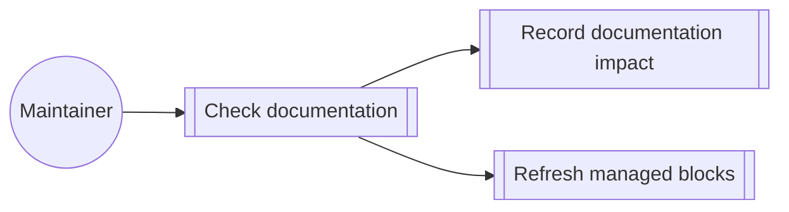

# Use case: keep-documentation-current

## Level

!

## Actors

- Project maintainer
- Supporting: Authoring agent

## Goal

Keep the project's documentation complete and current.

## Trigger

The maintainer checks project documentation.

## Preconditions

- The project configuration is available.
- The readme addon is enabled.

## Main flow

1. The maintainer inspects the documentation; the system reports unfinished sections and damaged managed blocks.
2. The maintainer records the documentation impact of a change; the system gates the review on the recorded decision.
3. The system refreshes the managed development block when a change archives.

## Extensions

- 1: a required section is still a placeholder → completion is blocked and the section is named; protects the success guarantee.
- 1: a managed block is damaged → the check names the block; protects the success guarantee.

## Rules

- Open documentation placeholders block completion.
- A recorded documentation impact decision passes the review.
- Managed blocks are refreshed from canonical sources, never hand-edited.

## Examples

- Archiving refreshes the development block.

## Minimal guarantee

The documentation check never rewrites user-authored prose.

## Success guarantee

The project's documentation has no unfinished required section and its managed blocks are current.

## Personas

- developer--primary-user
- givn-maintainer--owner

## Capabilities

- readme-enforcement

## Interactions

| Capability | Consumer action | E2E scenario |
|---|---|---|
| readme-enforcement | scaffold README placeholders | Scaffolding marks the unfilled sections |
| readme-enforcement | check a complete README | The check passes on a complete README |
| readme-enforcement | archive and refresh documentation | Archiving refreshes the development block |
| readme-enforcement | record documentation impact | A recorded impact decision passes the review |
| readme-enforcement | request unfinished README guidance | Instructions surface an unfinished README |

## Includes

- fragment: support

## Extends

- none

## Out of scope

Writing product documentation for a change; publishing releases (`publish-a-release`).

## Diagram

