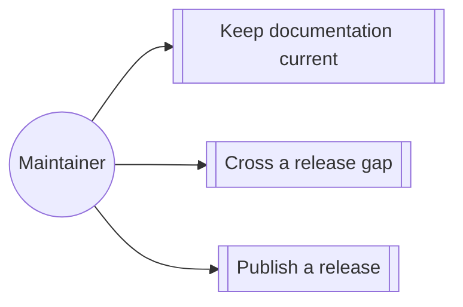

# Use case: maintain-project

## Level

+

## Actors

- Project maintainer

## Goal

Keep a project's documentation and managed files current across releases.

## Trigger

The maintainer maintains the project or prepares a release.

## Preconditions

- The project configuration and repository state are available.

## Main flow

1. Keep the documentation current.
2. Cross release gaps with reviewable upgrade and migration revisions.
3. Publish releases with truthful metadata and a migration route.

## Extensions

- none

## Rules

- Coverage is the union of `keep-documentation-current`, `upgrade-a-project`, and `publish-a-release`.

## Examples

- A maintainer refreshes the documentation, crosses a release gap, and publishes a release.

## Minimal guarantee

The project is protected from partial automatic changes.

## Success guarantee

The project's documentation and managed files are current, and every release crossing is reviewable.

## Personas

- developer--primary-user
- givn-maintainer--owner

## Capabilities

- none

## Interactions

- none

## Includes

- usecase: keep-documentation-current
- usecase: upgrade-a-project
- usecase: publish-a-release

## Extends

- none

## Out of scope

Changing product specifications as part of routine project maintenance.

## Diagram

