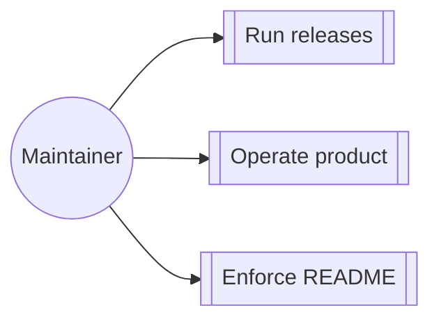

# Group: maintenance

## Actor

A maintainer operating the product over its lifetime.

## Goal

Keep the product running, current, and well-documented — release
checklists, the run command, execution wiring, and README enforcement.

## Main flow

1. Execute release steps with strict overrides where required
   (release-0-3-0).
2. Start and observe the product (`givn run`).
3. Enforce README completeness and managed blocks.

## Interactions

- run release acceptance steps for a release change
- start the product with `givn run` and observe readiness
- enforce README completeness and refresh managed blocks

## Includes

- support (readme-coverage-badge)

## Extends

- verification (README gates are deterministic checks)

## Out of scope

- Spec corpus changes; maintenance operates on the product, not the specs.

## Diagram

