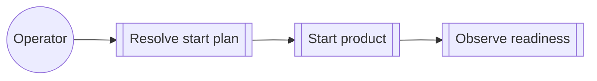

# Use case: operate-product

## Level

!

## Actors

- Product operator

## Goal

Run the declared product to a reported outcome.

## Trigger

The operator starts the declared product.

## Preconditions

- The project declares a valid product start plan.

## Main flow

1. The operator starts the declared product; the system resolves the declared start plan.
2. The system starts the product.
3. The system waits for the declared readiness.
4. The system reports the product outcome.

## Extensions

- 1: the declaration is invalid → the product is not started and the declaration is named; protects the minimal guarantee.

## Rules

- A server has exactly one port source.
- Readiness is confirmed through the declared boundary.

## Examples

- An operator starts a server and receives a ready line.

## Minimal guarantee

The product is not reported ready when its declaration is invalid or it fails to start.

## Success guarantee

The operator observes the product's lifecycle outcome.

## Personas

- developer--primary-user

## Capabilities

- declare-the-product-start
- start-the-declared-product

## Interactions

| Capability | Consumer action | E2E scenario |
|---|---|---|
| start-the-declared-product | start a server | The started server reports readiness and forwards a clean exit |
| start-the-declared-product | hand over a caller port | A caller-provided port is handed to the product |
| start-the-declared-product | print the start plan | Print mode emits the start plan without starting |
| start-the-declared-product | interrupt a started product | An interrupt stops the started product |
| declare-the-product-start | scaffold a run declaration | Scaffolding ships an unconfigured run declaration |
| declare-the-product-start | check an unconfigured declaration | The review check reports an unconfigured run declaration |
| declare-the-product-start | archive a configured project | Archive passes once the run declaration is complete |
| declare-the-product-start | upgrade a project declaration | Upgrade backfills the run declaration into an existing project |
| declare-the-product-start | inspect a damaged README block | The check names a damaged run managed block |
| declare-the-product-start | invoke the sentinel command | The sentinel start command prints setup guidance |

## Includes

- fragment: support

## Extends

- none

## Out of scope

Choosing a product architecture or inventing a start command from repository content.

## Diagram

<!-- givn:base-sha256:be5fb2589446c883a1b236e8adf9e24075084dc83ac9ddd779c62167f1ec9056 -->
