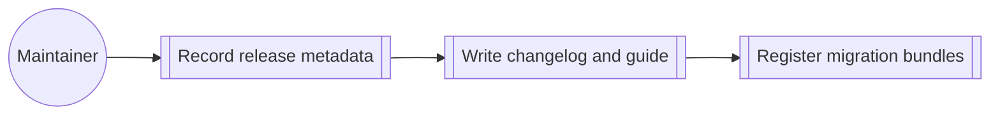

# Use case: publish-a-release

## Level

!

## Actors

- Project maintainer

## Goal

Publish a Givn release with truthful metadata and a migration route.

## Trigger

The maintainer prepares a release.

## Preconditions

- The release version and its user-visible changes are known.

## Main flow

1. The maintainer records the release metadata; the system reports the version from the package and keeps the default feature set empty.
2. The maintainer writes the changelog and the migration guide; the system keeps the guide an ordered prompt sequence.
3. The maintainer registers the migration bundles; the system validates that every bundle has a source, target, order, proposal, and design.

## Extensions

- 2: a guide prompt omits the project evidence it must inspect → the review blocks the release; protects the success guarantee.
- 3: a bundle is missing a field → the catalog validation fails and names the bundle; protects the success guarantee.

## Rules

- The reported version matches the package version.
- The default feature set stays empty; no optional model features are declared.
- Every migration bundle declares a source, target, order, proposal asset, and design asset.
- The migration guide is an executable prompt sequence that forbids automatic changes to domain specifications and architecture decisions.

## Examples

- A maintainer publishes 0.3.0 with a changelog entry and the 0.2.0 to 0.3.0 guide.

## Minimal guarantee

A release with incomplete metadata is never presented as complete.

## Success guarantee

The release describes itself truthfully and carries a complete migration route.

## Personas

- givn-maintainer--owner

## Capabilities

- describe-the-release

## Interactions

- none

## Includes

- fragment: support

## Extends

- none

## Out of scope

Publishing consumer projects; crossing a release gap in a project (`upgrade-a-project`).

## Diagram

