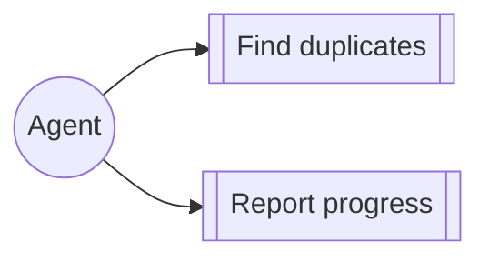

# Group: spec-discovery

## Actor

An authoring agent looking for existing scenarios before writing new ones.

## Goal

Make the permanent corpus discoverable deterministically — duplicates,
progress reporting, and strict-model overrides — with no embedding model
in the loop.

## Main flow

1. Search for existing scenarios that cover the intended behaviour.
2. Report duplicates and corpus progress (`givn spec duplicates`,
   progress output).
3. Apply release-strict overrides where configured.

## Interactions

- report duplicate and related permanent scenarios
- report spec corpus progress for a change
- override strict release models where a release requires it

## Includes

- support (spec-explore-change, spec-explore-permanent)

## Extends

- none

## Out of scope

- Embedding-based search ranking (retired).
- Merging deltas (archival).

## Diagram

