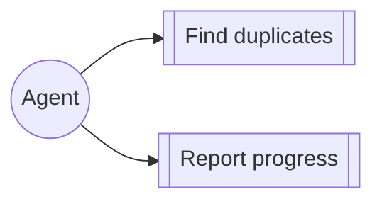

# Group: spec-discovery

## Actor

An authoring agent looking for existing scenarios before writing new ones.

## Goal

Make the permanent corpus discoverable deterministically — duplicates,
progress reporting, and strict-model overrides — with no embedding model
in the loop.

## Main flow

1. Search for existing scenarios that cover the intended behaviour.
2. Report duplicates and corpus progress (`givn spec duplicates`,
   progress output).
3. Apply release-strict overrides where configured.

## Interactions

- An installed givn refuses a request for simulated embedder output
- An installed givn honours a model-location request that still uses the real models
- An installed givn announces each refused request by name
- An installed givn keeps the review gate closed when model evidence is unavailable
- Maintainer inspects the complete permanent scenario audit
- A cold-cache index build logs every phase of the E5 model download and scenario processing
- The JSON duplicate audit keeps the report channel free of progress wording
- The review run logs the reranker and NLI downloads as they happen
- Searching a cold E5 cache logs the model download before printing ranked results

## Includes

- support (spec-explore-change, spec-explore-permanent)

## Extends

- none

## Out of scope

- Embedding-based search ranking (retired).
- Merging deltas (archival).

## Diagram

