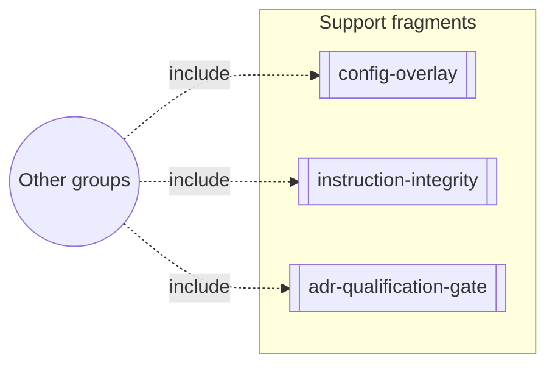

# Group: support

## Actor

Any givn actor (developer, agent, reviewer) whose workflow depends on a
cross-cutting capability.

## Goal

House the `«include»`-fragment capabilities — cross-cutting concerns with
no dominant command surface of their own: project configuration, guidance
integrity, license, coverage tooling, domain modelling, and repo
ownership. Other groups include these capabilities rather than owning
them.

## Main flow

1. A capability in another group needs configuration, guidance, or
   infrastructure.
2. It includes the relevant support capability rather than duplicating
   the behaviour.

## Interactions

- include configuration overlay behaviour when customising givn
- include instruction integrity when rendering guidance
- include ADR, license, domain-skill, and repository-ownership fixtures
  where the workflow requires them

## Includes

- none

## Extends

- every other group (support capabilities are included, not invoked
  directly)

## Out of scope

- Any capability with a dominant command surface (it belongs in that
  command's group).

## Diagram

