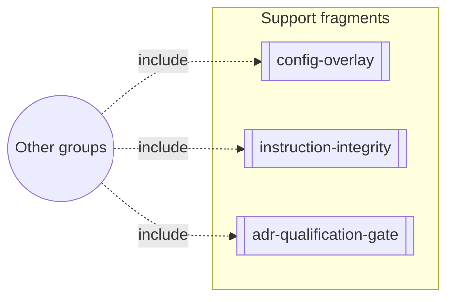

# Group: support

## Actor

Any givn actor (developer, agent, reviewer) whose workflow depends on a
cross-cutting capability.

## Goal

House the `«include»`-fragment capabilities — cross-cutting concerns with
no dominant command surface of their own: project configuration, guidance
integrity, license, coverage tooling, domain modelling, and repo
ownership. Other groups include these capabilities rather than owning
them.

## Main flow

1. A capability in another group needs configuration, guidance, or
   infrastructure.
2. It includes the relevant support capability rather than duplicating
   the behaviour.

## Interactions

- An author requests the strict ADR guidance through the Givn CLI
- A reviewer requests design-review guidance through the Givn CLI
- Arc42-enabled review instructions require conformance evidence
- The review template includes the Arc42 conformance block
- Generated review guidance stays aligned after skill sync
- Coverage-enabled project receives a complete README coverage example
- An initialized project documents reusable test and coverage scripts
- Archiving publishes line and branch badges from the merged report
- An agent synchronizes skills and the domain skill is routed
- An agent requests next-step guidance and is routed to the domain skill
- An agent requests the specs guidance and is routed to the domain skill
- An agent requests the design guidance and is routed to the domain skill
- An author requests the technical E2E design guidance
- An agent requests machine-readable artifact guidance
- A reviewer requests disposition-aware review guidance
- Coverage-enabled project is guided to place the coverage badge directly after the README title
- Repository-wide review accepts explicit overlap dispositions
- Archive publishes consolidated permanent specifications
- Pre-merge archive failure preserves the permanent specification tree
- Synchronized guidance explains how to resolve the deterministic gates
- Change-aware file exploration finds permanent and active change candidates
- Change-aware JSON exploration labels candidate sources
- File exploration finds a semantically similar permanent scenario
- Stdin exploration returns the same candidates as file exploration
- JSON exploration reports query index and candidate fields
- A consumer synchronizes skills and the generated guidance omits disabled-addon sections
- A consumer enables the addons a generated section needs and the guidance gains it
- A consumer disables an addon the domain-modeling skill needs and the generated domain skill is removed
- A consumer synchronizes skills and every agent target receives the ideation facilitation skill

## Includes

- none

## Extends

- none

(Use cases that include support record the relationship on their own
side; support holds no outgoing dependency.)

## Out of scope

- Any capability with a dominant command surface (it belongs in that
  command's group).

## Diagram

