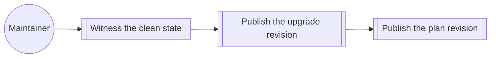

# Use case: upgrade-a-project

## Level

!

## Actors

- Project maintainer
- Supporting: Authoring agent

## Goal

Cross a release gap with reviewable upgrade and migration revisions.

## Trigger

The maintainer upgrades Givn.

## Preconditions

- The project configuration and repository state are available.
- The active version-control system is selected and its clean-state witness is available.

## Main flow

1. The maintainer requests an upgrade; the system witnesses the clean state and refuses before any write when the project is dirty or has no version-control system.
2. The system synchronizes the managed scaffold and publishes the allowlist-only upgrade revision.
3. When the upgrade carries migration requirements, the system publishes the plan revision recording the upgrade revision.
4. The system names any command a release removed instead of leaving a silent gap.

## Extensions

- 1: uncommitted changes exist → the upgrade is refused before any write, naming the dirty paths; protects the minimal guarantee.
- 1: no version-control system is selected → the upgrade is refused by name before any write; protects the minimal guarantee.
- 2: the project is already current → no revision is published and the state is reported; protects the success guarantee.
- 3: a plan for the gap already exists → the existing proposal and design are preserved and reported; protects the success guarantee.
- 4: a consumer invokes a command the release removed → the system reports the command as unavailable; protects the success guarantee.

## Rules

- Historical migration evidence remains reviewable.
- Ignored managed paths are force-staged only through the calculated allowlist, on both supported systems.
- The plan revision records the upgrade revision identifier.
- The managed upgrade and migration bundles run on both supported systems with the same guarantees; a migration-free upgrade publishes exactly one revision and no plan revision.

## Examples

- Git: a clean project without migration requirements receives one allowlist-only upgrade revision `a1b2c3d4e5f6...`.
- Git migration: a project crossing a version gap receives the upgrade revision and then a plan revision recording it.
- Fossil: the same project receives the allowlist-only check-in `c8d9e0f1a2b3...`; a migration-bearing upgrade adds the plan check-in.
- Dirty project: `givn upgrade` refuses before writing, naming the dirty paths.
- No SCM: `givn upgrade` refuses by name before writing.

## Minimal guarantee

The project is protected from partial automatic migration.

## Success guarantee

The upgrade work is explicit in the project's history, and any migration it carries is reviewable.

## Personas

- developer--primary-user
- givn-maintainer--owner

## Capabilities

- apply-a-managed-upgrade

## Interactions

| Capability | Consumer action | E2E scenario |
|---|---|---|
| apply-a-managed-upgrade | plan a release migration | A clean 0.2.0 project receives a reviewable aggregate migration plan |
| apply-a-managed-upgrade | run a managed upgrade | A clean project without migration requirements receives one managed upgrade commit |
| apply-a-managed-upgrade | upgrade a Fossil project | A clean Fossil project receives the same managed upgrade revision shape |
| apply-a-managed-upgrade | invoke a retired engine command | A consumer invoking a retired engine command is told it does not exist |
| apply-a-managed-upgrade | archive a maintenance migration | A completed maintenance migration can be archived without a product specification |

## Includes

- fragment: support

## Extends

- none

## Out of scope

Changing product specifications during an upgrade; publishing releases (`publish-a-release`).

## Diagram

