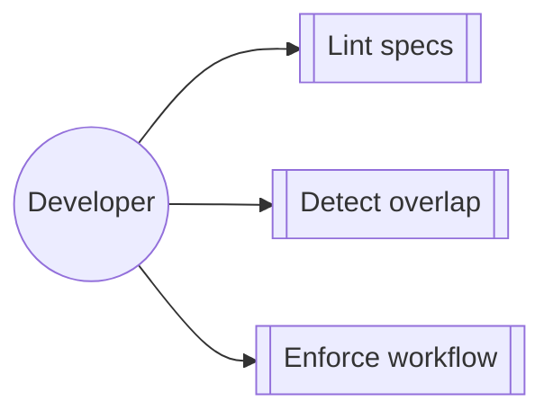

# Group: verification

## Actor

A developer (or agent) checking that a change's spec and implementation
are consistent, complete, and free of overlap.

## Goal

Run every deterministic gate over a change's artifacts — lint, overlap
detection, workflow enforcement, and input validation — so only sound
changes reach review and archive.

## Main flow

1. Lint the active tree or a change delta (`givn lint`).
2. Scan for overlapping scenarios and shape matches (spec-overlap-gates).
3. Enforce the workflow contract (change dirs, artifact ids, run
   declarations).

## Interactions

- lint feature files tree-wide or scoped to a change
- scan the tree for scenario overlap findings
- enforce change-directory dedup rules and workflow enforcement
- validate artifact id input before gates run

## Includes

- support (config-overlay for gate configuration)

## Extends

- archival (verification gates are the pre-archive line of defence)

## Out of scope

- Semantic similarity scoring (retired).
- Running the test suite itself (run/maintenance).

## Diagram

