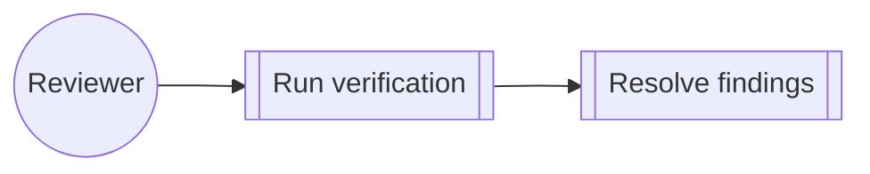

# Use case: verify-change

## Level

!

## Actors

- Developer
- Reviewer

## Goal

Check that a change is structurally valid, complete, and free of unresolved
overlap before implementation or archive.

## Trigger

The developer or reviewer runs a Givn check.

## Preconditions

- The change artifacts and active specifications are available.

## Main flow

1. Parse the active features and workflow artifacts.
2. Detect duplicates, overlap, and invalid references.
3. Report blocking and advisory findings.

## Extensions

- A missing review disposition blocks completion.

## Rules

- Parse failures outrank other lint findings.
- Every blocking overlap has an explicit disposition.

## Examples

- A duplicate title is reported as a hard error in JSON and text output.

## Minimal guarantee

An invalid change cannot pass the verification gate.

## Success guarantee

The reviewer receives complete, machine-readable verification evidence.

## Personas

- none

## Capabilities

- validate-artifact-id-input
- spec-overlap-gates
- review-disposition-gates
- deduplicate-change-dir-detection

## Interactions

| Capability | Consumer action | E2E scenario |
|---|---|---|
| validate-artifact-id-input | check an unknown artifact | Consumer invokes givn check with an unknown artifact and gets a helpful error |
| spec-overlap-gates | detect a duplicate title | A duplicate title across two permanent spec files is a hard error |
| spec-overlap-gates | inspect duplicate JSON | The json output reports duplicate-title findings machine-readably |
| review-disposition-gates | pass a disposed review | Review passes when every shape match is disposed and reports the net-delta receipt |
| deduplicate-change-dir-detection | run integrity in a change | Consumer runs the integrity check on a change inside givn/changes and the correct directory is detected |
| deduplicate-change-dir-detection | reject placeholder commit evidence | Integrity check detects a placeholder COMMIT hash in tasks.md and fails |

## Includes

- fragment: support

## Extends

- none

## Out of scope

Running the product test suite or changing implementation code.

## Diagram

