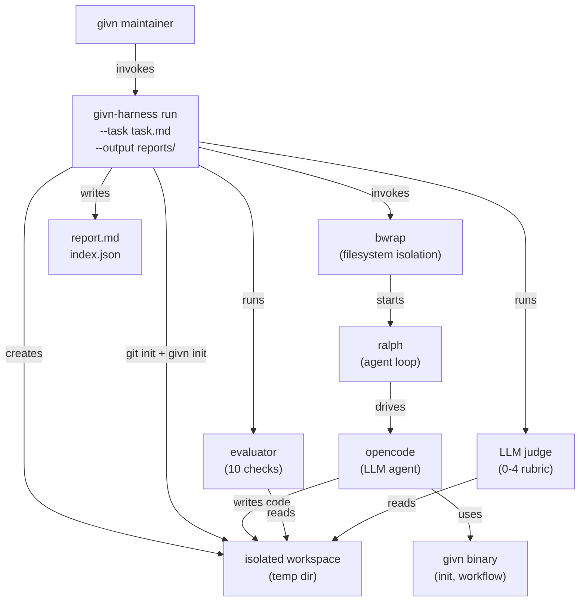

# Design: bubblewrap-sandbox

## Dependencies

This change depends on `givn-test-harness` being archived first. The sandbox delta
modifies scenarios that currently exist only in the unarchived `givn-test-harness`
change. The givn archive process requires a permanent spec to modify — that spec
is created when `givn-test-harness` is archived.

## Technology decisions

| Component | Choice | Version (verified) |
|---|---|---|
| Sandbox | bubblewrap (`bwrap`) | 0.11.0 (installed at `/usr/bin/bwrap`; checked via `bwrap --version` on 2026-07-28) |
| Resource limits | systemd-run (`--scope`) | Fallback: no resource limits, filesystem isolation only |
| Removed dependency | sandlock | No longer imported or required |
| Removed feature | learn-then-confine profiles | No profile mode; paths are declared statically |
| Removed CLI flag | `--profile` | Removed from CLI |

All other technology choices unchanged from the `givn-test-harness` design.

## Architecture impact

### Modified module: `sandbox.py`

Replace sandlock-based sandbox construction with bubblewrap subprocess construction.
The module's public API changes:

```python
# Before (sandlock):
def check_sandlock() -> bool
def _base_sandbox_args(workspace_path) -> dict
def _profiles_dir() -> Path
def create_sandbox(workspace_path, profile_name=None) -> dict
def _deduplicate_paths(paths) -> list[str]

# After (bubblewrap):
def check_bubblewrap() -> bool           # was check_sandlock
def build_bwrap_cmd(workspace_path) -> list[str]  # builds bwrap args
def _deduplicate_paths(paths) -> list[str]        # unchanged
```

The `create_sandbox` function and all profile-related logic is removed.
The `--profile` CLI option and `profile_info` dict passing through `runner.py`
are removed.

### Modified module: `runner.py`

The agent execution flow changes:

Before:
```
run_agent -> _run_with_profile (sandbox.run / sandbox.run_with_handlers)
         -> _run_without_sandbox (subprocess.Popen)
```

After:
```
run_agent -> _run_with_bwrap (subprocess.Popen wrapping bwrap)
         -> _run_without_sandbox (subprocess.Popen, fallback)
```

`_run_with_bwrap` constructs the bwrap command, prepends it to the agent command,
and runs the composite command via subprocess. No sandlock `Result` object —
the subprocess exit code and capture behavior are standard Python.

### Removed artifact: `_run_with_profile`

The `_run_with_profile` function and its three modes (learn, enforce, basic)
are removed. The harness no longer distinguishes between profile modes.

### Modified module: `cli.py`

The `--profile` option is removed from the `run` command.

### Modified file: `pyproject.toml`

The `sandlock` dependency (git source) is removed from `[tool.uv.sources]` and
`[project.dependencies]`.

### Removed directory: `profiles/`

The `profiles/` directory and all learn-then-confine `.toml` profile files
are no longer used. Existing profiles are not deleted (they are not committed
to the repository).



## Bubblewrap sandbox construction

### Filesystem layout

The sandbox mounts the host filesystem under a namespace where only
whitelisted paths are visible. The workspace is bind-mounted writable;
system paths are bind-mounted read-only.

```python
def build_bwrap_cmd(workspace_path: str) -> list[str]:
    """Build the bwrap command prefix for agent execution."""
    home = os.path.expanduser("~")
    cmd = [
        "bwrap",
        "--unshare-all",
        "--share-net",           # allow all outbound network
        "--new-session",
        "--die-with-parent",
        "--as-pid-1",
        "--chdir", workspace_path,
        # Read-only system mounts
        "--ro-bind", "/usr", "/usr",
        "--ro-bind", "/bin", "/bin",
        "--ro-bind-try", "/lib", "/lib",
        "--ro-bind-try", "/lib64", "/lib64",
        "--ro-bind", "/etc", "/etc",
        # Read-only user paths (tight whitelist — no .ssh, no other private dirs)
        "--ro-bind-try", os.path.join(home, "bin"), os.path.join(home, "bin"),
        "--ro-bind-try", os.path.join(home, ".cargo"), os.path.join(home, ".cargo"),
        "--ro-bind-try", os.path.join(home, ".opencode"), os.path.join(home, ".opencode"),
        "--ro-bind-try", os.path.join(home, ".gitconfig"), os.path.join(home, ".gitconfig"),
        "--ro-bind-try", os.path.join(home, ".config", "opencode"), os.path.join(home, ".config", "opencode"),
        # Writable workspace
        "--bind", workspace_path, workspace_path,
        # Writable temp and cache dirs
        "--bind", "/tmp", "/tmp",
        "--bind-try", os.path.join(home, ".npm"), os.path.join(home, ".npm"),
        "--bind-try", os.path.join(home, ".cache"), os.path.join(home, ".cache"),
        "--bind-try", os.path.join(home, ".bun"), os.path.join(home, ".bun"),
        "--bind-try", os.path.join(home, ".local"), os.path.join(home, ".local"),
        # Runtime pseudo-filesystems
        "--proc", "/proc",
        "--dev", "/dev",
        "--tmpfs", "/run",
        "--tmpfs", "/var/tmp",
    ]
    return cmd
```

`--bind-try` silently skips paths that do not exist — the agent may or may
not use these cache directories, and the harness should not fail if a given
path is absent on the host.

### Write isolation

The workspace is bind-mounted directly (not COW overlay). This means agent
writes are immediately visible on the host filesystem. The upside: no commit/
abort dance, no user-notify bottleneck. The downside: a malicious agent could
write anywhere in the workspace during execution. For a test harness where the
workspace is a throwaway temp directory, this is acceptable.

### Resource limits

Bubblewrap does not natively enforce memory, process count, or disk quotas.
The harness layers `systemd-run --user --scope` as an optional wrapper:

```python
def _wrap_with_limits(cmd: list[str]) -> list[str]:
    """Wrap command with systemd-run for resource limits, if available."""
    if shutil.which("systemd-run") is None:
        return cmd  # no resource limits enforced
    return [
        "systemd-run", "--user", "--scope",
        "-p", "MemoryMax=16G",
        "-p", "TasksMax=256",
        "--", *cmd,
    ]
```

If `systemd-run` is not available, the harness runs bubblewrap directly
without resource limits. The report notes this with a `resource_limits`
field (`"systemd"` or `"none"`).

Disk limits are not enforced. The workspace temp directory is on the host
filesystem and shares its available space.

### stdout/stderr capture

The `subprocess.Popen` with `stdout=PIPE, stderr=PIPE` captures output from
the bwrap process, which forwards the agent's stdout/stderr. This is identical
to the existing `_run_without_sandbox` path.

### Availability check

```python
def check_bubblewrap() -> bool:
    """Return True if bubblewrap is available and usable (with user namespaces)."""
    if os.environ.get("GIVN_HARNESS_NO_SANDLOCK") == "1":
        return False
    if shutil.which("bwrap") is None:
        return False
    try:
        subprocess.run(
            ["bwrap", "--unshare-user", "--", "true"],
            capture_output=True, timeout=5, check=True,
        )
        return True
    except (subprocess.CalledProcessError, subprocess.TimeoutExpired):
        return False
```

For backward compatibility with the env var used to disable sandboxing,
the `GIVN_HARNESS_NO_SANDLOCK` env var is retained (same name, same
semantics). A future change could rename it to `GIVN_HARNESS_NO_SANDBOX`.

### Execution flow

```
run_agent(workspace_path, ralph_bin, ...)
  |
  +-- check_bubblewrap()?
  |     |
|     +-- True: _run_with_bwrap(cmd, ...)
    |     |         1. bwrap_cmd = build_bwrap_cmd(workspace_path)
    |     |         2. full_cmd = _wrap_with_limits([*bwrap_cmd, "--", *agent_cmd])
    |     |         3. subprocess.Popen(full_cmd, ...)
  |     |         4. capture stdout/stderr, handle timeout/SIGINT
  |     |         5. return (stdout, termination)
  |     |
  |     +-- False: _run_without_sandbox(cmd, ...)  [unchanged]
  |
  +-- No profile_info dict (removed entirely)
```

### Termination detection

Unlike sandlock's `ExitReason` enum (`EXITED`, `SIGNALED`, `KILLED`, `TIMEOUT`),
bwrap reports exit status through standard subprocess mechanisms. The
`_run_with_bwrap` function distinguishes three outcomes:

| Condition | termination | detail |
|---|---|---|
| Timeout expired (`proc.wait(timeout=timeout)` raises TimeoutExpired) | `"timeout"` | Agent SIGKILL'd by harness, bwrap cleans up child namespace |
| bwrap exits non-zero (exit code != 0) | `"interrupted"` | stderr inspected: if bwrap error text ("bwrap:") found, map to sandbox failure; otherwise map to agent error |
| bwrap exits zero | `"completed"` | Agent stdout captured as usual |

The distinction between "bwrap failed to start" and "agent exited with non-zero"
is determined by inspecting stderr for bwrap diagnostic prefixes (e.g.
`"bwrap: Can't create user namespace"`, `"bwrap: Can't find source path"`).
This is a heuristic — a future iteration may add a dedicated sandbox failure
termination reason.

## Data model changes

### Modified: `sandbox.py` return types

The `create_sandbox` function and `profile_info` dict are removed.
`runner.py` no longer receives or passes a `profile_info` argument.

### New: sandbox status fields in report

The `sandboxed` boolean field becomes `sandbox` (string enum):

| `sandbox` value | Meaning |
|---|---|
| `"bwrap"` | bubblewrap sandbox was used |
| `"none"` | no sandbox was available, ran unsandboxed |

A separate `resource_limits` field reports the systemd-run layer:

| `resource_limits` value | Meaning |
|---|---|
| `"systemd"` | MemoryMax=16G, TasksMax=256 enforced via systemd-run |
| `"none"` | systemd-run not available, no resource limits |

### Removed: `--profile` CLI flag

The `--profile TEXT` option is removed from cli.py. Existing invocations
that pass `--profile` will receive a click error (unrecognized option).

## Step definition locations

Same as the existing harness: `tests/features/harness/steps/test_harness_steps.py`.

The `sandbox` capability has its own step file at:
`tests/features/sandbox/steps/sandbox_steps.py`

Step definitions for the new bubblewrap-specific scenarios are added there.
Modified scenarios (`@givn.modified`) update the existing step file.

## Test runner

### `verify.command`

```yaml
verify:
  command: "uv run behave tests/features/ --no-capture"
```

Same as the existing design. behave discovers `.feature` files under
`tests/features/` and step definitions under adjacent `steps/` directories.

### Strict-mode config

Same as the existing design: step-body discipline with `raise
NotImplementedError(...)` stubs. The `scripts/check-step-bodies.sh`
mechanical audit verifies no empty step bodies.

### Single-scenario run command

```sh
uv run behave tests/features/ --no-capture -n "<scenario title>"
```

### RED-phase scaffolding

1. Add `tests/features/sandbox/sandbox.feature` symlink pointing to the delta
   spec at `givn/changes/bubblewrap-sandbox/specs/sandbox/sandbox.feature`.
2. Create `tests/features/sandbox/steps/sandbox_steps.py` with
   `NotImplementedError` stubs for every step.
3. Run `uv run behave tests/features/ --no-capture -n "<scenario>"` to verify
   RED (fails with NotImplementedError).
4. Implement steps one scenario at a time.
5. Modified scenarios in the existing `test-harness` feature file update the
   corresponding step definitions in `test_harness_steps.py`.

## E2E smoke test infrastructure

### Interface type

**CLI** — same as the existing harness. The real interface is the
`givn-harness` subprocess invocation.

### E2E runner command

```yaml
verify:
  e2e_command: "uv run behave tests/features/ --no-capture --tags=@e2e"
```

### E2E step location

Same file as unit steps for each capability:
- `tests/features/harness/steps/test_harness_steps.py` (modified scenarios)
- `tests/features/sandbox/steps/sandbox_steps.py` (new scenarios)

### Local test infrastructure

Same as the existing design. Workspace root at `/tmp/givn-harness-workspaces/`.
No external services needed. The bubblewrap sandbox requires `/usr/bin/bwrap`
and user namespace support (kernel 3.8+, present on the host's 6.12 kernel).

### Framework choice

**behave** — same as the existing design.

## Local runnability & digital twins

### Local run command

```sh
cd harness && uv run givn-harness run --task tasks/shopping-list.md --output reports/
```

No `--profile` flag. No docker-compose, no external services.

### Digital twin per external dependency

| External dependency | Digital twin |
|---|---|
| opencode (LLM API) | None — the LLM is the system under test |
| npm registry | None — default-allow network |
| pip registry | None — default-allow network |
| bubblewrap (`/usr/bin/bwrap`) | None — host binary, kernel namespace support required |

### Foreseeable interface obstacles

| Obstacle | Fix |
|---|---|
| User namespaces disabled via kernel parameter (`kernel.unprivileged_userns_clone=0`) | `check_bubblewrap()` runs `bwrap --unshare-user -- true` to test namespace availability. If the kernel denies user namespaces, bwrap exits non-zero and `check_bubblewrap()` returns False. The harness falls back to unsandboxed mode. |
| Agent needs `/sys` for hardware detection (e.g., GPU for Playwright) | Mount `/sys` read-only: `--ro-bind /sys /sys`. Added only if needed; Playwright headless mode works without GPU via `/dev/dri`. |
| Agent spawns a dev server that must bind to a port | `--share-net` shares the host network namespace. Ports bound inside the sandbox are visible on the host. No port remapping needed — the sandbox IS the host's network namespace. |
| Agent writes to `~/.cache` or `~/.npm` which don't exist on a fresh host | `--bind-try` silently skips non-existent paths. The agent's package managers (npm, pip, cargo) create cache directories inside the sandbox on the bind-mounted tmpfs at `/tmp` if the home cache dirs are absent. |
| Agent opens a lot of files (node.js file watchers, cargo build, etc.) | Bubblewrap does not enforce `RLIMIT_NOFILE`. The host's limit applies. On a typical system this is 1024-65536, which is sufficient. |
| `bwrap` is not installed | `check_bubblewrap()` returns False. The harness falls back to unsandboxed execution with a warning. |

## Interaction Coverage Matrix

| Inventory entry | @e2e scenario title | Real interface | Driving mechanism |
|---|---|---|---|
| Run the harness with a task description | User runs the harness end-to-end and observes a complete autoresearch loop | CLI | `subprocess.run(["givn-harness", "run", "--task", "tasks/shopping-list.md", "--output", "reports/"])` — unchanged |
| E2E sandbox smoke test | E2E smoke test for bubblewrap sandbox with real agent | CLI | `subprocess.run(["givn-harness", "run", "--task", "tasks/trivial.md", "--output", "reports/"])` — verifies the sandboxed flag is true and workspace changes are visible |

## CLI design changes

```
Usage: givn-harness run [OPTIONS]

  Run an autoresearch loop against a givn task.

Options:
  --task PATH             Task prompt file (required)
  --output DIR            Report output directory (default: reports/)
  --workspace-root DIR    Temp workspace root (default: /tmp/givn-harness-workspaces/)
  --timeout INTEGER       Max agent execution time in seconds
  --max-iterations INTEGER  Max ralph iterations
  --ralph-bin PATH        Path to ralph binary (default: /usr/local/bin/ralph)
  --help                  Show this message and exit.
```

Removed from the `givn-test-harness` design:
- `--profile TEXT` — removed (no learn-then-confine mode)
- `--givn-bin PATH` — removed (was not implemented)
- `--no-sandbox` — removed (env var `GIVN_HARNESS_NO_SANDLOCK=1` serves the same purpose)

## Deviations & tradeoffs

1. **No COW filesystem.** Bubblewrap uses bind mounts, not copy-on-write. The
   agent writes directly to the workspace directory. The upside: no
   per-syscall interception, no user-notify bottleneck, no intermittent hangs.
   The downside: the workspace is modified in-place during execution, not
   after. For a test harness where the workspace is always a fresh temp
   directory, in-place modification is harmless.

2. **No learn-then-confine.** The filesystem whitelist is declared statically
   in `build_bwrap_cmd` rather than learned at runtime. This is simpler but
   requires the harness maintainer to keep the path list up to date if the
   agent's workload changes. The risk is low: the agent always needs `/usr`,
   `/bin`, `/lib`, `/lib64`, `/etc`, home, workspace, and temp dirs.

3. **Resource limits are optional.** Bubblewrap has no native cgroup
   integration. The harness uses `systemd-run --scope` when available; when
   not, it runs without resource limits. In practice, the host system's
   OOM killer and PID limit provide a coarse safety net.

4. **No port remapping.** The `port_remap` feature from sandlock (transparent
   TCP port virtualization) is removed. The harness shares the host network
   namespace via `--share-net`. Port conflicts between concurrent harness runs
   are possible but the MVP runs one harness instance at a time.

5. **GIVN_HARNESS_NO_SANDLOCK env var retained.** Same name, same semantics —
   setting it to `1` disables the sandbox entirely. Renaming to
   `GIVN_HARNESS_NO_SANDBOX` is deferred to avoid breaking existing scripts
   that set the old name.