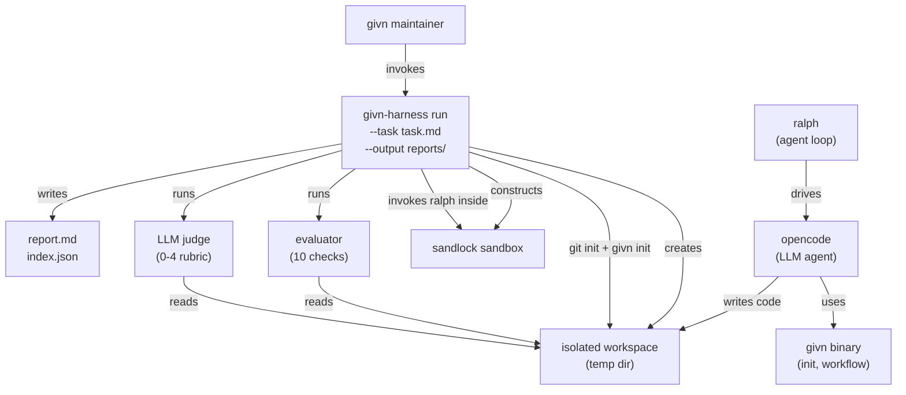

# Design: givn-test-harness

## Technology decisions

| Component | Choice | Version (verified) |
|---|---|---|
| Language | Python | 3.13+ (3.13.5 available on host; uv resolves at setup) |
| Package manager | uv | 0.6.6 (installed at `/home/sebastian/.local/bin/uv`) |
| CLI framework | click | 8.4.x (latest as of design; checked via `pip3 index versions click` on 2026-07-27) |
| Test runner (Gherkin) | behave | 1.3.x (latest 1.3.3; checked via `pip3 index versions behave` on 2026-07-27) |
| Sandbox | sandlock | Git source: `https://github.com/multikernel/sandlock` at SHA `6a4ec66`, subdirectory `python/`. `SANDLOCK_PATH` env var as fallback. |
| Agent loop | ralph | System binary at `/usr/local/bin/ralph` (resolved at runtime; no version pin — harness invokes what is installed) |
| LLM (opencode) | litellm/deepseek-v4-flash-sovereign | Configured in `~/.config/opencode/opencode.jsonc` (read by opencode, not the harness) |
| LLM judge | opencode via litellm | Same provider as the agent; judge invocations are separate opencode calls with a judge prompt |

## Architecture impact

### New component: `harness/`

A Python package at the repository root, sibling to `src/`, `tests/`, and
`docs/`. It is NOT part of the givn Rust binary. It is a separate tool with its
own dependency lifecycle.

```
harness/
├── pyproject.toml              # uv-managed project: deps, scripts, entry point
├── README.md                   # usage instructions
├── src/
│   └── givn_harness/
│       ├── __init__.py
│       ├── cli.py              # click CLI: `run` command + flags
│       ├── workspace.py        # temp dir creation, git init, givn init
│       ├── sandbox.py          # sandlock Sandbox construction + profile mgmt
│       ├── runner.py           # ralph invocation (subprocess inside sandbox)
│       ├── evaluator.py        # 10 automated checks
│       ├── judge.py            # LLM-as-judge artifact scoring
│       ├── report.py           # markdown report writer
│       ├── index.py            # JSON cross-run index
│       └── types.py            # dataclasses: RunResult, Check, JudgeScore, Report
├── tasks/                      # task prompt files (first task: shopping-list.md)
└── profiles/                   # sandlock learn-then-confine profiles (generated)
```

### Existing modules affected

None. The harness is a new, separate Python package that reads givn's embedded
defaults through the givn binary (via `givn init`) and writes nothing into the
givn source tree. The `harness/` directory is committed alongside the givn
source but has no build dependency on it.



## Data model

### `RunResult`
```python
@dataclass
class RunResult:
    run_id: str                    # UUID, timestamp, or profile-derived
    task: str                      # task prompt filename/identifier
    timestamp: str                 # ISO 8601
    workspace_path: str            # absolute path to the workspace
    agent_termination: str         # "completed" | "timeout" | "max_iterations" | "error"
    agent_log: str                 # captured ralph stdout/stderr
    checks: list[Check]            # 10 automated pass/fail results
    judge_scores: list[JudgeScore] # 5 artifact scores
    overall_pass: bool             # all checks pass AND no critical gaps
```

### `Check`
```python
@dataclass
class Check:
    name: str                      # "artifact_existence", "lint_clean", etc.
    passed: bool
    detail: str                    # human-readable explanation
```

### `JudgeScore`
```python
@dataclass
class JudgeScore:
    artifact: str                  # "proposal", "specs", "design", "tasks", "review"
    score: int                     # 0-4
    explanation: str               # written justification
```

### Cross-run index

```python
# Written as a JSON array of RunResult summaries (without full agent_log or
# detailed explanations). Each entry is a dict:
#   run_id, task, timestamp, overall_pass, check_pass_count, avg_judge_score
```

## Step definition locations

One file per capability: the `test-harness` capability uses a single step file.

- **Step definition file:** `tests/features/harness/steps/test_harness_steps.py`
- **Package path:** `harness.tests.features.harness.steps.test_harness_steps`

E2E step definitions share the same file (the harness CLI IS the real interface
for both unit and e2e scenarios — the distinction is in what each scenario
exercises, not in a separate step infrastructure).

The `behave` runner loads step definitions from `tests/features/**/steps/`
automatically (behave's default discovery). A `tests/features/environment.py`
handles workspace lifecycle setup (temp dir creation, cleanup on success,
preservation on failure).

## Test runner

### `verify.command`

```yaml
verify:
  command: "uv run behave tests/features/ --no-capture"
```

behave discovers `.feature` files under `tests/features/` and step definitions
under adjacent `steps/` directories. It passes `GIVN_FEATURES` from the
environment.

The `harness/` project gets its own `givn/` directory containing its own
`givn/config.yaml` with `verify.command` configured for the behave runner.
The parent givn project's Rust cucumber runner (`cargo test --test
features_runner`) is not involved in harness spec verification. The harness
and givn are separate projects in the same repository; each has its own
`givn/` directory and its own lifecycle.

### Strict-mode config

behave does not have a `--strict` flag that fails on undefined steps. The
enforcement mechanism is **step-body discipline**: every step definition
body starts with `raise NotImplementedError("step: <step text>")`. A step
with a bare `pass` or empty body reports as passed.

Enforcement is proven by a mechanical audit script `scripts/check-step-bodies.sh`
that greps all `*_steps.py` files for `def step_` functions and verifies every
one contains either a `raise NotImplementedError` or a real implementation
body longer than a single `pass` line. This script runs as a `post` hook on
the `tasks` artifact.

### Single-scenario run command

```sh
uv run behave tests/features/ --no-capture -n "<scenario title>"
```

behave's `-n` flag filters by scenario name (substring match). For exact match:

```sh
uv run behave tests/features/ --no-capture -n "Harness creates an isolated workspace outside the repository"
```

### RED-phase scaffolding strategy

The harness has no existing code at the start of this change. The RED phase
proceeds as follows:

1. **Scaffold empty package first.** Create `harness/` with `pyproject.toml`,
   `__init__.py`, and empty module files for every module in the architecture
   diagram (cli.py, workspace.py, sandbox.py, runner.py, evaluator.py,
   judge.py, report.py, index.py, types.py). This ensures imports resolve for
   step definitions.

2. **NotImplementedError step bodies.** Every step definition body starts with
   `raise NotImplementedError("step: <step text>")`. This satisfies the
   strict-mode audit while guaranteeing RED — no step passes without a real
   implementation.

3. **Implement non-sandlock/non-ralph scenarios first.** Scenarios that do not
   depend on sandlock or ralph (workspace creation, workspace init, report
   format, cross-run index) are implemented first. Mock sandlock and ralph at
   the module boundary for intermediate scenarios that need those integrations
   but are not testing them directly.

4. **@e2e scenarios run only via `verify.e2e_command`.** Full end-to-end
   scenarios that invoke the real agent loop run only when explicitly requested
   with `--tags=@e2e`.

## E2E smoke test infrastructure

### Interface type

**CLI** — the harness is a CLI tool invoked from a terminal. The real interface
is the `givn-harness` subprocess. No browser, no HTTP API, no message bus.

### E2E runner command

```yaml
verify:
  e2e_command: "uv run behave tests/features/ --no-capture --tags=@e2e"
```

behave's `--tags=@e2e` filters to only `@e2e`-tagged scenarios. Without
`--tags`, behave runs all scenarios (unit + e2e). The `verify.command` runs
all; `verify.e2e_command` runs only `@e2e`.

### E2E step location

Same file as unit steps: `tests/features/harness/steps/test_harness_steps.py`.
E2E scenarios differ in that they invoke the full `givn-harness run` CLI and
let ralph drive the agent through a real task. Non-@e2e scenarios may use
shorter mock runs or inspect structural properties without executing the full
agent loop.

### Local test infrastructure

- **Workspace root:** `/tmp/givn-harness-workspaces/` (configurable via `--workspace-root`).
- **givn binary:** Resolved at runtime; the harness calls `givn init` as a
  subprocess inside the workspace. The step definitions locate the givn binary
  via `GIVN_BINARY` env var (defaults to `givn` on PATH; set to
  `cargo build --release` output during development).
- **ralph:** Resolved at `/usr/local/bin/ralph` (configurable via `RALPH_BINARY`
  env var).
- **opencode config:** Read from `~/.config/opencode/opencode.jsonc` by opencode
  itself — the harness does not parse or manage it.
- **No external services needed.** The shopping list task is self-contained
  (agent writes a web app). The agent may install npm/pip packages and run
  servers — the sandlock sandbox must allow this.

### Framework choice

**behave** (Python Gherkin runner). Chosen because:
- The harness itself is Python, so no cross-language step definition bridging.
- behave's step discovery is filesystem-based (no registration boilerplate).
- `--tags` filtering works for e2e isolation.
- Strict-mode enforcement via mechanical audit fits the codebase's existing
  CLI-centric patterns.

### Strict-mode config for e2e runner

Same mechanism as the main runner: step-body discipline + `scripts/check-step-bodies.sh`.
behave's `--tags=@e2e` is a filter, not a strictness toggle — the same step
definitions serve both runners, so the same strictness enforcement applies.

## Local runnability & digital twins

### Local run command

```sh
cd harness && uv run givn-harness run --task tasks/shopping-list.md --output reports/ --profile shopping-list
```

No docker-compose, no external services. The agent inside the workspace may
start its own processes (dev server, npm install, etc.) — those run inside the
sandlock sandbox. The harness itself has no dependencies beyond Python +
sandlock + ralph + givn.

### Isolated network

Not applicable for the harness itself (the harness has no persistent
dependencies). The sandlock sandbox uses **default-allow networking** —
the agent inside the sandbox can reach the internet for npm/pip installs,
LLM API calls (via opencode), and any other network access the LLM chooses.

### Digital twin per external dependency

| External dependency | Digital twin |
|---|---|
| opencode (LLM API) | None — the LLM is the system under test. The harness invokes the real LLM. |
| npm registry | None — reached through sandlock's default-allow network. |
| pip registry | None — reached through sandlock's default-allow network. |

The LLM IS the external dependency and there is no digital twin for it — the
entire point of the harness is to test against the real LLM. This means runs
are nondeterministic and costly. Mitigations: timeouts, max-iterations, and
the judge scoring catches cases where the LLM produces garbage rather than
a real workflow outcome.

### Foreseeable interface obstacles

| Obstacle | Fix |
|---|---|
| ralph subprocess not finding opencode | Set `PATH` inside sandbox to include opencode binary location. The sandbox inherits the parent's `PATH` by default (`clean_env=False`). |
| sandlock restricting filesystem paths the agent needs | learn-then-confine: first run with a profile name runs in audit mode collecting all path accesses into a profile; second run enforces only those paths. The harness detects whether a profile exists and switches mode. |
| Agent produces partial artifacts that fail automated checks | Checks are independent — partial failure is recorded, not treated as harness error. The report records which checks passed and which failed. |
| Workspace temp dir mounted on a different filesystem than sandlock's COW storage | sandlock `fs_mount` maps the workspace path into the sandbox. Workspace root is set to a location that sandlock can track. |
| Agent exceeds disk quota inside sandbox | sandlock `max_disk` set to a generous limit (e.g. `"10G"`) to accommodate npm installs, build artifacts, and git history. |

## Sandlock configuration

The sandbox is constructed as:

```python
from sandlock import Sandbox

sandbox = Sandbox(
    name="givn-harness",
    workdir=workspace_path,
    cwd=workspace_path,
    fs_writable=[workspace_path, "/tmp", os.path.expanduser("~/.npm"),
                 os.path.expanduser("~/.cache")],
    fs_readable=["/usr", "/bin", "/lib", "/lib64", "/etc",
                 os.path.expanduser("~/.config/opencode"),
                 os.path.expanduser("~/.cargo"),  # for givn binary access
                 os.path.expanduser("~/.local")],  # for uv, pip
    # Network: default-allow (no net_allow or net_deny — everything allowed)
    clean_env=False,  # inherit parent environment (PATH, HOME, etc.)
    max_processes=256,     # generous for build toolchains (cargo, npm, pip)
    max_memory="16G",      # generous for LLM + build toolchains
    max_disk="20G",        # generous for npm/cargo artifacts
    port_remap=True,       # allow agent to bind dev servers on any port
    on_exit=BranchAction.COMMIT,  # keep workspace changes
)
```

### Learn-then-confine filesystem

On first run with a given `--profile <name>`:
1. The harness checks whether `profiles/<name>.toml` exists.
2. If not: run ralph inside the sandbox with an audit handler that records
   every path access (openat, stat, etc.) into a profile.
3. If yes: run ralph inside the sandbox with the learned profile enforcing
   exactly those paths (deny everything else).

Implementation uses sandlock's `run_with_handlers` with `AuditPathsHandler`
on the first run, and `PathAllowHandler` with the recorded paths on subsequent
runs.

## Evaluator: 10 automated checks

| # | Check name | What it verifies | How it verifies |
|---|---|---|---|
| 1 | artifact_existence | proposal.md, specs .feature, design.md, design-review.md, tasks.md, review.md all exist in the workspace's givn/changes/<id>/ | `os.path.exists` on each expected path |
| 2 | lint_clean | `givn lint` on the workspace exits 0 (no parse errors, no @wip) | Subprocess `givn lint` in the workspace; check exit code == 0 |
| 3 | tasks_all_done | All checkboxes in tasks.md are `[x]` | Parse tasks.md, verify no `[ ]` lines remain |
| 4 | valid_commits | At least one git commit exists, all commit messages follow Conventional Commits | `git log --oneline` in workspace; regex check |
| 5 | archive_succeeded | Change directory was moved to givn/archive/<id>/ and permanent specs exist | Filesystem check |
| 6 | specs_clean | Permanent spec .feature files have no @givn.* tags | `givn lint` on givn/specs/; verify clean |
| 7 | step_files_nonempty | Step definition files contain non-empty function bodies | Grep for `def step_` and verify adjacent lines have content |
| 8 | review_pass | review.md contains `REVIEW: PASS` | String search in review.md |
| 9 | design_review_pass | design-review.md contains `DESIGN-REVIEW: PASS` | String search in design-review.md |
| 10 | verify_green | `givn check review` exits 0 (the test suite is green after archive) | Subprocess `givn check review` in workspace; check exit code |

## LLM-as-a-judge

Each artifact is scored by a separate opencode invocation with a judge prompt:

```
You are evaluating the quality of a givn artifact produced by an AI agent
working on a task. Rate the artifact on a 0-4 scale:

0 - Missing or empty (no meaningful content)
1 - Minimal (exists but lacks substance)
2 - Adequate (covers basics but has gaps)
3 - Good (substantive, follows givn conventions, minor issues only)
4 - Excellent (complete, well-structured, follows all givn artifact instructions)

Respond ONLY with a JSON object: {"score": <int>, "explanation": "<text>"}

Task: <task description>
Artifact type: <proposal|specs|design|tasks|review>
Artifact content:
<file contents>
```

The judge prompt is delivered as a file and passed to opencode (not ralph —
this is a single-turn judgment, not an iterative loop).

If the LLM judge returns unparseable output, the artifact scores 0 with
explanation "judge output unparseable".

## Report format

### Per-run report (`reports/<run-id>/report.md`)

```markdown
# Test Run: <run-id>

- **Task:** shopping-list.md
- **Timestamp:** 2026-07-27T14:30:00Z
- **Workspace:** /tmp/givn-harness-workspaces/run-abc123/
- **Termination:** completed
- **Overall:** PASS

## Automated Checks

| Check | Result | Detail |
|---|---|---|
| artifact_existence | PASS | All 6 artifacts present |
| lint_clean | PASS | givn lint exit 0 |
| ... | ... | ... |

## LLM Judge Scores

| Artifact | Score | Explanation |
|---|---|---|
| proposal | 3 | ... |
| specs | 4 | ... |
| design | 2 | ... |
| tasks | 3 | ... |
| review | 3 | ... |

## Agent Log

<captured ralph stdout/stderr>
```

### Cross-run index (`reports/index.json`)

```json
[
  {
    "run_id": "abc123",
    "task": "shopping-list.md",
    "timestamp": "2026-07-27T14:30:00Z",
    "overall_pass": true,
    "check_pass_count": 10,
    "judge_avg_score": 3.0,
    "report_path": "reports/abc123/report.md"
  }
]
```

## Interaction Coverage Matrix

| Inventory entry | @e2e scenario title | Real interface | Driving mechanism |
|---|---|---|---|
| Run the harness with a task description | User runs the harness end-to-end and observes a complete autoresearch loop | CLI | `subprocess.run(["givn-harness", "run", "--task", "tasks/shopping-list.md", "--output", "reports/"])` — verifies exit code 0, report file created, index updated |
| View run progress on stdout | User observes live progress on stdout during execution | CLI | `subprocess.run(...)` with `capture_output=True` — verifies stdout contains workspace creation message, git/init progress, ralph iteration output, evaluation progress, judge progress |
| Read a per-run report | User reads a per-run report after a completed run | CLI output (file) | Read `reports/<run-id>/report.md` — verify sections: Automated Checks, LLM Judge Scores, Workspace, Agent Log |
| Inspect the cross-run index | User inspects the cross-run index after multiple runs | CLI output (file) | Read `reports/index.json` — verify valid JSON array, each entry has run_id, task, timestamp, overall_pass |
| Inspect a workspace from a failed run | User inspects a workspace from a failed run | Filesystem | `os.listdir(workspace_path)` — verify task.md, givn/ dir, .git dir exist; workspace not deleted after failure |

## CLI design

```
Usage: givn-harness run [OPTIONS]

  Run an autoresearch loop against a givn task.

Options:
  --task PATH             Task prompt file (required)
  --output DIR            Report output directory (default: reports/)
  --workspace-root DIR    Temp workspace root (default: /tmp/givn-harness-workspaces/)
  --profile TEXT          Sandlock profile name for learn-then-confine
  --timeout INTEGER       Max agent execution time in seconds
  --max-iterations INTEGER  Max ralph iterations
  --ralph-bin PATH        Path to ralph binary (default: /usr/local/bin/ralph)
  --givn-bin PATH         Path to givn binary (default: givn on PATH)
  --no-sandbox            Run without sandlock (for debugging)
  --help                  Show this message and exit.
```

## Version freshness notes

- **Python 3.13.5**: available on host; `uv` resolves at setup time. Code
  targets 3.12+ for compatibility. No async features used.
- **click 8.4.x**: latest stable (checked `pip3 index versions click` on
  2026-07-27). Installed 8.1.8 is compatible — no breaking changes in 8.x.
- **behave 1.3.x**: latest stable 1.3.3 (checked `pip3 index versions behave`
  on 2026-07-27). Mature, stable — no version concerns.
- **uv 0.6.6**: installed on host. `pyproject.toml` declares `requires-python
  = ">=3.12"`.
- **sandlock**: git source at `https://github.com/multikernel/sandlock`, SHA
  `6a4ec66`, subdirectory `python/`. Declared in `[tool.uv.sources]` in
  `pyproject.toml`. `SANDLOCK_PATH` env var as fallback for local development.
- **ralph**: system binary at `/usr/local/bin/ralph`. No version pinning.
- **opencode**: system-installed. Read from PATH.

## Deviations & tradeoffs

1. **No digital twin for the LLM.** The LLM is the system under test — the
   harness exists to measure whether givn's assets guide the LLM successfully.
   A stub LLM would defeat the purpose. Consequence: runs are nondeterministic
   and slow. Acceptable for the MVP (manual triggering, not CI).

2. **Single Python package, not two.** The harness code and its behave tests
   live in the same `harness/` directory. A `harness/tests/` subdirectory
   holds behave features and steps. This keeps the harness self-contained
   without a separate test package.

3. **behave over pytest-bdd.** behave is simpler for this use case — no
   fixture machinery, no pytest plugin configuration. The harness is a CLI
   tool, not a web framework; behave's minimal ceremony fits.

4. **Step definitions in one file per capability.** The `test-harness`
   capability has one `.feature` file and one step file. This matches
   givn's convention of one step file per capability, not one per scenario.
