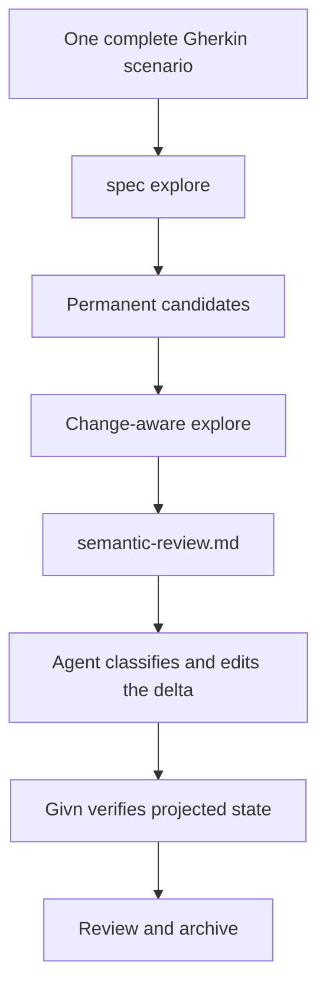

# Semantic Scenario Consolidation Plan

## Status

This document is the implementation sequence for extending Givn with
scenario-level semantic exploration and consolidation. It is anchored on
`main`, the root base branch of the complete stacked PR series, so every
subsequent PR inherits the same scope and ordering. Changes to this plan belong
on `main`, not on an individual feature branch.

The current stack has thirteen open PRs. PR 18 is the thirteenth and has twelve
stack predecessors. Superseded closed PRs are not counted.

| Stack order | PR | Head branch | Base branch |
|---:|---:|---|---|
| 1 | #1 | `spec-refactoring` | `main` |
| 2 | #5 | `spec-overlap-gates` | `spec-refactoring` |
| 3 | #7 | `workflow-enforcement-wip-cleanup` | `spec-overlap-gates` |
| 4 | #8 | `prose-consolidation` | `workflow-enforcement-wip-cleanup` |
| 5 | #9 | `skill-rewrites` | `prose-consolidation` |
| 6 | #10 | `spec-retrieval` | `skill-rewrites` |
| 7 | #11 | `repository-wide-ownership-e2e` | `spec-retrieval` |
| 8 | #13 | `experiments/cross-encoder-reranker` | `repository-wide-ownership-e2e` |
| 9 | #14 | `experiments/nli-experiment` | `experiments/cross-encoder-reranker` |
| 10 | #15 | `experiments/watn-corpus-comparison` | `experiments/nli-experiment` |
| 11 | #16 | `semantic/01-spec-explore-permanent` | `experiments/watn-corpus-comparison` |
| 12 | #17 | `semantic/02-spec-explore-change` | `semantic/01-spec-explore-permanent` |
| 13 | #18 | `semantic/03-semantic-review` | `semantic/02-spec-explore-change` |

The existing experiment stack is:

```text
experiments/cross-encoder-reranker
  -> experiments/nli-experiment
  -> experiments/watn-corpus-comparison
```

The semantic implementation PRs are the final three links currently in this
stack. PR 19 is the next planned semantic-remediation link on top of PR 18.
They continue on top of `experiments/watn-corpus-comparison`, which is itself
inherited from the twelve earlier stack links. Each PR is one
independent capability slice. No later PR may silently pull an unfinished
future slice into an earlier one.

## Product Boundary

Givn helps an agent discover and consolidate similar Gherkin scenarios. Givn
does not make an unvalidated model score an automatic delete decision. The
agent changes `.feature` files in the current change; Givn produces evidence and
verifies that the requested remediation was actually applied.

The first implementation path is advisory exploration followed by a blocking
completeness check for unresolved review candidates:



## PR Sequence

### PR 1: Explore Permanent Specs

**Branch:** `semantic/01-spec-explore-permanent`

**Enabler:** An agent can check a scenario before creating it.

**User interface:**

```text
givn spec explore --file <draft.feature>
```

**Scope:**

- Accept exactly one complete Gherkin scenario.
- Reject free text and malformed or multi-scenario input.
- Refresh the permanent E5 index incrementally before searching.
- Search all permanent scenarios, including scenarios in the same feature file.
- Exclude only the exact query identity when the query comes from an existing
  feature file.
- Return the top candidates in human-readable text.
- Return the same result as stable machine-readable JSON with `--format json`.
- Include candidate title, file, rank, score, model, and index metadata.
- Remain advisory and never modify specs or block the workflow.

**Out of scope:** current changes, BGE, NLI, deterministic fact explanation,
coverage, automatic edits, and review gating.

**Completion evidence:** A real CLI exploration finds a known permanent
near-duplicate from both `--file` and `--stdin`; malformed input fails clearly;
the JSON output is stable enough for an agent to consume.

### PR 2: Explore the Current Change

**Branch:** `semantic/02-spec-explore-change`

**Base:** `semantic/01-spec-explore-permanent`

**Enabler:** An agent can compare a draft against both the permanent baseline and
the scenarios already being written in the current change.

**User interface:**

```text
givn spec explore --change <id> --file <draft.feature>
givn spec explore --change <id> --stdin
```

**Scope:**

- Preserve PR 1 input validation, permanent candidate set, ranking, and existing
  output fields/order. Output metadata is intentionally additive rather than
  byte-for-byte PR 1 compatibility: JSON results gain scope/owning-change
  metadata for both no-change and change-aware calls, and text results identify
  their source.
- Accept both file and standard-input queries with an optional current-change
  scope.
- Cover `--change --stdin` as regular behavior; it does not create another
  interaction-inventory entry or `@e2e` scenario.
- Add active delta scenarios to the search set.
- Exclude `@givn.removed` scenarios.
- Handle `@givn.modified` identity without reporting a scenario against itself.
- Normalize permanent, delta-source, projected-target, and query identities with
  one project-relative forward-slash path rule for relative and absolute inputs.
- Show whether a candidate comes from permanent specs or the current change.
- Keep the index permanent-only; delta vectors are computed for the request and
  are not persisted as permanent entries.
- Keep the output advisory and non-mutating.
- Reject unsafe identifiers, missing changes, missing change specs directories,
  and malformed delta features with clear non-zero errors before refreshing the
  permanent index.

**Out of scope:** projected archive semantics, classification, remediation,
review blocking, BGE, NLI, and coverage.

**Completion evidence:** A draft is found against a permanent twin and against
another active delta scenario; removed deltas are absent; added and modified
queries exclude their own source and projected-target identities while another
eligible candidate remains visible; file and `--stdin` change-aware queries are
covered as regular scenarios; unsafe, missing, incomplete, and malformed change
requests fail clearly without mutating the permanent index where observable.

### PR 3: Generate the Semantic Review Report

**Branch:** `semantic/03-semantic-review`

**Base:** `semantic/02-spec-explore-change`

**Enabler:** A change review presents all relevant semantic candidates as an
explicit agent worklist.

**Output:**

```text
givn/changes/<id>/semantic-review.md
```

**Scope:**

- Generate the report only from blocking `givn check review --change <id>`;
  preserve advisory `givn spec review --change <id>` behavior.
- Include active Added/Modified delta-to-permanent and delta-to-delta candidates
  whose E5 cosine score is at least the binary-fixed `0.9500` boundary. Exclude
  Removed and permanent-permanent pairs; a Modified scenario excludes only its
  own projected target.
- Record both endpoints, paths, titles, scopes, scores, complete source-ordered
  evidence, content/evidence hashes, and deterministic facts without BGE/NLI.
- Require one of `DUPLIKAT`, `VARIANTE`, `VALID-BOUNDARY`, or `UNCERTAIN` for
  every candidate, with an agent-authored rationale for every resolved value.
  A candidate that appears unrelated above the boundary remains unresolved
  until its vocabulary and invariant are sharpened or it receives an allowed
  classification.
- Make missing, invalid, or `UNCERTAIN` classifications fail the change review.
- Regenerate the complete change-local report atomically on every run, carry
  classifications only across unchanged full evidence, and retain the report
  as historical evidence when the existing archive move runs.
- Treat a malformed permanent index as stale, rebuild it from permanent specs,
  validate its permanent-only structure, and continue semantic review.
- Keep the existing structural overlap and coverage review contracts intact.

**Agent responsibility:** Givn generates evidence and the report. The agent
edits the current change. Givn does not rewrite or delete feature files itself.

**Completion evidence:** A change with a semantic candidate receives a complete
report; an unclassified candidate exits non-zero; a fully classified report
exits zero while leaving feature files, permanent specs, and dispositions
untouched; a seemingly unrelated high-score candidate cannot pass without
vocabulary sharpening or an allowed classification.

### PR 4: Verify Semantic Remediation

**Branch:** `semantic/04-semantic-remediation`

**Base:** `semantic/03-semantic-review`

**Enabler:** A classification cannot be used as a substitute for the required
  change to the specs.

**Scope:**

- Project the current permanent tree with the active delta operations.
- For `DUPLIKAT`, verify that the redundant scenario is actually removed.
- For `VARIANTE`, verify that the scenarios are actually consolidated or
  parameterized.
- For `VALID-BOUNDARY`, verify that both scenarios remain and their titles/steps
  make the distinction explicit.
- Re-run the semantic comparison after remediation.
- Require a valid `VALID-BOUNDARY` pair to fall below the current binary
  similarity boundary; keeping a boundary is not an exception to the boundary.
- Invalidate the report when a referenced scenario content hash changes and
  require a fresh transient report.

**Out of scope:** full permanent-permanent auditing, BGE, NLI, Cobertura, and
automatic feature-file edits.

**Completion evidence:** Marking a candidate `DUPLIKAT` or `VARIANTE` without
changing the projected tree remains red; an actual consolidation becomes green;
a retained boundary that remains above the boundary remains red.

### PR 5: Read-Only Permanent Duplicate Audit

**Branch:** `semantic/05-spec-duplicates`

**Base:** `semantic/04-semantic-remediation`

**Enabler:** A maintainer can inspect the entire permanent corpus independently
of a particular change.

**User interface:**

```text
givn spec duplicates
```

**Scope:**

- Compare the complete permanent scenario tree against itself.
- Include same-feature and cross-feature pairs.
- Report exact duplicates, structural overlap, and semantic candidates.
- Return deterministic ordering and machine-readable JSON.
- Remain read-only and advisory.
- Do not write a change, modify permanent specs, or block an ordinary change.
- Point maintainers to a new change as the remediation location.

**Completion evidence:** The command scans the full permanent corpus, reports
all candidates beyond the interactive top-five view, and leaves the project
byte-for-byte unchanged.

## Model Evidence Layers

### PR 6: BGE Reranking Evidence

**Branch:** `semantic/06-bge-evidence`

**Experiment reference:** The existing comparison implementation is kept on
`experiments/cross-encoder-reranker` (GitHub PR #13). That branch is evidence for
this later layer; it is not active in the PR 1 product build unless the explicit
`cross-encoder-reranker` Cargo feature is enabled.

**Base:** `semantic/05-spec-duplicates`

**Enabler:** Semantic candidates can be prioritized with a jointly scored local
relevance model.

**Scope:**

- Add the local BGE cross-encoder as a second-stage evidence layer.
- Score both pair directions and report the symmetric raw score.
- Include model identity, score, and runtime in explore/review output.
- Use it to prioritize agent review, not to perform automatic merge/delete.
- Keep the current E5 candidate generator and deterministic facts available.
- Record a benchmark against the combined Givn/Watn corpus.

**Out of scope:** treating the BGE raw logit as a Givn class probability,
automatic deletion, and a new hard threshold without labeled evidence.

### PR 7: NLI Evidence

**Branch:** `semantic/07-nli-evidence`

**Base:** `semantic/06-bge-evidence`

**Enabler:** Candidates expose bidirectional entailment, neutral, and
contradiction evidence in addition to similarity and relevance.

**Scope:**

- Add the local multilingual NLI model behind the retrieval feature.
- Score `(A, B)` and `(B, A)`.
- Report directional probabilities and the symmetric summary.
- Preserve the distinction between NLI labels and Givn classifications.
- Keep NLI diagnostic and non-authoritative.
- Record model artifact, tokenizer, hashes, runtime, and benchmark results.

**Out of scope:** training a Gherkin-specific classifier, mapping NLI labels
directly to `DUPLIKAT`/`VARIANTE`/`VALID-BOUNDARY`, and automatic gates.

## Full Audit In Normal Review

### PR 8: Permanent Audit in Normal Review

**Branch:** `semantic/08-permanent-audit-review`

**Base:** `semantic/07-nli-evidence`

**Enabler:** A normal change review also verifies the complete permanent corpus,
not only pairs involving the current delta.

**Scope:**

- Extend the normal semantic review to include permanent-permanent pairs.
- Continue to include current delta versus permanent and delta versus delta.
- Put all candidates into the transient `semantic-review.md` report.
- Require classifications for every reported candidate.
- Require actual remediation for `DUPLIKAT` and `VARIANTE`.
- Require rewritten `VALID-BOUNDARY` scenarios to fall below the current
  similarity boundary.
- Run a fresh complete baseline over Givn's own permanent corpus before the
  gate is considered green.
- Do not grandfather existing candidates through hidden dispositions.

**Dogfood prerequisite:** The current permanent baseline must be measured and
resolved before this gate can pass. Existing candidates cannot be silently
accepted merely because they predate the audit.

**Completion evidence:** A normal `givn spec review --change <id>` proves both
the change-local and permanent-permanent scopes, and a clean Givn baseline is
recorded.

## Future Optional Experiments

These are intentionally excluded from PRs 1 through 8:

### Scenario-Level Cobertura Branch Attribution

Documented in `docs/future-coverage-experiment.md`. It would compare permanent
and projected branch sets and, where supported, calculate leave-one-out marginal
coverage per scenario. It is not a redundancy proof and requires stable branch
identity plus isolated scenario execution.

### Mutation-Based Scenario Value

Measure whether an individual scenario kills mutations that other scenarios do
not. This may provide stronger evidence than branch coverage but has unknown
runtime and tooling cost.

### Gherkin-Specific Pair Classifier

Train or calibrate a classifier for `DUPLIKAT`, `VARIANTE`, and
`VALID-BOUNDARY` using adjudicated Givn and Watn pairs. A candidate that appears
unrelated above the active boundary is not a fourth class: its vocabulary or
invariant must be clarified. No off-the-shelf BGE or NLI score may be treated as
this classifier.

### LLM-Assisted Adjudication

Use an LLM to propose a classification and rationale for the small candidate
set, while keeping the final decision and remediation verification explicit.
The LLM is not a deterministic gate by itself.

### Step-Definition and Runtime Trace Evidence

Resolve Gherkin steps to implementation bindings or runtime traces as an
additional boundary signal. This is project-specific and outside the initial
generic Givn feature.

## Per-PR Workflow

Every PR in this sequence is a formal Givn change and follows the normal
proposal/spec/design/design-review/tasks/implementation/review workflow. The
experiment PRs above remain experiment evidence and are not retroactively
converted into product changes.

For each implementation PR:

1. Branch from the preceding stack head.
2. Create one focused Givn change for that slice.
3. Add executable scenarios for the observable CLI behavior.
4. Implement only that slice.
5. Run the full required checks.
6. Commit and push the branch.
7. Synchronize the GitHub stack before starting the next slice.

No implementation PR should begin until the preceding PR is green enough to
serve as its base. The current task stops after documenting this plan; no
production extension is started here.
